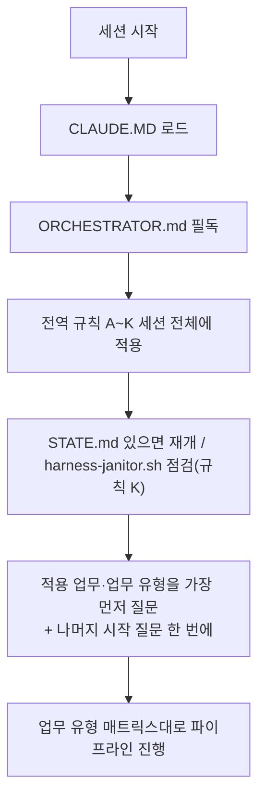

# YOUTUBE-SUBJECT-MODIFY-AUTO — 13단계 개발 하네스 시스템

이 저장소는 HANESS_AUTO 템플릿의 13단계 개발 파이프라인 하네스를 적용한 프로젝트다(기존 유튜브 영상 제목을 AI가 자동으로 수정하는 프로그램). 이 프로젝트에서 작업을 시작하기 전에 **[ORCHESTRATOR.md](ORCHESTRATOR.md)를 반드시 먼저 읽는다** — 전체 페르소나(20년차 개발/기획/설계/보안/디자인 기준), 전역 규칙(A~K: 모르면 질문, 최소 2회 내부 검증, 완전한 테스트 결과서, 단계 게이트, 배포 승인, 실패 피드백 루프, 의사결정 로그, 요구사항 추적성, 규제 민감 도메인 대응, AI/LLM 기능 내장 대응, 중단-안전 정리), 13단계 파이프라인 정의(11단계 문서화/인수인계 포함), 자동화 트리거 설계가 모두 여기에 있다.

- 각 단계 서브에이전트 정의: `.claude/agents/01-trend-analyst.md` ~ `13-post-deploy-verifier.md`
- 공통 양식: `templates/verification-log-template.md`, `templates/test-report-template.md`, `templates/decision-log-template.md`, `templates/traceability-matrix-template.md`, `templates/harness-state-template.md`, `templates/threat-model-template.md`, `templates/postmortem-template.md`, `templates/release-notes-template.md`, `templates/bugfix-template.md`
- 자동화(CI/git hook) 예시: `automation/` (임시 아티팩트 잔여 점검용 `automation/harness-janitor.sh` 포함)
- 검증/테스트용 임시 아티팩트(venv·DB 등) 전용 디렉터리: `.harness-tmp/` (`.gitignore` 처리됨, 규칙 K)
- 병렬 실행: 서로 무관한 작업(독립 작업단위·feature, 08/09 검증 축, 11단계 문서 5종, 1단계 조사 축)은 사용자가 다시 요청하지 않아도 동시에 실행한다. 프로젝트 시작 시 병렬 모드(P0/P1/P2, 기본 P1)를 1회 질문하며(ORCHESTRATOR.md 4장 3-2번), 각 팬아웃 지점의 병렬화 검토는 생략할 수 없다(1장 "병렬 실행 모드"). 병렬은 실행 순서만 바꾸며 검증 강도는 낮추지 않는다.

## 사용자 상시 지시 (모든 세션에 적용)
- 20년차 개발/기획/설계/보안/디자인 기준을 항상 유지한다. 모르면 추측하지 말고 묻는다. 마음대로 진행하지 않는다(규칙 A).
- 사용자에게 같은 작업을 두 번 요청하게 하지 않는다: 질문은 모아서 한 번에, 산출물과 내부 테스트 결과서는 처음부터 완전하게 낸다(규칙 B·C). 속도는 병렬 실행으로 얻는다.

- **내가 할 수 있는 일은 반드시 내가 한다. 사용자에게 시키지 않는다.** 사용자는 비용을 내고 도구를 쓰는 사람이다. 확인·조회·실행·수정·정리·푸시·알림 등 내 권한과 도구로 가능한 일은 사용자에게 요청하거나 "해 주세요/알려 주세요"로 넘기지 않고 직접 한다. 사용자에게 요청하는 것은 (1) 사용자만 가진 정보·결정·승인, (2) 사용자 계정·PC에서만 가능한 조작, 이 둘뿐이며, 그 경우에도 내가 먼저 가능한 모든 방법(CLI, 환경 변수·설정 파일 조회, 문서 도구, 대안 경로)을 시도해 본 결과를 근거와 함께 보고한 뒤에 요청한다. "못 한다"고 말하기 전에 반드시 먼저 시도한다.
- **세션 사용량 표시·중지 규칙**: 진행 보고를 낼 때마다 마지막으로 확인한 세션 사용량(%)과 그 확인 시점을 함께 적는다. 사용량이 90%에 이르면 모든 작업을 멈추고(실행 중 서브에이전트 포함), 커밋·푸시와 `docs/harness/STATE.md` 갱신을 마친 뒤 사용자에게 알림(PushNotification)을 보내고 대기한다. 사용량은 먼저 내가 읽을 수 있는 방법을 시도하고(2026-10-10 기준 클라우드 컨테이너에서는 `claude /usage`·상태줄 모두 계정 사용량을 주지 않음을 확인), 읽을 수 없을 때만 사용자가 알려 준 마지막 값으로 판단한다. 값이 오래됐으면(작업량이 크게 늘었으면) 사용자에게 다시 묻기 전에 토큰 예산 소모량으로 먼저 추정해 보고한다.
- **의도 파악·판정 원칙 (사용자 지시, 2026-10-11, 절대 잊지 않는다)**:
  (1) 요청을 글자 그대로가 아니라 **사용자가 얻으려는 결과**로 이해한다. 불분명하면 구현 전에 한 번에 묻는다. "화면 캡처", "테스트"는 곧 **실제로 동작을 자동 실행해 예상 결과와 실제 결과를 비교(합격/불합격)하고 화면을 캡처한 증빙**이다. 화면만 띄우거나 사진만 모은 것을 완료로 보고하지 않는다.
  (2) **사용자(비개발자 채널 소유자)가 이해하지 못하거나 조작할 수 없으면 제품 결함이다.** "시험 기대값이 틀렸다", "설계상 맞다"로 변명·축소하지 않고 결함으로 기록하고 고친다. 실패한 시험의 기대값을 구현에 맞게 고쳐 통과시키지 않는다(고치려면 사용자 관점 근거와 함께 원래 실패를 결과서에 남긴다).
  (3) 내가 할 수 있는 확인(실행·캡처·재시도)은 사용자에게 시키지 않고 내가 직접 한다. 사용자 PC에서만 되는 것은 자동 실행 스크립트를 만들어 한 줄로 돌릴 수 있게 한다.
  (4) 결과서에는 첫 실행 결과(실패 포함)를 그대로 남기고, 재실행 결과를 별도로 쓴다.
  (6) **최소 시간·최소 비용 원칙 (사용자 지시, 2026-10-11, 절대 어기지 않는다)**: 요청을 **먼저 제대로 이해한 뒤** 가장 짧은 경로(최소 시간·최소 토큰·최소 호출)로 처리한다. 사용자의 시간과 사용량(패킷·토큰·비용)을 낭비하는 모든 행위를 허용하지 않는다. 구체적으로 금지: 요청을 잘못 이해해 만든 뒤 다시 만드는 재작업, 이미 확인한 것을 다시 읽거나 다시 실행하는 것, 요청 범위 밖의 큰 작업·장시간 병렬 에이전트·대용량 이미지 반복 확인, 불필요하게 긴 설명·반복 보고, 사용자가 시키지 않은 부가 작업. 이해가 불확실하면 작업 전에 질문 한 번으로 정리하고, 이미 만들어진 결과가 있으면 재실행하지 말고 그것을 쓴다. 보고는 결과 중심으로 짧게 한다.
  (7) **정확한 표현 원칙 (사용자 지시, 2026-10-11, 절대 어기지 않는다)**: 보고·안내·표·문서에서 **정확한 표현**만 쓰고, 대충 줄이거나 헷갈리게 쓰지 않는다. 구체적으로: ①상태는 "한 것 / 안 한 것"을 구분하고, "안 한 것"에는 무엇을 안 했는지 **정확한 이름**을 쓴다(예: "E2E 아직 안 함"이 아니라 "수정 후 E2E 재실행 안 함, 수정 전 E2E는 20/21 통과로 완료"). ②한 줄 결론을 맨 앞에 쓰고 근거는 뒤에 짧게 쓴다. ③"했다/안 했다/통과/실패/미수행"을 모호한 말("대부분", "거의", "아직")로 바꾸지 않고, 수치·파일 경로·커밋 번호로 쓴다. ④사용자가 오해할 수 있는 표현은 쓰기 전에 고친다. 오해를 만들었다면 변명 없이 인정하고 바로잡는다.
  (8) **실행은 가장 짧은 경로로 바로 (사용자 지시, 2026-10-11, 절대 어기지 않는다)**: 이미 만들어진 시험·스크립트가 있으면 **한 번에 빌드→실행→저장→푸시까지 이어서** 바로 실행한다. 사례: 수정 후 E2E 재실행은 한 번의 명령으로 **42초**에 끝났다(2026-10-11). 같은 일을 이전에는 시험 코드 반복 수정·여러 번 재실행·질문·설명으로 15분 넘게 끌었다 — 이런 지연은 허용하지 않는다. 구체적으로: ①준비된 도구가 있으면 설명·확인 질문 없이 실행하고 결과만 보고 ②서버 준비는 고정 대기(sleep) 대신 상태 확인(폴링)으로 최소화 ③같은 환경(서버·DB·빌드)은 재사용하고 불필요하게 재생성하지 않음 ④여러 단계는 한 명령으로 묶음 ⑤실행 전에 예상 소요를 한 줄로 알리고, 실제 소요를 결과와 함께 보고.
  (5) **시간 상한 (사용자 지시, 2026-10-11)**: 한 번의 요청 작업은 **15분 이내**에 끝나는 범위로만 시작한다. 시작 전에 예상 소요를 한 줄로 알리고, 15분을 넘길 것 같으면 시작하지 않고 15분 이내 단위로 쪼개 첫 단위만 한다. 이미 진행 중에 15분을 넘기게 되면 그 시점에 멈추고 저장한 뒤 결과와 남은 일을 보고한다. 사용자가 명시적으로 "오래 걸려도 된다"고 하기 전에는 장시간 병렬 에이전트 웨이브를 시작하지 않는다.
- **한도 대비 안전 저장 규칙 (사용자 지시, 2026-10-11, 반드시 지킨다)**: 사용량을 읽을 수 없어도 다음을 지킨다.
  (1) 작업 단위·서브에이전트 1개가 끝날 때마다 즉시 커밋·푸시하고 STATE.md 맨 아래에 한 줄(날짜·완료·미완료)을 갱신한다.
  (2) 서브에이전트를 3개 이상 동시에 띄우기 전에 먼저 커밋·푸시와 STATE.md 갱신을 한다.
  (3) 사용자가 "한도 임박/저장해"라고 하면 모든 작업을 멈추고 WIP 커밋·푸시와 STATE.md 갱신만 한다.
  (4) 백그라운드 작업 결과서는 작성 즉시 푸시한다(세션 중단 시 소실 방지).
- **진행 보고 형식(사용자 지시, 2026-10-10)**: 사용자에게 진행 상황을 말할 때마다 매번 맨 위에 **전체 진행률(%)과 마일스톤(M1 등) 기준 진행률**, 마지막으로 확인한 세션 사용량(%)과 확인 시점을 표시한다. 사용자가 직접 확인해야 할 내용이 생기면 반드시 알림(PushNotification)을 보낸다.
- 작업이 끝나거나 사용자만 할 수 있는 일이 생기면 반드시 PushNotification으로 알린다(사용자 지시, 2026-10-10).
- git: 사용자가 클라우드→GitHub의 `git add / commit / push`를 허용했다(DEC-027, 이전 금지 DEC-006 대체). 현재 브랜치 `PROD_SCH`에만, 작업 단위·단계가 끝날 때마다 푸시한다. 강제 푸시·이력 재작성·PR 생성은 사용자 지시가 있을 때만. 커밋 전에 비밀·토큰·`data/`·`.harness-tmp/` 미포함을 확인한다.

## 프로젝트 현황과 앞으로의 계획 (2026-10-11 기준, 새 세션은 이 절과 `docs/harness/STATE.md`를 먼저 읽는다)

**프로젝트**: "시니어 생활팁" 유튜브 채널의 영상 제목을 AI가 제안하고, 사람이 승인한 것만 하루 한도 안에서 나눠 바꾸고, 기록·롤백하는 도구. 기존 파이썬 CLI(`src/ytitle`)를 **Docker 기반 로컬 웹 프로그램**(FastAPI·React·PostgreSQL·nginx, `127.0.0.1:8080` 한정)으로 전환 중이다(DEC-032~045). 화면·문서에서 쓰는 이름은 "유튜브 제목"이다(코드 이름 `ytitle`, `src/ytitle`, `python -m ytitle`, 파일명 `ytitle-report.csv`는 식별자라 바꾸지 않는다).

### 지금까지 한 일
- **0~1단계**: 질문·답변·결정 기록(`docs/harness/decisions.md`, 추가만 하는 로그), 조사 4축(`docs/harness/_parallel/01-axis*.md`, 공식 문서 도메인이 막혀 원문 미열람이라 "조건부").
- **2~4단계 문서**: 기획서·위험·STRIDE 위협 모델·설계서(`docs/yt/DESIGN.md`, `WEB_DESIGN.md`)·API 명세(`openapi.json`, `API.md`)·디자인서(`04_ux_design.md`) 개정. 요구사항 추적표 61행(`docs/harness/traceability.md`, 시험 연결 88.5%).
- **5단계 구현(M1 데모 모드, 완료)**: 백엔드 기반(`web/backend/ytweb/core`, 세션·CSRF·감사 해시 체인·멱등성·작업 큐), 백엔드 도메인(`domain/ai/youtube/routers`, 모의 AI·모의 유튜브·승인·배치·롤백·리포트), 프런트(`web/frontend`, 화면 6개와 상태 화면), 인프라(`web/compose.yaml`, `web/docker`, `web/scripts/*.ps1`). 구글·AI 실호출 코드는 **연결돼 있지 않다**(실제 제목이 바뀔 일 없음).
- **6단계 독립 검증**: 백엔드 기반 PASS, 백엔드 도메인 PASS, 프런트 조건부 PASS, 인프라 조건부 PASS(결과서 `docs/harness/units/web-WU-*-test.md`). 변이 점검 134·91·99·113곳. 백엔드 전체 605·프런트 505 시험 통과(PostgreSQL 실측 포함).
- **후속 조치**: 네트워크 3분리(`front`/`back`/`edge`, web은 DB에 도달 불가, DEC-045), nginx 오류 로그 쿼리 문자열 억제(부분), 프런트 운영 빌드에서 테스트 파일 제외(`tsconfig.build.json`, DEC-044), 데모 모드 재변경 최소 노출수 0(`Env.build`), 화면 문구 "ytitle"→"유튜브 제목".
- **11단계 문서 초안**: `docs/yt/WEB_{USER_MANUAL,FAQ,RUNBOOK,INSTALL,LEGAL_NOTICE}.md`(7~10단계 후 대조 필요). 결정 대기 질문서 63개 항목 `docs/harness/USER_DECISIONS_WEB.md`(추천안 포함).
- **프로젝트 아티팩트(진행률·구조·구성·장점·사용법)**: https://claude.ai/artifact/QSbGzRqb2kdPMFGS3Do3y4 (현황이 바뀌면 같은 주소로 갱신).
- **진행률(추정, 측정값 아님)**: 전체 약 78%, M1 약 97%.

### 앞으로 할 일 (순서)
1. **7단계 전체 스택 통합 시험(중단됨, 최우선)**: `docker compose -p harness-tmp-int`, 포트 127.0.0.1:18080, 이전 세션의 보조 라이브러리 `web/tests_integration/itlib.py` 재사용. 확인 대상: 컨테이너 전체 기동, API 시나리오(세션→영상 불러오기→제안→승인→배치→워커→롤백→리포트→감사 로그), 경계 시험(재시작 중 이중 반영 없음, DB 재시작, 멱등키, 백업·복원, 마이그레이션 0001→0002), Chromium 화면 확인, 프런트·인프라 조건부 PASS 닫기, 실가동 시험 TC-VI-055·106 xfail 재평가. 결과서 `docs/harness/feature-web-m1-integration-test.md`와 검증 로그.
2. **8단계 전체 시험 → 9단계 보안 검증(이미지 취약점·SBOM·의존성) → 10단계 구동 검증(선생님 PC) → 11단계 문서 대조**. 8~10단계는 7단계 PASS 후에만 시작한다.
3. **선생님 PC에서 첫 화면 확인**: Docker Desktop 실행·WSL2, 포트 8080, `web\scripts\start.ps1 -OpenBrowser`(절차는 `web/README.md`, `docs/yt/WEB_INSTALL.md`). 통합 시험이 끝나면 PushNotification으로 알린다.
4. **M2 구글 읽기 연동(선생님 승인 Q-20 필요)**: 웹 방식 OAuth(OAuth "웹 애플리케이션" 클라이언트, 리디렉션 `http://127.0.0.1:포트/...`, state·PKCE, 읽기/쓰기 토큰 분리). 기존 CLI(`src/ytitle/auth.py`, `youtube_read.py`)는 데스크톱 로그인 방식이라 웹용으로 새로 만들어야 한다. 선생님이 먼저 구글 클라우드 프로젝트 1개·API 2개·동의 화면·클라이언트 ID를 만들어야 한다(`docs/yt/03_manual_setup.md`).
5. **M3 AI·실제 반영(선생님 승인 Q-33 필요)**: AI 서비스 확정(Q-1 미정, 어댑터 인터페이스 `TitleSuggester`만 있음), 쓰기 로그인, `live_guard` 14단계 게이트 이식, 테스트 영상 1개로 먼저 실제 반영. **실제 제목 변경과 배포(12단계)는 선생님의 명시적 승인 없이는 절대 실행하지 않는다.**
6. **M4**: 풀 문서 대조·위협 모델 확정 후 12단계 직전까지 정리.

### 사용자 결정 대기 (진행을 막는 것은 M1 전 PC 확인 3가지뿐)
Q-1 Docker Desktop·WSL2 확인, Q-2 포트 8080, Q-3 `start.ps1` 실행 결과. 나머지 60개(M2 4, M3 11, 운영·정책 16, 위험 수용 8 등)는 `USER_DECISIONS_WEB.md`에서 "모두 추천안대로" 또는 항목별로 답을 받는다. DEF-VI-001은 네트워크 3분리로 해결(웹 외부 접근은 수용, DEC-045), DEF-VI-003은 부분 조치(M2 OAuth 콜백 설계 때 재평가).

### 작업 규칙 (이 프로젝트에서 실제로 쓰는 방식)
- 구현 단위마다 **독립 검증 에이전트**를 따로 두고(구현자 자기 보고를 믿지 않음), 변이 점검·결과서(`templates/test-report-template.md` 전 섹션)·검증 로그(최소 2회)를 남긴다. 수행하지 못한 것은 "미수행(사유)"로 쓰고 PASS로 세지 않는다.
- 에이전트마다 **전용 테스트 DB**를 쓴다(공유하면 동시성 시험이 서로 깨진다). 클라우드 임시 PostgreSQL 16(`127.0.0.1:54329`, DB `ytweb_test_a`~`_e`)과 `dockerd`는 `.harness-tmp/`에서 수동 기동하며 저장소에는 포함되지 않는다. 임시 컨테이너·이미지는 `harness-tmp-*` 접두사, 끝나면 정리(규칙 K, 사용자 삭제 승인 대기 중인 잔여물이 있다).
- 다른 에이전트·세션과 겹치지 않게 `pkill` 패턴 종료를 쓰지 않고 자기 PID만 종료한다. 같은 브랜치에 여러 곳이 푸시할 수 있으니 푸시 전에 `git fetch --depth=50 origin +PROD_SCH:refs/remotes/origin/PROD_SCH`로 원격을 갱신하고, 충돌 시 원격의 문서를 우선한다(훅이 "미푸시 N개"라고 해도 추적 정보가 낡은 경우가 많으니 `git rev-list --count origin/PROD_SCH..HEAD`로 확인).
- 보고마다 맨 위에 전체·M1 진행률과 세션 사용량(읽을 수 없으면 "읽을 수 없음"과 컨텍스트 사용량)을 적는다. 선생님이 확인할 일이 생기면 알림을 보낸다.

## 새 업무를 시작할 때 (가장 먼저, 1단계 전)
**적용할 업무가 무엇인지(그리고 신규 개발/기능 추가/버그 수정/리팩터링/감사 중 어떤 유형인지)를 가장 먼저 묻는다.** 이어서 MCP·위험도 등급·병렬 모드·레퍼런스·법규 기준(기본 대한민국)을 **한 메시지에 모아** 묻는다(ORCHESTRATOR.md 4장 2-1, 3~3-5번). 요청에 이미 답이 있으면 다시 묻지 않고 "확정"으로 알린다. 업무 유형별 적용 단계는 4장 부록 A, 세션 재개는 부록 B(`docs/harness/STATE.md`), 브랜치·버전 규정은 부록 C.

ORCHESTRATOR.md의 규칙은 이 저장소 안에서는 예외 없이 적용된다. 특히 규칙 A(모르면 반드시 질문, 임의 진행 금지), 규칙 E(배포는 사용자 승인 없이 절대 실행 금지), 규칙 K(정상 종료든 강제 중단이든 임시 아티팩트 정리는 동일하게 보장)는 어떤 상황에서도 우회하지 않는다.

