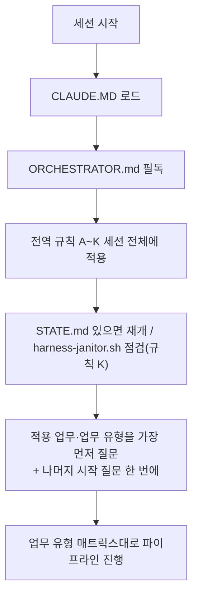

# YOUTUBE-SUBJECT-MODIFY-AUTO — 13단계 개발 하네스 시스템

이 저장소는 HANESS_AUTO 템플릿의 13단계 개발 파이프라인 하네스를 적용한 프로젝트다(기존 유튜브 영상 제목을 AI가 자동으로 수정하는 프로그램). 이 프로젝트에서 작업을 시작하기 전에 **[ORCHESTRATOR.md](ORCHESTRATOR.md)를 반드시 먼저 읽는다** — 전체 페르소나(20년차 개발/기획/설계/보안/디자인 기준), 전역 규칙(A~K: 모르면 질문, 최소 2회 내부 검증, 완전한 테스트 결과서, 단계 게이트, 배포 승인, 실패 피드백 루프, 의사결정 로그, 요구사항 추적성, 규제 민감 도메인 대응, AI/LLM 기능 내장 대응, 중단-안전 정리), 13단계 파이프라인 정의(11단계 문서화/인수인계 포함), 자동화 트리거 설계가 모두 여기에 있다.

- 각 단계 서브에이전트 정의: `.claude/agents/01-trend-analyst.md` ~ `13-post-deploy-verifier.md`
- 공통 양식: `templates/verification-log-template.md`, `templates/test-report-template.md`, `templates/decision-log-template.md`, `templates/traceability-matrix-template.md`, `templates/harness-state-template.md`, `templates/threat-model-template.md`, `templates/postmortem-template.md`, `templates/release-notes-template.md`, `templates/bugfix-template.md`
- 자동화(CI/git hook) 예시: `automation/` (임시 아티팩트 잔여 점검용 `automation/harness-janitor.sh` 포함)
- 검증/테스트용 임시 아티팩트(venv·DB 등) 전용 디렉터리: `.harness-tmp/` (`.gitignore` 처리됨, 규칙 K)
- 병렬 실행: 서로 무관한 작업(독립 작업단위·feature, 08/09 검증 축, 11단계 문서 5종, 1단계 조사 축)은 사용자가 다시 요청하지 않아도 동시에 실행한다. 프로젝트 시작 시 병렬 모드(P0/P1/P2, 기본 P1)를 1회 질문하며(ORCHESTRATOR.md 4장 3-2번), 각 팬아웃 지점의 병렬화 검토는 생략할 수 없다(1장 "병렬 실행 모드"). 병렬은 실행 순서만 바꾸며 검증 강도는 낮추지 않는다.

## 사용자 상시 지시 (모든 세션에 적용)
- 20년차 개발/기획/설계/보안/디자인 기준을 항상 유지한다. 모르면 추측하지 말고 묻는다. 마음대로 진행하지 않는다(규칙 A).
- 사용자에게 같은 작업을 두 번 요청하게 하지 않는다: 질문은 모아서 한 번에, 산출물과 내부 테스트 결과서는 처음부터 완전하게 낸다(규칙 B·C). 속도는 병렬 실행으로 얻는다.

## 새 업무를 시작할 때 (가장 먼저, 1단계 전)
**적용할 업무가 무엇인지(그리고 신규 개발/기능 추가/버그 수정/리팩터링/감사 중 어떤 유형인지)를 가장 먼저 묻는다.** 이어서 MCP·위험도 등급·병렬 모드·레퍼런스·법규 기준(기본 대한민국)을 **한 메시지에 모아** 묻는다(ORCHESTRATOR.md 4장 2-1, 3~3-5번). 요청에 이미 답이 있으면 다시 묻지 않고 "확정"으로 알린다. 업무 유형별 적용 단계는 4장 부록 A, 세션 재개는 부록 B(`docs/harness/STATE.md`), 브랜치·버전 규정은 부록 C.

ORCHESTRATOR.md의 규칙은 이 저장소 안에서는 예외 없이 적용된다. 특히 규칙 A(모르면 반드시 질문, 임의 진행 금지), 규칙 E(배포는 사용자 승인 없이 절대 실행 금지), 규칙 K(정상 종료든 강제 중단이든 임시 아티팩트 정리는 동일하게 보장)는 어떤 상황에서도 우회하지 않는다.

