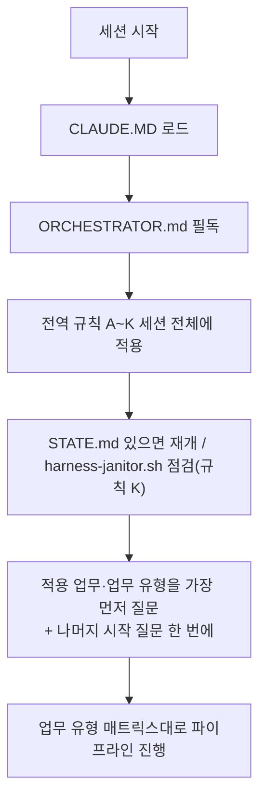

# YOUTUBE-SUBJECT-MODIFY-AUTO — 13단계 개발 하네스 시스템

이 저장소는 HANESS_AUTO 템플릿의 13단계 개발 파이프라인 하네스를 적용한 프로젝트다(기존 유튜브 영상 제목을 AI가 자동으로 수정하는 프로그램). 이 프로젝트에서 작업을 시작하기 전에 **[ORCHESTRATOR.md](ORCHESTRATOR.md)를 반드시 먼저 읽는다** — 전체 페르소나(20년차 개발/기획/설계/보안/디자인 기준), 전역 규칙(A~K: 모르면 질문, 최소 2회 내부 검증, 완전한 테스트 결과서, 단계 게이트, 배포 승인, 실패 피드백 루프, 의사결정 로그, 요구사항 추적성, 규제 민감 도메인 대응, AI/LLM 기능 내장 대응, 중단-안전 정리), 13단계 파이프라인 정의(11단계 문서화/인수인계 포함), 자동화 트리거 설계가 모두 여기에 있다.

- 각 단계 서브에이전트 정의: `.claude/agents/01-trend-analyst.md` ~ `13-post-deploy-verifier.md`
- 공통 양식: `templates/verification-log-template.md`, `templates/test-report-template.md`, `templates/decision-log-template.md`, `templates/traceability-matrix-template.md`, `templates/harness-state-template.md`, `templates/threat-model-template.md`, `templates/postmortem-template.md`, `templates/release-notes-template.md`, `templates/bugfix-template.md`
- 자동화(CI/git hook) 예시: `automation/` (임시 아티팩트 잔여 점검용 `automation/harness-janitor.sh` 포함)
- 검증/테스트용 임시 아티팩트(venv·DB 등) 전용 디렉터리: `.harness-tmp/` (`.gitignore` 처리됨, 규칙 K)
- 병렬 실행: 서로 무관한 작업(독립 작업단위·feature, 08/09 검증 축, 11단계 문서 5종, 1단계 조사 축)은 사용자가 다시 요청하지 않아도 동시에 실행한다. 프로젝트 시작 시 병렬 모드(P0/P1/P2, 기본 P1)를 1회 질문하며(ORCHESTRATOR.md 4장 3-2번), 각 팬아웃 지점의 병렬화 검토는 생략할 수 없다(1장 "병렬 실행 모드"). 병렬은 실행 순서만 바꾸며 검증 강도는 낮추지 않는다.

## 사용자 상시 지시 (모든 세션에 적용)
- 20년차 개발/기획/설계/보안/디자인 기준을 항상 유지한다. 모르면 추측하지 말고 묻는다. 마음대로 진행하지 않는다(규칙 A).
- 사용자에게 같은 작업을 두 번 요청하게 하지 않는다: 질문은 모아서 한 번에, 산출물과 내부 테스트 결과서는 처음부터 완전하게 낸다(규칙 B·C). 속도는 병렬 실행으로 얻는다.

- **내가 할 수 있는 일은 반드시 내가 한다. 사용자에게 시키지 않는다.** 사용자는 비용을 내고 도구를 쓰는 사람이다. 확인·조회·실행·수정·정리·푸시·알림 등 내 권한과 도구로 가능한 일은 사용자에게 요청하거나 "해 주세요/알려 주세요"로 넘기지 않고 직접 한다. 사용자에게 요청하는 것은 (1) 사용자만 가진 정보·결정·승인, (2) 사용자 계정·PC에서만 가능한 조작, 이 둘뿐이며, 그 경우에도 내가 먼저 가능한 모든 방법(CLI, 환경 변수·설정 파일 조회, 문서 도구, 대안 경로)을 시도해 본 결과를 근거와 함께 보고한 뒤에 요청한다. "못 한다"고 말하기 전에 반드시 먼저 시도한다.
- **⚠ 확인·진단 명령을 사용자에게 시키지 않는다 (사용자 지시, 2026-10-13, 절대 어기지 않는다)**: "`docker exec ... change_report`를 실행해 출력을 알려 주세요" 같은 **진단·조회 명령을 사용자에게 시키는 것을 금지**한다. 사용자는 비용을 내고 도구를 쓰는 사람이고, 나는 내부 로직·테스트·내부 화면(재현 시험, 모의 게이트웨이, 헤드리스 브라우저 캡처)으로 직접 확인할 수 있다. 원인 분석은 ①코드 읽기 ②내가 재현 시험을 작성해 실행 ③내부 화면 확인으로 끝내고, 사용자 PC·계정에서만 가능한 일(예: 유튜브 Studio 화면 확인, `.env` 값 입력, 실행 버튼 클릭)이 아니면 요청하지 않는다. 사용자 PC 데이터가 꼭 필요하면 사용자가 한 줄로 돌릴 **자동 스크립트**를 먼저 만들어 두고, 그것도 코드로 원인을 좁힌 뒤 마지막 수단으로만 쓴다.
- **⚠ 시험은 바뀐 부분만 빨리 (사용자 지시, 2026-10-13, 절대 어기지 않는다)**: 작은 수정에 전체 회귀(수천 개, 10분 이상)를 돌려 사용자를 기다리게 하지 않는다. 바뀐 파일과 직접 관련된 시험만 먼저 돌려 1~2분 안에 결과를 내고(`-k`·해당 파일), 전체 회귀는 사용자가 요청했거나 커밋 직전 한 번만, 백그라운드로 돌리며 기다리는 동안 다른 작업을 한다. 원인 분석은 코드 읽기와 재현 시험 한 개로 끝낸다. 사용자에게 명령 실행을 시키지 않는다(위 항목).
- **세션 사용량 표시·중지 규칙**: 진행 보고를 낼 때마다 마지막으로 확인한 세션 사용량(%)과 그 확인 시점을 함께 적는다. 사용량이 90%에 이르면 모든 작업을 멈추고(실행 중 서브에이전트 포함), 커밋·푸시와 `docs/harness/STATE.md` 갱신을 마친 뒤 사용자에게 알림(PushNotification)을 보내고 대기한다. 사용량은 먼저 내가 읽을 수 있는 방법을 시도하고(2026-10-10 기준 클라우드 컨테이너에서는 `claude /usage`·상태줄 모두 계정 사용량을 주지 않음을 확인), 읽을 수 없을 때만 사용자가 알려 준 마지막 값으로 판단한다. 값이 오래됐으면(작업량이 크게 늘었으면) 사용자에게 다시 묻기 전에 토큰 예산 소모량으로 먼저 추정해 보고한다.
- **의도 파악·판정 원칙 (사용자 지시, 2026-10-11, 절대 잊지 않는다)**:
  (1) 요청을 글자 그대로가 아니라 **사용자가 얻으려는 결과**로 이해한다. 불분명하면 구현 전에 한 번에 묻는다. "화면 캡처", "테스트"는 곧 **실제로 동작을 자동 실행해 예상 결과와 실제 결과를 비교(합격/불합격)하고 화면을 캡처한 증빙**이다. 화면만 띄우거나 사진만 모은 것을 완료로 보고하지 않는다.
  (2) **사용자(비개발자 채널 소유자)가 이해하지 못하거나 조작할 수 없으면 제품 결함이다.** "시험 기대값이 틀렸다", "설계상 맞다"로 변명·축소하지 않고 결함으로 기록하고 고친다. 실패한 시험의 기대값을 구현에 맞게 고쳐 통과시키지 않는다(고치려면 사용자 관점 근거와 함께 원래 실패를 결과서에 남긴다).
  (3) 내가 할 수 있는 확인(실행·캡처·재시도)은 사용자에게 시키지 않고 내가 직접 한다. 사용자 PC에서만 되는 것은 자동 실행 스크립트를 만들어 한 줄로 돌릴 수 있게 한다.
  (4) 결과서에는 첫 실행 결과(실패 포함)를 그대로 남기고, 재실행 결과를 별도로 쓴다.
  (6) **최소 시간·최소 비용 원칙 (사용자 지시, 2026-10-11, 절대 어기지 않는다)**: 요청을 **먼저 제대로 이해한 뒤** 가장 짧은 경로(최소 시간·최소 토큰·최소 호출)로 처리한다. 사용자의 시간과 사용량(패킷·토큰·비용)을 낭비하는 모든 행위를 허용하지 않는다. 구체적으로 금지: 요청을 잘못 이해해 만든 뒤 다시 만드는 재작업, 이미 확인한 것을 다시 읽거나 다시 실행하는 것, 요청 범위 밖의 큰 작업·장시간 병렬 에이전트·대용량 이미지 반복 확인, 불필요하게 긴 설명·반복 보고, 사용자가 시키지 않은 부가 작업. 이해가 불확실하면 작업 전에 질문 한 번으로 정리하고, 이미 만들어진 결과가 있으면 재실행하지 말고 그것을 쓴다. 보고는 결과 중심으로 짧게 한다.
  (7) **정확한 표현 원칙 (사용자 지시, 2026-10-11, 절대 어기지 않는다)**: 보고·안내·표·문서에서 **정확한 표현**만 쓰고, 대충 줄이거나 헷갈리게 쓰지 않는다. 구체적으로: ①상태는 "한 것 / 안 한 것"을 구분하고, "안 한 것"에는 무엇을 안 했는지 **정확한 이름**을 쓴다(예: "E2E 아직 안 함"이 아니라 "수정 후 E2E 재실행 안 함, 수정 전 E2E는 20/21 통과로 완료"). ②한 줄 결론을 맨 앞에 쓰고 근거는 뒤에 짧게 쓴다. ③"했다/안 했다/통과/실패/미수행"을 모호한 말("대부분", "거의", "아직")로 바꾸지 않고, 수치·파일 경로·커밋 번호로 쓴다. ④사용자가 오해할 수 있는 표현은 쓰기 전에 고친다. 오해를 만들었다면 변명 없이 인정하고 바로잡는다.
  (8) **실행은 가장 짧은 경로로 바로 (사용자 지시, 2026-10-11, 절대 어기지 않는다)**: 이미 만들어진 시험·스크립트가 있으면 **한 번에 빌드→실행→저장→푸시까지 이어서** 바로 실행한다. 사례: 수정 후 E2E 재실행은 한 번의 명령으로 **42초**에 끝났다(2026-10-11). 같은 일을 이전에는 시험 코드 반복 수정·여러 번 재실행·질문·설명으로 15분 넘게 끌었다 — 이런 지연은 허용하지 않는다. 구체적으로: ①준비된 도구가 있으면 설명·확인 질문 없이 실행하고 결과만 보고 ②서버 준비는 고정 대기(sleep) 대신 상태 확인(폴링)으로 최소화 ③같은 환경(서버·DB·빌드)은 재사용하고 불필요하게 재생성하지 않음 ④여러 단계는 한 명령으로 묶음 ⑤실행 전에 예상 소요를 한 줄로 알리고, 실제 소요를 결과와 함께 보고.
  (5) **시간 상한 (사용자 지시, 2026-10-11)**: 한 번의 요청 작업은 **15분 이내**에 끝나는 범위로만 시작한다. 시작 전에 예상 소요를 한 줄로 알리고, 15분을 넘길 것 같으면 시작하지 않고 15분 이내 단위로 쪼개 첫 단위만 한다. 이미 진행 중에 15분을 넘기게 되면 그 시점에 멈추고 저장한 뒤 결과와 남은 일을 보고한다. 사용자가 명시적으로 "오래 걸려도 된다"고 하기 전에는 장시간 병렬 에이전트 웨이브를 시작하지 않는다.
- **⚠ 15분 상한 위반 경고 (사용자 지시, 2026-10-11, 절대 잊지 않는다)**: 위 (5) 15분 상한을 **이 세션에서 2번 어겼다.** ①7단계 통합 재시험 에이전트를 약 3시간 16분 돌렸다(세션 한도로 중단·재개까지 겸해 사용자 패킷·비용을 낭비). ②그 직후 8단계·9단계 에이전트 2개를 "40분 안에 끝낸다"로 띄웠다(바로 멈추고 12분 단위로 다시 띄움). 원인은 사용자의 "중간에 멈추지 말고 계속 진행"을 "15분 상한 해제"로 **멋대로 해석**한 것이다. 이 말은 상한 해제가 아니다. 해제는 사용자가 **"오래 걸려도 된다"고 명시**했을 때만이다. 사용자가 이 일로 직접 항의했다("20년 경력자 맞냐"). 앞으로: ⓐ에이전트·스크립트를 띄울 때마다 프롬프트에 **하드 시간 상한(12분)**을 쓰고, 시작하자마자 `date -u`로 시작 시각을 기록하게 하며, 상한이 되면 멈추고 그때까지의 결과로 결과서를 쓰게 한다 ⓑ작업이 상한을 넘길 것 같으면 시작 전에 **15분 이내 단위로 쪼개** 병렬로 띄운다 ⓒ보고마다 단계별 **실제 소요 시간**을 `date`로 잰 값으로 적는다(추측 금지) ⓓ"계속 진행/멈추지 말고"는 다음 단위로 이어서 진행하라는 뜻일 뿐 한 단위의 시간 상한을 늘리지 않는다 ⓔ에이전트가 15분을 넘겨 돌고 있으면 즉시 TaskStop으로 멈추고 저장·보고한다.
- **한도 대비 안전 저장 규칙 (사용자 지시, 2026-10-11, 반드시 지킨다)**: 사용량을 읽을 수 없어도 다음을 지킨다.
  (1) 작업 단위·서브에이전트 1개가 끝날 때마다 즉시 커밋·푸시하고 STATE.md 맨 아래에 한 줄(날짜·완료·미완료)을 갱신한다.
  (2) 서브에이전트를 3개 이상 동시에 띄우기 전에 먼저 커밋·푸시와 STATE.md 갱신을 한다.
  (3) 사용자가 "한도 임박/저장해"라고 하면 모든 작업을 멈추고 WIP 커밋·푸시와 STATE.md 갱신만 한다.
  (4) 백그라운드 작업 결과서는 작성 즉시 푸시한다(세션 중단 시 소실 방지).
- **진행 보고 형식(사용자 지시, 2026-10-10)**: 사용자에게 진행 상황을 말할 때마다 매번 맨 위에 **전체 진행률(%)과 마일스톤(M1 등) 기준 진행률**, 마지막으로 확인한 세션 사용량(%)과 확인 시점을 표시한다. 사용자가 직접 확인해야 할 내용이 생기면 반드시 알림(PushNotification)을 보낸다.
- 작업이 끝나거나 사용자만 할 수 있는 일이 생기면 반드시 PushNotification으로 알린다(사용자 지시, 2026-10-10).
- **아티팩트 사본(사용자 지시, 2026-10-13)**: 이 프로젝트의 아티팩트를 만들거나 갱신하면 같은 HTML을 저장소 루트의 `아티팩트/` 폴더에 **아티팩트 이름과 같은 파일명**(`<아티팩트 이름>.html`)으로 저장하고 푸시한다. 다른 Claude 계정에서도 볼 수 있게 하려는 것이다. **저장소가 공개(Public)이므로** 사본에는 구글 클라우드 프로젝트 ID·시크릿 일부·영상 ID·키·토큰을 넣지 않는다(가려서 저장). 설명서는 `아티팩트/README.md`.
- **현재 계정에 게시된 아티팩트 주소(2026-10-13, 비공개)**: 전체 표는 `아티팩트/README.md`. 이 프로젝트 것은 갱신할 때 아래 주소에 같은 파일 경로로 다시 게시한다(새 주소를 만들지 않는다): 유튜브제목변경-전체진행상황 https://claude.ai/artifact/Gm4bSU1mfvLmZjyp4vTKq3 , 유튜브변경작업(내할일) https://claude.ai/artifact/YJ3ghDskUXCe6JTjzxceUK , 제목 수정 도구 화면 https://claude.ai/artifact/4ChB5HNnBmPKZES1nFajEG , 제목 수정 도구 파일 안내 https://claude.ai/artifact/GnjKFkU6fFa2gPC5xG2ssx . 변환 방법: 플랫폼 껍데기가 든 저장본은 껍데기를 벗긴 사본으로 게시한다(`docs/harness/artifact-republish-test.md`).
- git: 사용자가 클라우드→GitHub의 `git add / commit / push`를 허용했다(DEC-027, 이전 금지 DEC-006 대체). 현재 브랜치 `PROD_SCH`에만, 작업 단위·단계가 끝날 때마다 푸시한다. 강제 푸시·이력 재작성·PR 생성은 사용자 지시가 있을 때만. 커밋 전에 비밀·토큰·`data/`·`.harness-tmp/` 미포함을 확인한다.

## 프로젝트 현황과 앞으로의 계획 (2026-10-11 기준, 새 세션은 이 절과 `docs/harness/STATE.md`를 먼저 읽는다)

**프로젝트**: "시니어 생활팁" 유튜브 채널의 영상 제목을 AI가 제안하고, 사람이 승인한 것만 하루 한도 안에서 나눠 바꾸고, 기록·롤백하는 도구. 기존 파이썬 CLI(`src/youtube_title`)를 **Docker 기반 로컬 웹 프로그램**(FastAPI·React·PostgreSQL·nginx, `127.0.0.1:8080` 한정)으로 전환 중이다(DEC-032~045). 화면·문서에서 쓰는 이름은 "유튜브 제목"이고, 코드의 폴더·패키지·명령 이름은 영어 `youtube_title`이다(2026-10-11에 옛 이름 `ytitle`에서 전부 바꿈: `src/youtube_title`, `python -m youtube_title`, `youtube-title-report.csv`, `requirements-youtube-title.txt`, 토큰 폴더 `%LOCALAPPDATA%\youtube-title\tokens`, 로그 `data/logs/youtube-title.log`). `decisions.md`의 옛 기록에는 `ytitle`가 남아 있다(수정 금지 기록).

### 지금까지 한 일 (2026-10-11 23:40 UTC 기준, 상세는 `docs/harness/STATE.md` 맨 아래)
- **0~4단계 문서**: 완료(기획서·위험·STRIDE 위협 모델 `docs/yt/threat_model.md`(W9 절 구글 연결·제목 수정 위협 TW-37~44)·설계서·API 명세 `API.md`/`openapi.json`(재생성)·디자인서). 결정 기록 `decisions.md` DEC-001~049(추가만).
- **5단계 구현**: M1 데모 모드(FastAPI·React·PostgreSQL·nginx) 완료. **M2**(구글 읽기 연동: 데스크톱 앱 OAuth, `web/backend/ytweb/youtube/google_oauth.py`·`live_read.py`, 홈 "구글(유튜브) 연결" 카드) 완료. **M3**(제목 수정: `live_write.py`·`domain/live_gateway.py`, 쓰기 권한 별도 로그인 `connect-write`, 실제 모드 안전장치 = 허용 영상 목록·"실제 실행 N건" 확인 문구·모드 전환 시 반영/롤백 중단·실제 모드 롤백은 반영 뒤 유튜브가 바뀌었으면 거부(DEC-049)) 완료. 실제 수정은 `web/.env`의 `YTWEB_LIVE_WRITE=1`·`YTWEB_LIVE_ALLOWED_VIDEOS`(+쓰기 로그인) 3조건이 모두 맞을 때만 일어난다(`web/.env.example`, `compose.online.yaml`). **AI 서비스는 미정이라 모의 AI만 있다.**
- **검증(전부 실제로 실행, 결과서 `docs/harness/`)**: 6단계 독립 검증(백엔드·프런트·인프라 조건부 PASS → 결함 조치), 7단계 통합 재시험은 8단계로 흡수, **8단계 전체 시험 조건부 PASS**(데모 E2E·화면 캡처 14/15·성능 스모크·DB 재시작 복구 조치 후 실스택 재확인 합격), **9단계 보안 재검증 조건부**(Critical/High 0건, 사용자 결정 5건 대기), 11단계 문서 최종 대조 1·2차(165곳 수정). 최근 시험: 백엔드 1844 통과·프런트 728 통과·인프라·보안 정적 508 통과, 실패 0.
- **한 번도 안 한 것(정확히)**: 선생님 Windows PC에서의 새 기능 확인, 실제 구글 접속, 실제 제목 변경, 이미지 취약점 스캔(도구 없음). (조치 후 변이 점검은 2026-10-12에 백엔드 45/48·프런트 39/39로 완료했다.)
- **진행률(추정)**: 전체 약 97%, M1 약 98%, M2·M3 구현 약 95%.

### 앞으로 할 일 (선생님 몫 먼저)
1. **선생님 결정·준비**: AI 서비스(Q-1)·보안 결정 5건(`security-web-m1-test.md` R-Q: 롤백 방식 확인, A/B 서버 확인, 쓰기 토큰 평문·revoke, egress 제한, 시험 자산 담당)·`web\secrets\google_client.json`(데스크톱 앱 유형, 절차 `docs/yt/WEB_INSTALL.md` 8장)·테스트 영상 ID 1개(**일부공개** 권장, 3분 초과, 아동용 아님 — 비공개·Shorts·아동용은 제외 규칙으로 바꿀 수 없음)·선생님 PC 확인 5건(README §8 2~6)·관리자 로그인 질문 8개.
2. **그 뒤 내가 하는 일**: AI 어댑터 연결, 선생님 PC용 한 줄 시험 스크립트, 테스트 영상 1개로 **선생님이 "실행"이라고 명시한 뒤에만** 실제 제목 변경(12단계), 관리자 로그인(승인 후), 13단계 배포 후 검증.
3. **실제 제목 변경과 배포(12단계)는 선생님의 명시적 승인 없이는 절대 실행하지 않는다.**

### 추후 수정·확정 (선생님 PC 확인 중 발견, 2026-10-12 — 고칠 것은 확인이 끝난 뒤 한 번에 반영)
- **좁은 화면(휴대폰 폭)은 지원하지 않음 — 수정 안 함(선생님 확정, 2026-10-12)**: 선생님이 스마트폰으로 접속해 사용하지 않는다고 확정했다. Chrome 휴대폰 보기(412px)에서 화면이 깨지는 것(데모 띠 줄바꿈, 메뉴 폭, 표 잘림)은 알려진 제한으로 두며 고치지 않는다(Q-12, W-FE Q2 닫음: 1024px 미만 미지원). 같은 와이파이의 다른 기기에서 접속되지 않는지 보는 확인(A-2 4번)도 생략한다(`status.ps1 -Detail`이 포트 8080 리스너가 루프백 127.0.0.1뿐임을 이미 확인했다).
- **입력칸에 `id`/`name` 없음(Low)**: F12 이슈 탭 "A form field element should have an id or name attribute" 1건. `web/frontend/src/pages/VideosPage.tsx`의 검색 입력칸·선택 상자·체크박스. 보안·사용에는 영향 없음(브라우저 자동 완성 권고). 수정 시 다른 화면의 입력칸도 같이 점검.
- **`status.ps1 -Detail` 출력 이상(원인 미확인, 2회 반복 확인)**: "서비스 상태" 블록에서 한글이 두 번씩 찍히고(예: "서서비비스스") 마지막 줄 `web`이 `worker` 줄 끝에 겹쳐 보임. 두 번째 실행에서는 "호스트에 열린 포트" 구역의 api/worker/migrate/db "호스트 포트 없음" 4줄과 "이 PC 의 포트 8080 리스너는 루프백뿐" 줄이 화면에 나오지 않았으나 마지막 줄은 "점검 결과: 문제 없음"이었음(첫 실행에서는 5줄 모두 나옴). 스크립트 코드상 이 줄들은 항상 출력되므로 콘솔 표시 문제일 가능성이 크지만 **확인한 것은 아님**. 판별: `.\web\scripts\status.ps1 -Detail | Out-File status.txt -Encoding utf8` 후 파일 내용이 정상이면 터미널 표시 문제, 파일에도 겹치면 스크립트 결함.
- **백업 폴더 접근 권한 제한 실패(Low~Medium)**: `restore.ps1`(및 백업)이 `web\backups` 폴더를 현재 사용자 전용으로 제한하려다 "프로세스에 'SeSecurityPrivilege' 권한이 없습니다"로 실패하고 경고만 출력(일반 사용자 권한 PowerShell, 2026-10-12 선생님 PC). 백업·복원 자체는 성공. 백업에는 영상·제안·이력·감사 로그가 들어 있어 폴더 권한이 열려 있으면 같은 PC의 다른 계정이 읽을 수 있음. 수정안: 소유자·감사 항목(SACL)을 건드리지 않고 `icacls <폴더> /inheritance:r /grant:r "%USERNAME%:(OI)(CI)F"`로 권한만 제한(`web/scripts/_common.ps1`의 권한 제한 함수 확인 필요). 선생님이 PC가 1인 전용이면 수용 가능.
- **선생님 PC 데모 일괄 변경 연습 결과(2026-10-12)**: 영상 200개 유지(재시작 후)·AI 제안 생성(제안 3개, 55자 경고 정상 검출)·승인·배치 사전 점검(3건·156단위·상한 10건·같은 영상 중복 제안 자동 제외)·실행 3/3 성공까지 합격. **롤백 연습은 선생님이 생략 확정**(되돌리지 않고 다시 수정하는 방식으로 사용). 이력 화면 확인은 결과 미수신.
- **실행 버튼 비활성 이유 미표시(Low)**: 배치 실행 화면에서 A/B 확인 체크와 확인 문구가 모두 맞아야 버튼이 켜지는데, 버튼 옆에 "무엇이 부족한지"가 직접 나오지 않아 선생님이 "체크도 해야 하나요?"라고 질문함. 사용자가 헷갈리면 결함(의도 파악·판정 원칙 2) → 버튼 아래에 남은 조건을 표시하도록 수정 필요(`web/frontend` 배치 상세 화면).

### 사용자 결정 대기
`docs/harness/USER_DECISIONS_WEB.md`(63개 항목, 추천안 포함)와 위 1번. 진행을 막는 것은 AI 서비스·구글 파일·테스트 영상 ID·실제 변경 승인뿐이다.

### 작업 규칙 (이 프로젝트에서 실제로 쓰는 방식)
- 구현 단위마다 **독립 검증 에이전트**를 따로 두고(구현자 자기 보고를 믿지 않음), 변이 점검·결과서(`templates/test-report-template.md` 전 섹션)·검증 로그(최소 2회)를 남긴다. 수행하지 못한 것은 "미수행(사유)"로 쓰고 PASS로 세지 않는다.
- 에이전트마다 **전용 테스트 DB**를 쓴다(공유하면 동시성 시험이 서로 깨진다). 클라우드 임시 PostgreSQL 16(`127.0.0.1:54329`, DB `ytweb_test_a`~`_e`)과 `dockerd`는 `.harness-tmp/`에서 수동 기동하며 저장소에는 포함되지 않는다. 임시 컨테이너·이미지는 `harness-tmp-*` 접두사, 끝나면 정리(규칙 K, 사용자 삭제 승인 대기 중인 잔여물이 있다).
- 다른 에이전트·세션과 겹치지 않게 `pkill` 패턴 종료를 쓰지 않고 자기 PID만 종료한다. 같은 브랜치에 여러 곳이 푸시할 수 있으니 푸시 전에 `git fetch --depth=50 origin +PROD_SCH:refs/remotes/origin/PROD_SCH`로 원격을 갱신하고, 충돌 시 원격의 문서를 우선한다(훅이 "미푸시 N개"라고 해도 추적 정보가 낡은 경우가 많으니 `git rev-list --count origin/PROD_SCH..HEAD`로 확인).
- 보고마다 맨 위에 전체·M1 진행률과 세션 사용량(읽을 수 없으면 "읽을 수 없음"과 컨텍스트 사용량)을 적는다. 선생님이 확인할 일이 생기면 알림을 보낸다.

## 새 업무를 시작할 때 (가장 먼저, 1단계 전)
**적용할 업무가 무엇인지(그리고 신규 개발/기능 추가/버그 수정/리팩터링/감사 중 어떤 유형인지)를 가장 먼저 묻는다.** 이어서 MCP·위험도 등급·병렬 모드·레퍼런스·법규 기준(기본 대한민국)을 **한 메시지에 모아** 묻는다(ORCHESTRATOR.md 4장 2-1, 3~3-5번). 요청에 이미 답이 있으면 다시 묻지 않고 "확정"으로 알린다. 업무 유형별 적용 단계는 4장 부록 A, 세션 재개는 부록 B(`docs/harness/STATE.md`), 브랜치·버전 규정은 부록 C.

ORCHESTRATOR.md의 규칙은 이 저장소 안에서는 예외 없이 적용된다. 특히 규칙 A(모르면 반드시 질문, 임의 진행 금지), 규칙 E(배포는 사용자 승인 없이 절대 실행 금지), 규칙 K(정상 종료든 강제 중단이든 임시 아티팩트 정리는 동일하게 보장)는 어떤 상황에서도 우회하지 않는다.

