# 기능 자동 시험 결과 (E2E)

> **수정 후 재실행 결과** (승인 창 결함 수정 커밋 1607321 이후). 수정 전 결과는 `../web-m1-e2e/RESULT.md`(20/21 통과).

- 대상: http://127.0.0.1:8080
- 실행: 2026-10-11T14:34:25.302Z
- 결과: **21 / 21 통과**, 실패 0

| ID | 시나리오 | 예상 결과 | 실제 결과 | 판정 | 화면 |
|---|---|---|---|---|---|
| TC-E01 | 홈 화면이 열리고 데모 모드·서버 연결 표시가 보인다 | "데모 모드" 배지, "서버 연결됨", 제목 "홈" | 데모 배지·서버 연결됨·라이브 꺼짐 확인 | Pass |  |
| TC-E02 | 데모 영상 200개가 준비된다(비어 있으면 [데모 영상 불러오기]로 채움) | 전체 영상 200개 | 전체 영상 200개 | Pass |  |
| TC-E03 | 영상 목록: 검색이 동작하고 결과가 줄어든다 | "냉장고" 검색 → 모든 행 제목에 "냉장고" 포함, 200개보다 적음 | 검색 결과 5행, 모두 "냉장고" 포함 | Pass | 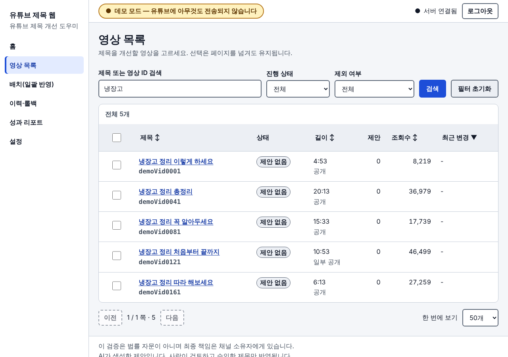 |
| TC-E04 | 제외 대상 영상(쇼츠·비공개 등)은 선택할 수 없다 | 제외 배지가 있는 행의 체크박스가 비활성, 서버 제외 영상 37개 | 제외 영상 37개, 체크박스 비활성 확인 | Pass | 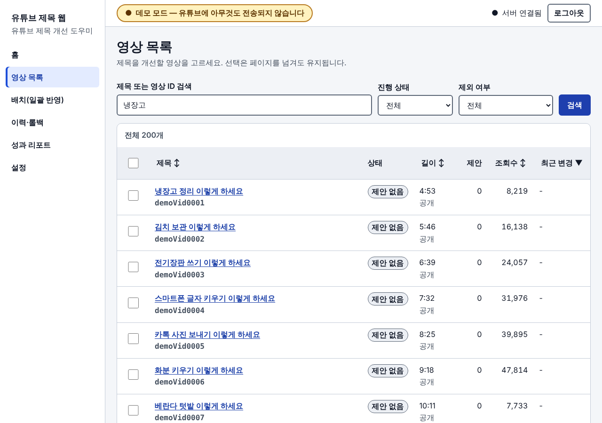 |
| TC-E05 | 영상 상세가 열리고 현재 제목이 서버 값과 같다 | 영상 상세 제목 = 서버의 제목 | demoVid0001 "냉장고 정리 이렇게 하세요" | Pass | 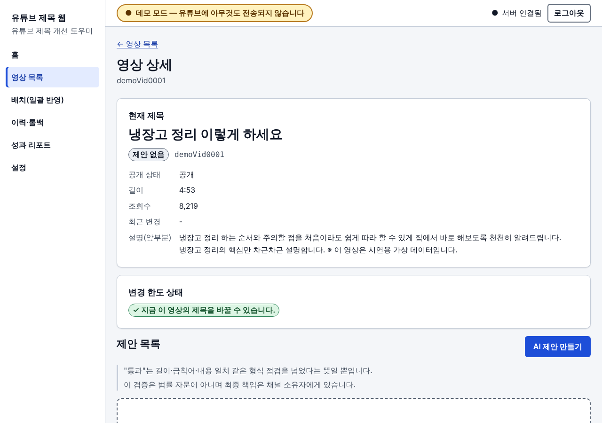 |
| TC-E06 | AI 제안 만들기: 제안이 2건 이상 생기고 검증 결과가 붙는다 | 제안 2건 이상, 각 제안의 검증 결과가 pass/warn/block 중 하나 | 제안 3건: warn, pass, pass | Pass |  |
| TC-E07 | 면책·AI 생성 고지 문구가 상세 화면에 보인다 | "법률 자문이 아니며 최종 책임은 채널 소유자" 및 "AI가 생성한 제안" 문구 | 면책·AI 고지 문구 확인 | Pass | 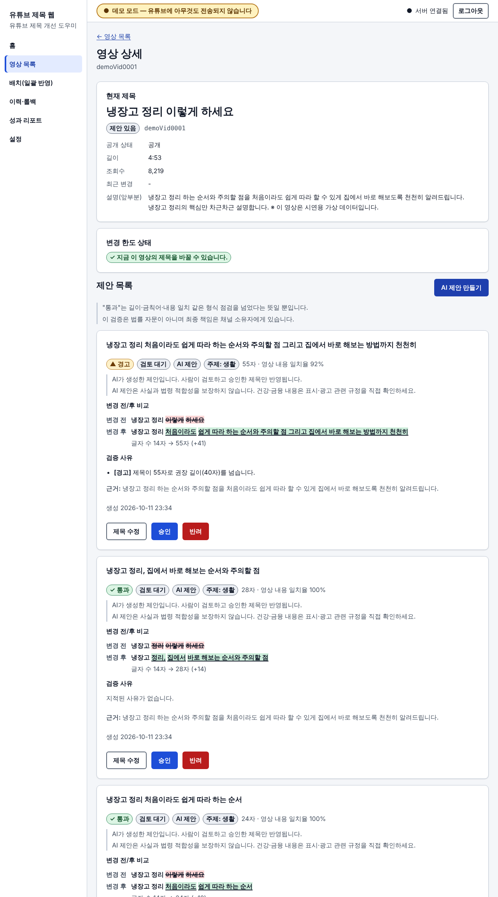 |
| TC-E08 | 민감 문구("완치")를 넣은 제목은 "차단"되고 승인할 수 없다 | 수정 후 검증 결과 block, 그 카드의 [승인] 버튼이 비활성이고 "승인할 수 없는 이유"가 보임, 서버도 승인 거부 | 차단 판정, [승인] 버튼 비활성+"승인할 수 없는 이유" 안내 표시, 서버 승인 요청 거부(409) | Pass | 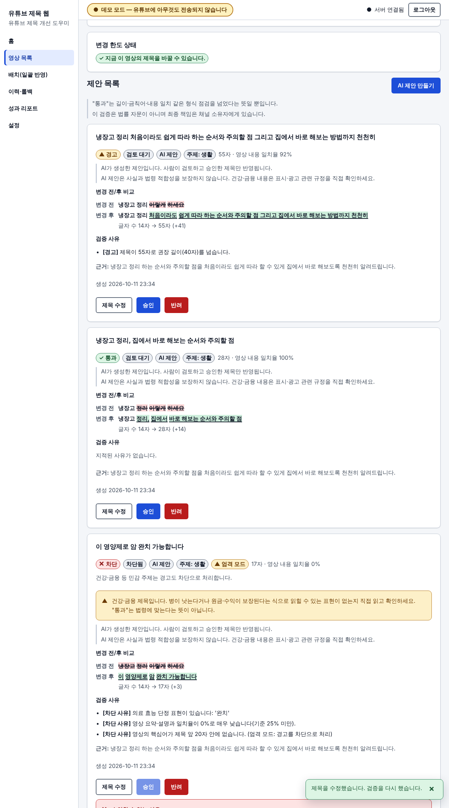 |
| TC-E09 | 승인: 승인자 이름이 비어 있으면 거부, 입력하면 "승인됨"이 된다 | 빈 이름 → 승인 안 됨 + 사용자에게 이유 안내 문구가 보임 / 이름 입력 → 서버 상태 approved, 승인자 기록 | 제안 3 승인됨, 승인자 "시험자", 만료 2026-10-12T14:34:10.693169Z | Pass | 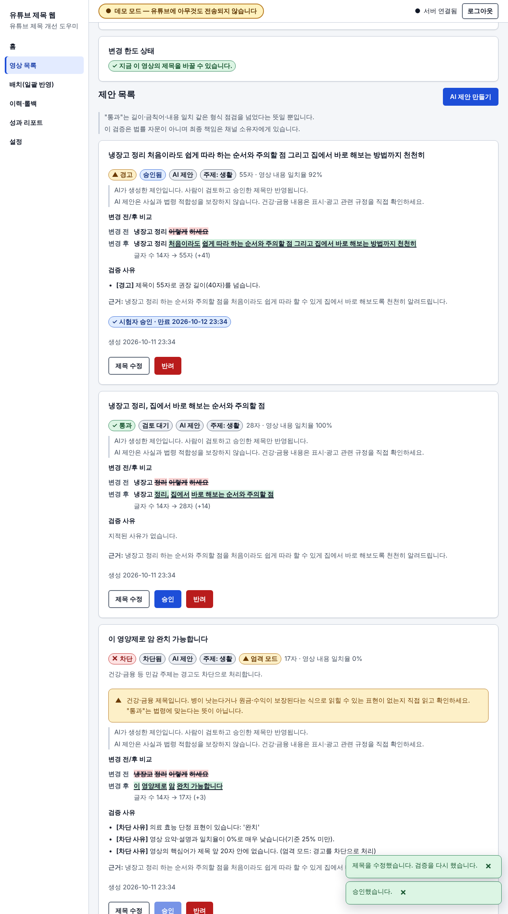 |
| TC-E10 | 배치 사전 점검: 선택한 1건이 점검에 담기고 수치가 맞다 | 반영 대상 1건, 예상 52단위, 서버 점검 결과와 화면 일치 | 반영 대상 1건, 예상 52단위 표시 | Pass | 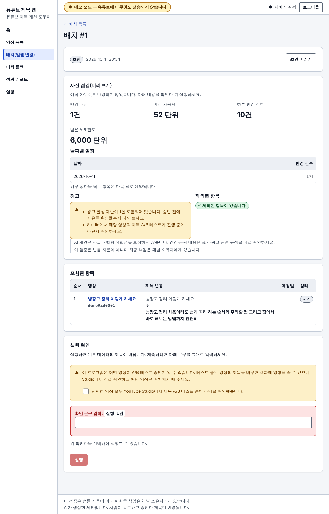 |
| TC-E11 | 실행 잠금: A/B 확인과 정확한 확인 문구가 있어야만 [실행]이 켜진다 | 아무것도 안 하면 비활성 / 문구만 맞춰도 비활성 / A/B 확인+문구 일치 → 활성 / 문구 틀리면 비활성 | 4가지 조합 모두 예상대로 | Pass | 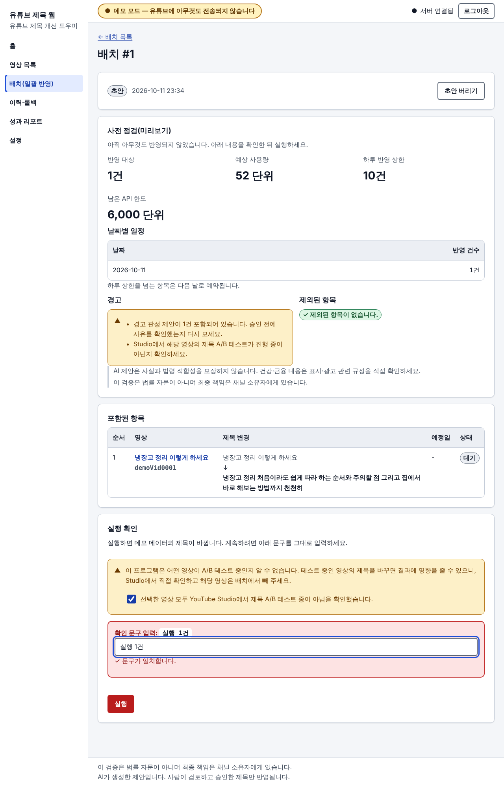 |
| TC-E12 | 실행: 워커가 처리해 배치가 "완료·성공 1"이 된다 | 배치 상태 done, 성공 1·실패 0, 화면 "이 배치는 끝났습니다" | 배치 #1 done, 성공 1 | Pass | 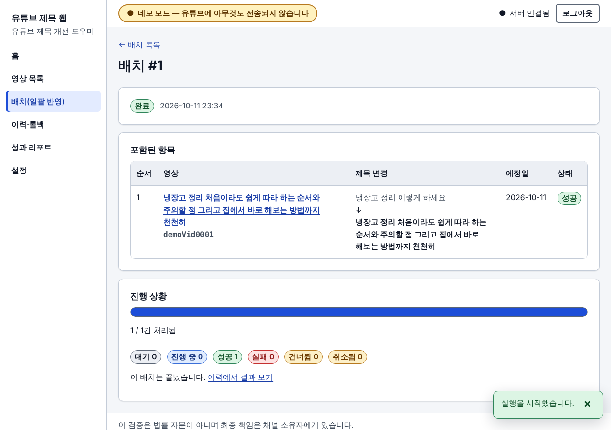 |
| TC-E13 | 반영 결과: 영상의 현재 제목이 실제로 새 제목으로 바뀐다(데모 데이터) | 서버 영상 제목 = 승인한 새 제목, 상세 화면 현재 제목도 같음 | "냉장고 정리 이렇게 하세요" → "냉장고 정리 처음이라도 쉽게 따라 하는 순서와 주의할 점 그리고 집에서 바로 해보는 방법까지 천천히" | Pass | 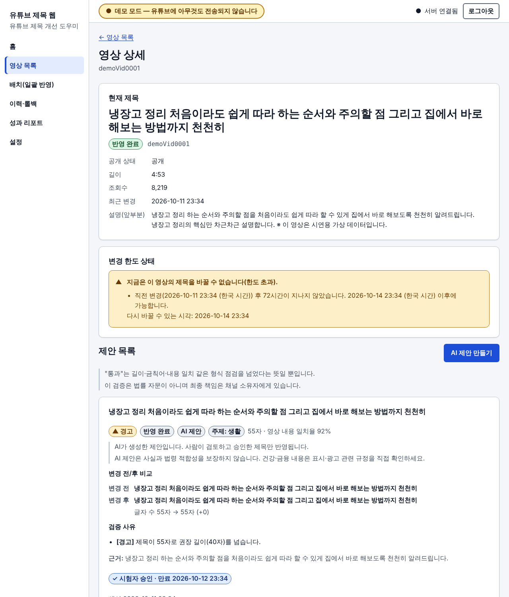 |
| TC-E14 | 이력: 반영 기록 1건이 "성공"으로 남고 [롤백] 버튼이 있다 | 이력에 해당 영상의 apply 성공 기록, 화면에 [롤백] 버튼 | 이력 1건, 반영 성공 기록과 [롤백] 확인 | Pass | 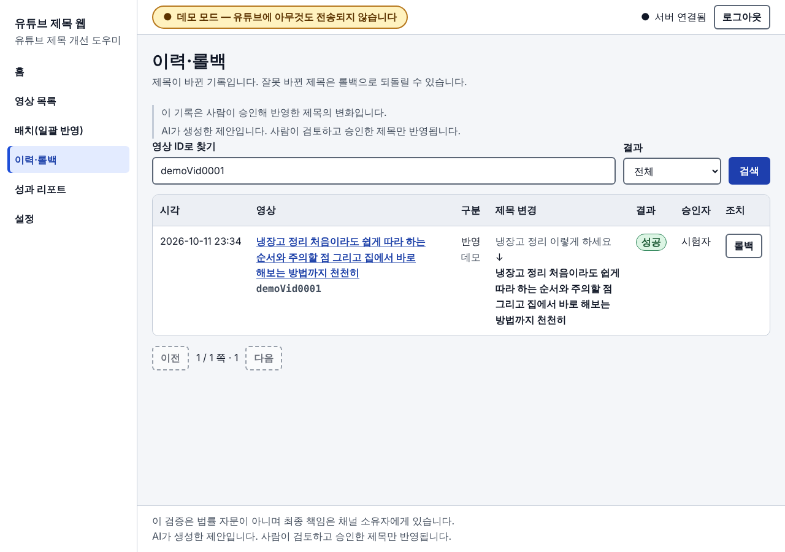 |
| TC-E15 | 롤백 안전장치: 영상 ID를 틀리게 입력하면 [롤백 실행]이 꺼져 있다 | 틀린 ID → 비활성, 올바른 ID+승인자 → 활성 | 틀린 ID 비활성 / 올바른 ID 활성 | Pass | 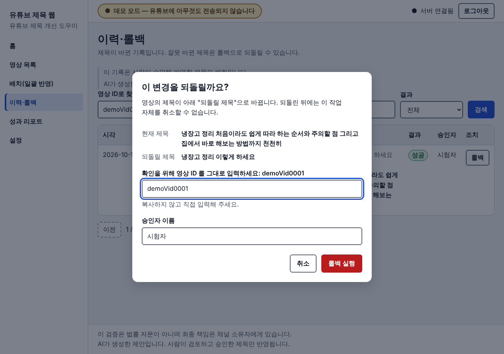 |
| TC-E16 | 롤백 실행: 제목이 원래대로 돌아오고 롤백 기록이 남는다 | 서버 영상 제목 = 원래 제목, 이력에 rollback 성공 기록 | 제목 "냉장고 정리 이렇게 하세요"로 복원, 롤백 기록 확인 | Pass | 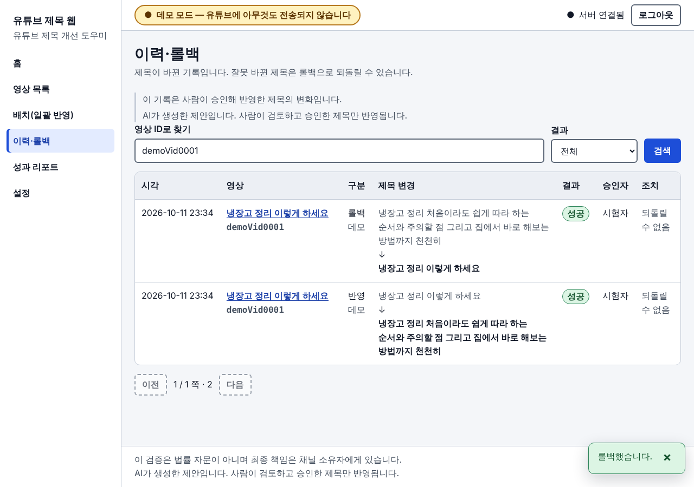 |
| TC-E17 | 성과 리포트: 안내 문구와 "데이터 부족"이 보이고 CSV가 내려온다 | "읽기 전에 꼭 확인하세요", "데이터 부족", CSV 응답 200 | CSV 200 응답, 안내 문구·데이터 부족 표시 확인 | Pass | 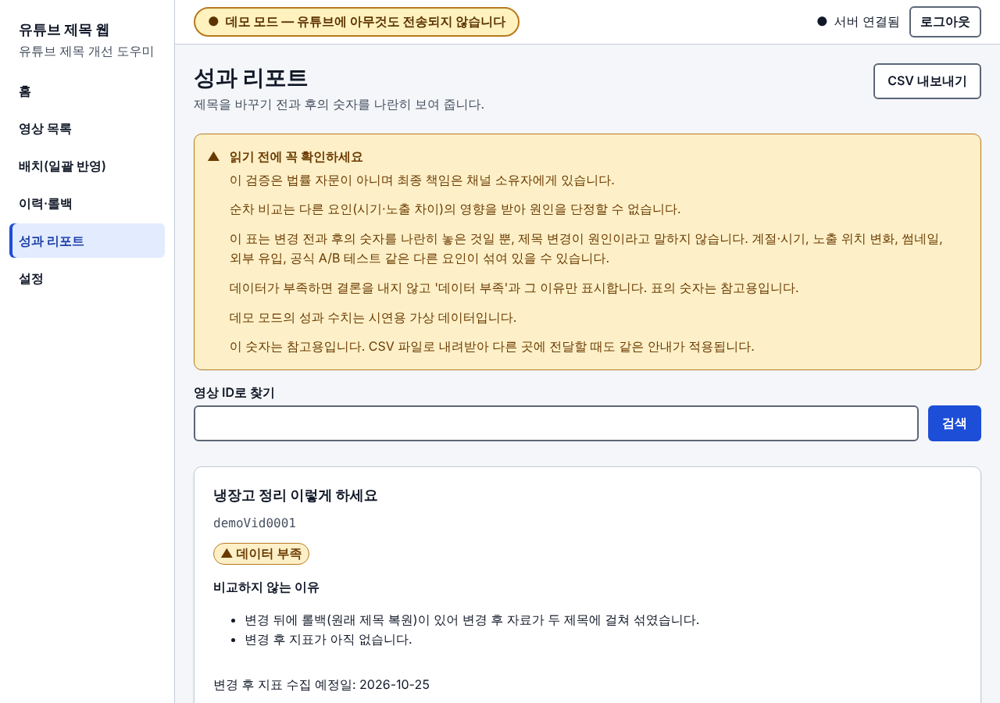 |
| TC-E18 | 설정: 하루 반영 상한을 바꾸면 저장되고 홈에 반영된다(확인 후 원래 값 복구) | 상한 5로 저장 → 서버 값 5, 홈 "0 / 5건" → 원래 값으로 복구 | 10 → 5(홈 "0 / 5건" 확인) → 10 복구 | Pass | 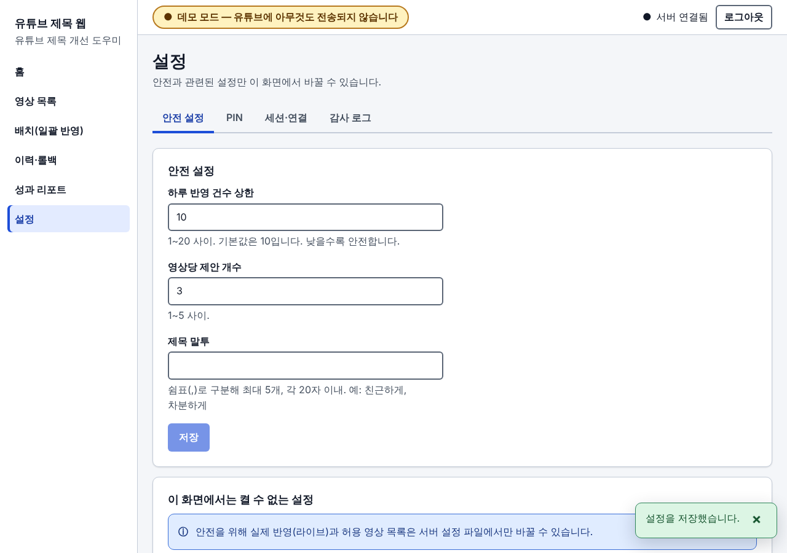 |
| TC-E19 | 감사 로그: 기록이 쌓이고 변조 검사(체인)가 정상이다 | 감사 로그 chain_ok = true, 기록 5건 이상 | 기록 12건, 체인 정상 | Pass | 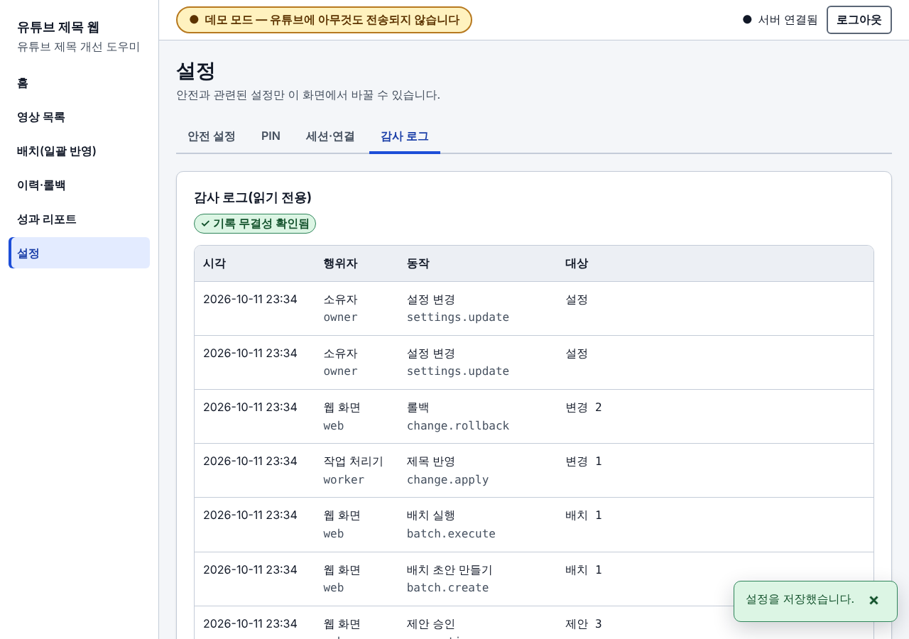 |
| TC-E20 | 보안: 로그인 없이는 API가 거부되고, 엉뚱한 주소로는 접근할 수 없다 | 세션 없음 → 401, 잘못된 Host → 거부, 문서(/docs) 비공개, CSRF 없는 변경 요청 거부 | 조회 401, 잘못된 Host 403, /docs 200(API 문서가 아니라 앱 첫 화면 index.html), CSRF 없는 변경 403 | Pass |  |
| TC-E21 | 화면 오류: 시험 내내 브라우저 콘솔에 치명 오류가 없다 | 페이지 오류(pageerror) 0건, CSP 위반 0건 | 콘솔 오류 0건(치명 0건) | Pass |  |
