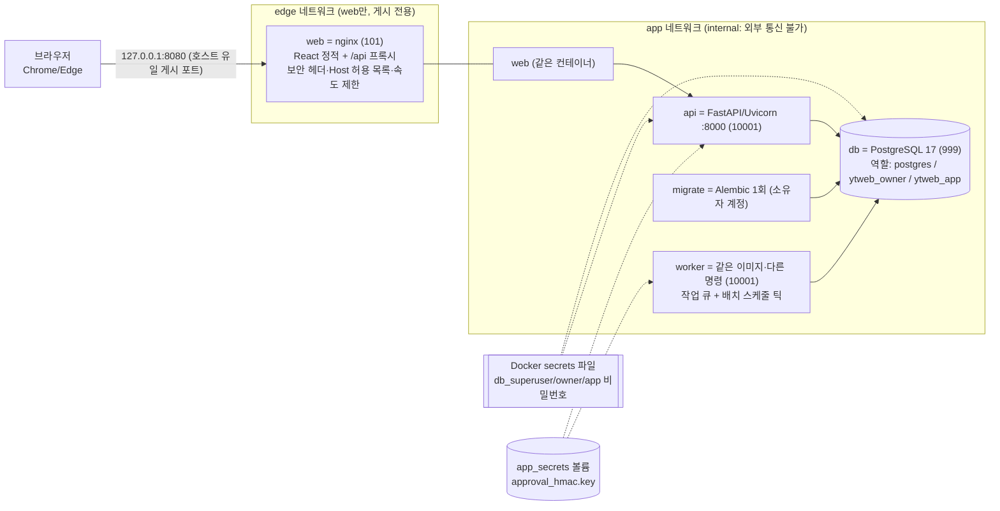
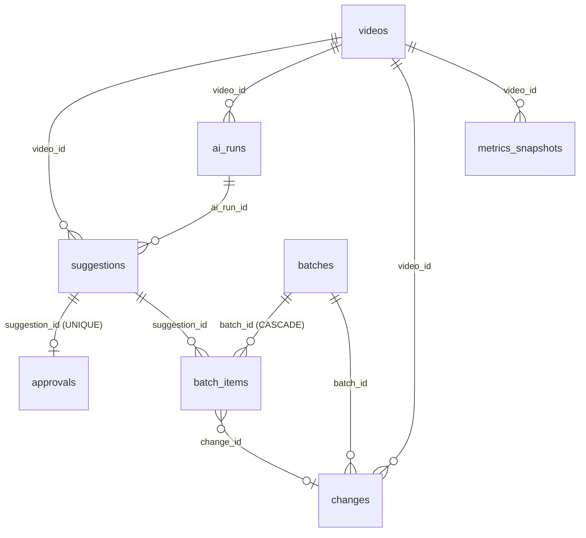

# YT-04 설계서 (TRD) — 유튜브 제목 수정 자동화

- 입력: `02_planning.md`(v4, PASS), `01_policy_research.md`(CONDITIONAL PASS), `02_risk_assessment.md`
- 작성: 오케스트레이터(3단계 역할 직접 수행). 위협 모델은 `threat_model.md`, UX는 `04_ux_design.md`
- 되돌리기 어려운 결정은 `ADR-xxx`로 `decisions.md`(DEC-013~023)와 상호 참조한다.
- **상태: 사용자 승인 대기 (★승인 게이트 a)** — 이 문서 맨 끝 13장 참고

> **문서 구성 (2026-10-10 개정)**: 1~13장 = **CLI(ytitle) 설계서**(승인 완료 DEC-024, 원문 그대로 보존). **맨 아래 `Part B` = 웹 전환(Docker 로컬 웹) 설계서** — 구현 결과(as-built) 기준. 웹 API 상세는 `API.md`, 기계용 스키마는 `openapi.json`, 압축 설계는 `WEB_DESIGN.md`.
> **Part B 상태: 초안 — 6단계 독립 검증 대기.** 아래 표의 항목이 끝나면 결함에 따라 갱신될 수 있다.

### 검증 대기 항목 (Part B에 영향을 줄 수 있는 것 — 오케스트레이터가 결과를 받아 갱신)
| ID | 대기 항목 | 바뀔 수 있는 내용 | 영향 절 | 상태 |
|---|---|---|---|---|
| V-01 | W-BE-A 독립 검증(TC-VA, 변이 점검) | 보안 게이트(Host/Origin/CSRF/세션/PIN)·감사 체인·멱등성·잡 큐·마이그레이션 결함 | W4, W9, 부록 A-1, API.md 1·3장 | 대기(진행 중) |
| V-02 | W-BE-B 독립 검증(TC-VB, 변이 점검) | 승인·배치·롤백·리포트 규칙, 오류·사유 코드 | W5, NFR-W03, API.md 5~7장 | 대기(진행 중) |
| V-03 | W-FE 독립 검증(TC-VF) | 화면 동작·접근성·타입 불일치 | DV-W09, NFR-W10, 부록 A-2b | 대기(진행 중) |
| V-04 | W-INF 독립 검증(TC-VI) | 컨테이너 권한·포트·자원값·백업/복원 실측 | W1-1, W7, NFR-W06, S-W01·13a·14 | 대기(진행 중) |
| V-05 | 7단계 전체 스택 통합(포트 18080) | nginx 경유 헤더·속도 제한·헬스·쿠키·CSV 실동작 | W9-1(S-W04), DV-W18, API.md 1장 | 시작 직후 중지, 재개 대기 |
| V-06 | 사용자 PC 확인(README §8: Docker Desktop·PS 5.1·쿠키 `Secure` 없음·CSP 콘솔·ACL) | 포트 바인딩·권한·쿠키 동작 | NFR-W01, S-W01·S-W04 | 사용자 확인 필요 |
| V-07 | 사용자 결정 Q-W01~Q-W18 (W13) | 보류 항목(WU-5 질문, UI 이상, 금칙어 등)의 웹 처리, RTO/RPO, PIN, 감사 키 | W5, W7, W8, W9, 부록 | 질문 대기 |
| V-08 | 결정은 났으나 코드 미반영 3건 | DEC-042 D1(데모 최소 노출수 0), DEC-041 ⑤(운영 빌드에서 테스트 제외), 워커 하트비트 | DV-W14·W15·W17 | 후속 구현 대기 |
| V-09 | 위협 모델(S-W15)·04 디자인서 개정(별도 에이전트 산출) | STRIDE 대응 `SEC-xxx`, 면책 문구 위치 | W9-4~W9-6 | 별도 작업 대기 |

## 1. 아키텍처 개요

### 1-1. 구성 (텍스트 다이어그램)
```
[사용자 PowerShell]
      │  python -m ytitle <서브커맨드> [--live]
      ▼
┌─────────────────────────────  CLI 계층 (cli.py + commands/*.py)  ─────────────────────────────┐
│ auth  fetch  validate  plan  approve  apply  rollback  report  purge   (각 파일이 서브커맨드 1개) │
└──────┬──────────────┬───────────────┬────────────────┬──────────────────┬───────────────────────┘
       ▼              ▼               ▼                ▼                  ▼
  auth.py        youtube_read.py   validator.py     updater.py        report.py
 (OAuth,        (조회·Analytics)   candidates.py   limits.py         csv_import.py
  토큰 2종)       quota.py          banned_terms.py history.py
                                                    live_guard.py
                                                    approvals.py
       └──────────────┴───────────────┴────────┬───────┴──────────────────┘
                                                ▼
        공통 기반(WU-0): config · logging_setup(마스킹) · errors · retry · db · timeutil · platform_utils · textsafe · ui
                                                ▼
   ┌───────────── 로컬 저장소 ─────────────┐        ┌──────── 외부 ────────┐
   │ data/ytitle.sqlite3  (DB 7개 테이블)   │        │ YouTube Data API v3  │  ← HTTPS, OAuth 토큰
   │ data/backups/  data/logs/              │        │ YouTube Analytics API│
   │ candidates/  approvals/  config/       │        └──────────────────────┘
   │ secrets/client_secret.json (프로젝트)  │
   │ %LOCALAPPDATA%\ytitle\tokens\ (토큰)   │
   └────────────────────────────────────────┘
```

### 1-2. 신뢰 경계 (상세는 `threat_model.md`)
TB-1 PC ↔ Google API, TB-2 외부 입력 파일(후보 JSON·CSV·YAML) ↔ 프로그램, TB-3 프로그램 ↔ 같은 PC의 다른 프로세스·파일, TB-4 PyPI 의존성 ↔ 프로그램.

### 1-3. 작업 단위 확정표 (02 §9를 설계 경계에 맞춰 확정)
| 단위 | feature | 소유 파일(수정 범위) | 공유 자원 접촉 | 선행 | 확정 사항 |
|---|---|---|---|---|---|
| **WU-0** (공통 선행, unit-0) | F-0 | `pyproject.toml`, `requirements.txt`, `requirements-dev.txt`, `.gitignore`(추가), `config/settings.yaml`, `src/ytitle/{__init__,__main__,config,logging_setup,errors,retry,db,timeutil,platform_utils,textsafe,ui,cli}.py`, `src/ytitle/commands/{__init__,purge}.py`, `tests/conftest.py`, `tests/test_{config,logging,retry,db,timeutil,textsafe,ui,cli,purge}.py` | **모든 공유 자원을 선점**: 의존성 매니페스트(전체 의존성 사전 선언), DB 스키마 전체(7개 테이블), CLI 서브커맨드 자동 탐색부, 설정 로더 | 없음 | 02 대비 변경: `timeutil`·`platform_utils`·`textsafe`·`ui`(터미널 출력 컴포넌트, `04_ux_design.md`) 추가(공통 유틸) |
| WU-1 | F-A | `src/ytitle/auth.py`, `src/ytitle/commands/auth.py`, `tests/test_auth.py` | 없음(등록부는 자동 탐색, 의존성은 WU-0이 선언) | WU-0 | 불확실이던 칸 확정: **접촉 없음** |
| WU-2 | F-A | `src/ytitle/{youtube_read,quota}.py`, `src/ytitle/commands/fetch.py`, `tests/test_{read,quota}.py` | DB 읽기·쓰기(스키마는 WU-0 소유) | WU-1 | 변경 없음 |
| WU-3 | F-B | `src/ytitle/{candidates,validator,banned_terms}.py`, `config/banned_terms.yaml`, `src/ytitle/commands/validate.py`, `tests/test_{candidates,validator}.py` | 없음(PyYAML은 WU-0 선언) | WU-0 | **WU-1과 병렬 가능**(파일·데이터·의존성 독립 확정) |
| WU-4 | F-C | `src/ytitle/{updater,limits,history}.py`, `src/ytitle/commands/{plan,rollback}.py`, `tests/test_{updater,limits,history}.py` | DB `title_changes` 쓰기, `quota` 모듈 호출 | WU-2, WU-3 | 02 대비 변경: `rollback`의 쓰기 게이트는 WU-5의 `live_guard`를 호출하므로 **롤백 명령의 쓰기 실행부는 WU-5 완료 후 활성화**(WU-4는 롤백 계획·DB 처리까지, 실제 호출은 인터페이스 스텁) |
| WU-5 | F-C | `src/ytitle/{live_guard,approvals}.py`, `src/ytitle/commands/{approve,apply}.py`, `tests/test_{live_guard,approvals}.py` | 설정 계층(`settings.local.yaml` 읽기) | WU-4 | 02 대비 변경: `approve` 명령 추가(FR-013), 롤백의 실제 호출 활성화 포함 |
| WU-6 | F-D | `src/ytitle/{report,csv_import}.py`, `src/ytitle/commands/report.py`, `tests/test_{report,csv_import}.py` | DB 읽기 | WU-2, WU-4 | **WU-5와 병렬 가능**(파일 독립, 읽기 전용, 테스트는 임시 DB 별도) |

**웨이브 초안** (오케스트레이터가 5단계 착수 직전에 판정·통지): 웨이브0 = WU-0 → 웨이브1 = WU-1 ∥ WU-3 → 웨이브2 = WU-2 → 웨이브3 = WU-4 → 웨이브4 = WU-5 ∥ WU-6. 병렬 실행의 근거는 위 표의 "공유 자원 접촉"과 파일 범위이다. 이 환경에서는 하네스 서브에이전트를 쓰지 않으므로(DEC-011) 실제 실행은 순차이다.

## 2. 기술 스택과 근거

| 영역 | 선택 | 근거 |
|---|---|---|
| 언어/런타임 | Python 3.12 + venv | 사용자 기본값(DEC-003). 3.10 이상에서 동작하도록 작성(이 클라우드에서 3.11·3.12·3.13 모두 테스트함) |
| CLI | 표준 라이브러리 `argparse` + `commands/` 자동 탐색 | 의존성 최소(초보자 설치 부담↓), 단위마다 파일이 분리되어 병렬 개발 시 충돌 없음 |
| DB | 표준 라이브러리 `sqlite3` | 사용자 기본값. 단일 사용자 로컬 도구에 충분. 별도 서버 불필요 |
| Google 연동 | `google-api-python-client`, `google-auth-oauthlib`, `google-auth-httplib2` | 공식 클라이언트. 직접 HTTP 구현보다 인증·재시도 오류가 적다 |
| 설정 | `PyYAML`(`safe_load`만 사용), `python-dotenv` | 금칙어·정책값은 YAML, 경로·비밀은 `.env` |
| 시간대 | 표준 `zoneinfo` + `tzdata` | 쿼터 하루 경계가 태평양 시간. **Windows는 tzdata 패키지가 없으면 zoneinfo가 동작하지 않음** |
| 테스트 | `pytest`, `pytest-cov` | NFR-006 커버리지 측정 |

### 2-1. 의존성 실존·라이선스 확인 (SEC-013, 2026-10-10 PyPI 조회)
| 패키지 | 최신 | 라이선스 | 비고 |
|---|---|---|---|
| google-api-python-client | 2.201.0 (2026-09-30) | Apache 2.0 | yanked 아님 |
| google-auth-oauthlib | 1.5.0 | Apache 2.0 | |
| google-auth-httplib2 | 0.4.4 | Apache 2.0 | |
| PyYAML | 6.0.3 | MIT | |
| tzdata | 2026.5 | Apache-2.0 | |
| python-dotenv | 1.2.4 | BSD-3-Clause | |
| pytest / pytest-cov (개발용) | 9.1.1 / 7.1.0 | MIT | |
- 개인용 도구 사용에 라이선스 충돌 없음. **버전은 5단계에서 `pip install`로 확정 후 `requirements.txt`에 고정(`==`)**한다. 지금 표의 버전은 조회 시점 값이다.
- **외부 제공자 약관 확인 근거**: YouTube Data/Analytics API는 사용자 본인 OAuth로 본인 채널만 호출하고, 쿼터 우회·크롤링을 하지 않는다. 약관 조항 번호는 확인하지 못했다 → **[확인 필요]** (1단계 e, CONDITIONAL).

## 3. 데이터 모델

### 3-1. 테이블 (SQLite, 외래키 ON, 모든 시각은 UTC ISO8601 문자열)
| 테이블 | 컬럼 | 설명 |
|---|---|---|
| `schema_meta` | `version INTEGER` | 마이그레이션 버전 |
| `videos` | `video_id PK`, `title`, `category_id`, `privacy_status`, `made_for_kids`(0/1/NULL), `live_broadcast_content`, `duration_sec`, `description_excerpt`(앞 500자), `snippet_json`(최신 조회본 전체), `fetched_at` | 조회 결과 캐시 |
| `title_candidates` | `id PK`, `video_id FK`, `candidate_title`, `evidence`, `source`(`human`/`ai-assisted`/…), `topic`(`life`/`health`/`finance`/NULL), `strict_mode`(0/1), `validation_result`(`pass`/`warn`/`block`), `validation_reasons_json`, `dictionary_hash`, `file_name`, `file_sha256`, `status`, `created_at`, `updated_at` | 후보와 검증 결과, 사용한 금칙어 사전 해시(SEC-017) |
| `title_changes` | `id PK`, `video_id`, `candidate_id FK NULL`, `change_type`(`apply`/`rollback`), `previous_title`, `new_title`, `backup_snippet_json`(적용 직전 snippet 전체), `reason`, `approver`, `approved_at`, `plan_hash`, `result`(`planned`/`success`/`failed`/`aborted`), `error_code`, `applied_at`, `verified_at`, `verify_result_json`, `run_id` | 모든 쓰기 시도와 결과(성공·실패·중단 모두 기록) |
| `metrics_snapshots` | `id PK`, `video_id`, `taken_at`, `phase`(`before`/`after`/`periodic`), `source`(`api`/`csv`), `period_start`, `period_end`, `impressions`, `ctr`, `views`, `watch_minutes`, `raw_json` | 변경 전후 지표(FR-007) |
| `run_logs` | `id PK`, `run_id`, `started_at`, `ended_at`, `command`, `mode`(`dry_run`/`live`), `exit_code`, `summary` | 실행 단위 기록(FR-020). 토큰·키는 저장하지 않음 |
| `quota_usage` | `id PK`, `pt_date`(태평양 시간 날짜), `method`, `units`, `called_at`, `run_id`, `status`(`reserved`/`ok`/`failed`) | 쿼터 선예약 기록(ADR-008) |
- 인덱스: `title_changes(video_id, applied_at)`, `quota_usage(pt_date)`, `metrics_snapshots(video_id, phase, taken_at)`.
- 모든 SQL은 **파라미터 바인딩**만 사용한다(SEC-018).

### 3-2. 상태 머신 (`title_candidates.status`)
```
candidate ──검증──▶ filtered(pass/warn) ──approve──▶ approved ──apply 성공──▶ applied ──평가창 경과+after 지표──▶ evaluated
    │                                                                              │                                   │
    └──검증 block(엄격 모드의 warn 포함)──▶ blocked(종료)                                          rollback│                                  │rollback
                                                                                   ▼                                  ▼
                                                                              rolled_back(종료)             rolled_back(종료)
```
- 허용 전이만 코드에서 허용하고, 그 외 전이 시도는 예외로 처리한다. `blocked`와 `rolled_back`은 종료 상태.
- `warn`은 사람이 사유를 읽고 `approve`로 넘어갈 수 있다(건강·금융 주제 엄격 모드에서는 `warn`이 `block`으로 승격: POL-001).

### 3-3. 이관·마이그레이션
- 기존 데이터 이관 없음(신규 개발). `schema_meta.version`과 `db.py`의 순서 있는 마이그레이션 함수로 관리한다. 스키마 변경은 새 번호의 마이그레이션 추가로만 한다(기존 번호 수정 금지).

### 3-4. 보관과 삭제 (NFR-009)
- 변경 이력과 백업 snippet은 기본 365일 보관(설정값), `purge --before <날짜>` 명령으로 삭제하며 **삭제 전 DB 사본을 자동 생성**하고 확인을 요구한다. 최근 `success` 변경의 백업은 롤백 가능성을 위해 삭제하지 않는다(대상에서 제외하고 경고).

## 4. 인터페이스 명세

### 4-1. CLI (`python -m ytitle ...`) — 이벤트/인터페이스 `EVT-xxx`
| ID | 명령 | 쓰기? | 주요 옵션 | 동작 |
|---|---|---|---|---|
| EVT-001 | `auth` | 토큰 파일 | `--read` / `--write` / `--revoke` | 설치형 앱 OAuth. 읽기·쓰기 토큰을 **분리 저장**(ADR-004). `--revoke`는 로컬 토큰 삭제와 구글 계정에서의 앱 접근 제거 안내(계정 회수 절차) |
| EVT-002 | `fetch` | DB | `--all` / `--video ID` / `--metrics` | 영상 목록·snippet 조회(읽기 전용 API), 지표 수집 |
| EVT-003 | `validate` | DB | `--file candidates/ID.json` / `--all` | 후보 검증, 리포트 출력 |
| EVT-004 | `plan` | `run_logs`만 | `--candidate N` | **dry-run diff**. 쓰기 API·읽기 API 호출 없음(마지막 `fetch`로 저장된 `videos.snippet_json` 사용, 저장 시각이 24시간보다 오래되면 `fetch`를 다시 하라고 경고). 계획 해시 `plan_hash = SHA-256(video_id, candidate_id, previous_title, new_title, snippet_json의 해시)`를 계산해 출력. **`title_changes`에는 쓰지 않는다** |
| EVT-005 | `approve` | 승인 파일 | `--candidate N` `--approver 이름` `--ttl-hours` | 사람의 승인 파일 생성(계획 해시 바인딩, 만료 포함) |
| EVT-006 | `apply` | **YouTube 쓰기** | `--candidate N` `--live` | 후보 **1건씩만** 처리. 5-2의 안전 게이트를 모두 통과해야 실행. 기본(옵션 없음)은 dry-run |
| EVT-007 | `rollback` | **YouTube 쓰기** | `--change N` `--live` | 이전 제목 복원(복원도 이력 기록). 게이트: `--live` + `enable_live` + 영상 ID 직접 입력 확인 + 허용 목록 |
| EVT-008 | `report` | 파일 | `--video ID` `--import-csv 파일` | 변경 전후 비교 리포트와 CSV 가져오기 |
| EVT-009 | `purge` | DB | `--before 날짜` | 오래된 이력 삭제(자동 DB 사본, 확인 필요) |
- 모든 명령 공통 전역 옵션: `--plain`(스크린리더 친화 목록 출력), `--color`(색 켜기, 기본 꺼짐). 기본은 dry-run/읽기, `--help` 제공, 종료 코드 0(정상) / 1(오류) / 2(사용법) / 3(안전 게이트로 중단). 오류 메시지는 한국어 + "다음에 할 일"(NFR-007).

### 4-2. 외부 API 호출 `EVT-1xx`
| ID | 호출 | 용도 | 단위 비용(가정, 설정값) |
|---|---|---|---|
| EVT-101 | `channels.list` (mine=true, part=contentDetails) | 업로드 재생목록 ID 획득 | 1 |
| EVT-102 | `playlistItems.list` | 영상 ID 목록(50개씩 페이지) | 1 |
| EVT-103 | `videos.list` (part=snippet,status,contentDetails, 최대 50 ID) | snippet 전체·상태 조회 | 1 |
| EVT-104 | `videos.update` (part=snippet) | 제목 변경(전체 snippet 보존 본문) | **50** |
| EVT-105 | Analytics `reports.query` | 영상별 지표 | **미확인**(설정값, 기본 1) |
- 모든 호출은 `retry.py`를 거친다(최대 2회, 지수 백오프 1s→2s, 인증 오류·할당량 초과는 재시도하지 않음). 호출 전에 쿼터를 **선예약**한다(ADR-008).
- 계약 검증: 응답 JSON에서 필요한 필드의 존재·타입을 검사하는 함수를 두고, 8단계가 mock 응답으로 확인한다. API 버전은 `v3`/Analytics `v2`로 고정한다(변경 시 [확인 필요]).

### 4-3. 파일 형식 `EVT-2xx`
| ID | 파일 | 형식 |
|---|---|---|
| EVT-201 | `candidates/{video_id}.json` | `{"video_id","current_title","topic":"life|health|finance","summary","source":"human|ai-assisted","description_excerpt"?,"candidates":[{"title","evidence"}]}`. 최대 256KB, `video_id`는 `^[A-Za-z0-9_-]{11}$`, 후보 최대 20개 |
| EVT-202 | `approvals/{video_id}-{candidate_id}.approved.json` | `{"video_id","candidate_id","new_title","plan_hash","approver","approved_at","expires_at","used":false}` |
| EVT-203 | Studio 내보내기 CSV | 열 이름은 Studio 화면의 한글/영문 헤더를 `config/csv_mapping.yaml`로 매핑(헤더가 달라도 수정 가능). 실제 헤더는 [확인 필요] |
| EVT-204 | `config/banned_terms.yaml` | `{"version", "types": {"fear":[...], "medical":[...], "finance":[...], "impersonation":[...], "superlative":[...]}, "warning_patterns":{...}}` |
| EVT-205 | `config/settings.yaml` + `config/settings.local.yaml` | 5-3 참고 |

## 5. 비기능 요구사항 (구체화)

### 5-1. NFR 목표
| ID | 항목 | 구체화 |
|---|---|---|
| NFR-001 | 지원 환경 | Windows 10/11, PowerShell 5.1+, Python 3.12(3.10+ 호환). **Windows 전용 동작(파일 권한, 콘솔 인코딩)은 `platform_utils.py`에 격리** |
| NFR-002 | UTF-8 | 모든 파일 입출력은 `encoding="utf-8"` 명시, 콘솔은 시작 시 UTF-8로 재설정 시도 |
| NFR-003 | 쿼터 | 일일 상한 6,000 units(60%), 80% 도달 시 경고, 100% 시 즉시 중단. 날짜 경계 `America/Los_Angeles` |
| NFR-004 | 재시도 | 최대 2회, 지수 백오프, 이후 중단·기록 |
| NFR-005 | 성능 | 후보 100건 검증 5초 이내(로컬) |
| NFR-006 | 테스트 | 검증기·요청 본문 구성 모듈 줄 커버리지 90%+ |
| NFR-007 | 사용성 | 한국어 오류 + 다음 행동 안내 |
| NFR-008 | 감사 | 모든 쓰기 시도·결과·승인자 DB 기록, 로그 365일 |
| NFR-009 | 데이터 최소 보관 | 3-4 |
| **NFR-010** (신규) | 복구 목표 | **RPO ≤ 24시간, RTO ≤ 30분(가정)**. 쓰기 직전마다 DB 사본(`data/backups/`)을 만들고, 복구는 사본 파일 복사로 한다 |
| **NFR-011** (신규) | 관측성 | 실행 로그는 사람이 읽는 한국어 한 줄 + `run_id`, `data/logs/ytitle.log`(회전 5MB×10). 토큰·키 마스킹(SEC-008) |

### 5-2. 안전한 쓰기 흐름 (`apply --live`) — 앞 단계가 하나라도 실패하면 **즉시 중단(fail-closed)**하고 `result=aborted`로 기록. 값싼 로컬 검사를 먼저, 네트워크 호출은 나중에 한다
```
1  --live 플래그 있음?                                   (SEC-001 ①)
2  settings.local.yaml 의 enable_live=true?               (SEC-001 ③)  ※ settings.yaml 의 값은 무시
3  영상 ID ∈ live_allowlist? (빈 목록 = 전부 거부)          (SEC-012)
4  쿼터 여유? (오늘 남은 양 ≥ 읽기 2 + 쓰기 50 + 여유)      (SEC-002)
5  교체 제한 통과? (72h, 횟수, 최소 노출 수, 오늘 live 적용 건수)  (SEC-004, SEC-020)
6  [네트워크 읽기] 영상 snippet 재조회 → 저장본/승인 당시 제목과 동일?  (SEC-009)
7  승인 파일 유효? plan_hash를 6단계의 최신 snippet으로 다시 계산해 승인 파일의 값과 비교, 만료·사용 여부  (SEC-001 ②, SEC-014)
   → 불일치면 "승인 이후 영상 정보가 바뀌었습니다. plan부터 다시 하세요"로 중단
8  변경 전 지표 스냅샷 존재? (없으면 경고하고 사용자 확인)      (FR-012)
9  요청 본문 = 6단계 snippet 전체 + 제목만 교체                (SEC-005)
10 사용자에게 요약 출력(SCR-005) → 영상 ID를 직접 입력해 확인   (사람 승인)
11 DB 백업 사본 생성 + title_changes(planned) 기록 + 쿼터 선예약
12 [네트워크 쓰기] videos.update 호출 (재시도 ≤ 2)
13 [네트워크 읽기] videos.list 재조회 → 제목 반영·설명·태그·카테고리 보존 검증   (SEC-010)
14 결과 기록(승인 파일 used=true). 검증 실패 시 경보 + rollback 명령 안내(자동 롤백 안 함 — 쓰기이므로 사람 확인)
```
- `title_changes` 행은 **11단계에서 처음 생성**된다(`plan`은 쓰지 않음). 1~10단계에서 중단되면 `aborted` 행을 별도로 남겨 어떤 조건에서 막혔는지 감사할 수 있게 한다.

### 5-3. 설정 파일 구조
`config/settings.yaml`(저장소에 포함, 안전한 기본값) + `config/settings.local.yaml`(`.gitignore`, 사용자별 덮어쓰기). **`enable_live`와 `live_allowlist`는 local 파일에서만 인식**한다.
```yaml
quota:            { daily_limit_units: 6000, warn_ratio: 0.8, update_cost: 50, read_cost: 1, analytics_cost: 1 }
cadence:          { min_interval_hours: 72, max_changes_per_video: 3, min_impressions_before_rechange: 1000, max_live_changes_per_day: 3 }
validation:       { key_phrase_chars: 20, recommended_max_chars: 40, hard_max_chars: 100, warn_match_ratio: 0.5, block_match_ratio: 0.25 }   # 임계값은 가정
sequential_mode:  { enabled: false, evaluation_window_days: 14 }
retention:        { logs_days: 365, history_days: 365 }
live:             { enable_live: false, live_allowlist: [] }      # local 파일에서만 유효
approval:         { ttl_hours: 24 }
exclusions:       { shorts_max_seconds: 180 }      # Shorts 가능성 판별 기준(가정, 순차 교체 모드 제외 근거로만 사용)
```
`.env`: `YT_CLIENT_SECRET_PATH`, `YT_TOKEN_DIR`(기본 `%LOCALAPPDATA%\ytitle\tokens`), `YT_DATA_DIR`(기본 `data`).

### 5-4. 비용·임계값
외부 API는 무료 쿼터 안에서 사용(비용 0원). 50개 영상 전체 조회는 약 4 units, 제목 1건 적용은 약 50 + 조회 2 units. 하루 상한 6,000 units이면 이론상 100건 이상 적용 가능하지만 교체 제한(72시간·3회)이 더 먼저 걸린다. **비용이 통제 범위를 벗어났다고 보는 기준**: 일일 사용량이 상한의 80%를 넘는 날이 일주일에 2번 이상이면 사용량 점검.

## 6. 보안 설계 원칙 (`SEC-xxx`)

### 6-1. 02에서 받은 SEC-001~013의 설계 반영
| ID | 설계 |
|---|---|
| SEC-001 | 기본 dry-run, 쓰기 3중 조건(5-2의 1·2·7단계), `apply`/`rollback`만 쓰기 경로이며 모듈 한 곳(`live_guard.py`)에서만 `videos.update`를 호출 |
| SEC-002 | 5-2의 4단계, 선예약 후 호출 |
| SEC-003 | `retry.py` 단일 구현 |
| SEC-004 | `limits.py` |
| SEC-005 | 재조회한 snippet 전체 + 제목만 교체, 백업은 DB 저장(`backup_snippet_json`) |
| SEC-006 | `title_changes` + `rollback` |
| SEC-007 | 코드 금지: `requests`/`urllib`로 Studio·유튜브 웹 접근 금지, 브라우저 자동화 패키지 의존 금지. 9단계가 의존성·코드를 점검 |
| SEC-008 | 로그 마스킹 필터(`ya29.` `1//` Bearer, `client_secret` 값, 긴 base64 토큰 패턴), 예외 메시지도 같은 필터 통과, 토큰 파일은 사용자 프로필 폴더에 저장 |
| SEC-009 | 5-2의 6단계 |
| SEC-010 | 5-2의 13단계 |
| SEC-011 | `candidates.py`: 경로는 `candidates/` 하위로만 해석(resolve 후 상위 경로 확인), `video_id` 정규식, 크기·후보 수 상한, 필드 타입 검증 |
| SEC-012 | `live_allowlist`(빈 목록이면 모두 거부) |
| SEC-013 | 2-1 |

### 6-2. 3단계에서 새로 등록하는 SEC (위협 모델 근거)
| ID | 원칙 | 위협 |
|---|---|---|
| SEC-014 | 승인 파일은 `plan_hash`(영상 ID·후보 ID·새 제목·이전 제목·현재 snippet 해시)에 바인딩되고, 만료(기본 24시간)되며, **한 번 사용하면 `used=true`**로 재사용을 막는다 | T-03 |
| SEC-015 | 읽기 토큰과 쓰기 토큰을 분리 저장하고, 쓰기 토큰은 `apply`/`rollback` 실행 순간에만 로드한다. `auth --revoke`로 로컬 삭제 | T-08 |
| SEC-016 | 안전한 파싱: `yaml.safe_load`만 사용, JSON/CSV 크기 상한, CSV는 값을 실행·평가하지 않고 숫자·문자열로만 읽음 | T-11 |
| SEC-017 | 검증 때 사용한 금칙어 사전의 해시를 후보 검증 기록에 저장하고, 사전이 바뀐 사실을 리포트에 표시 | T-10 |
| SEC-018 | 모든 SQL은 파라미터 바인딩(문자열 결합 금지). 제목·설명 등 외부 문자열은 값으로만 전달 | T-12 |
| SEC-019 | 화면·로그에 출력하는 외부 문자열(제목·설명·사유)은 제어 문자(ANSI 이스케이프 포함)를 제거/이스케이프한다 | T-13 |
| SEC-020 | `apply`와 `rollback`은 **1회 실행에 영상 1건만** 처리하고(일괄 적용 없음), 하루 live 적용 건수 상한(`max_live_changes_per_day`, 기본 3)을 둔다 | T-16 |
- AI/LLM 관련(규칙 J): 프로그램이 LLM을 호출하지 않으므로 **프롬프트 인젝션·출력 렌더링·도구 권한·LLM 비용 항목은 해당 없음(사유: LLM 호출 없음, DEC-003)**. 후보 `source` 필드로 AI 보조 여부만 기록한다(POL-004). LLM 호출을 추가하면 규칙 J와 Tier를 재평가한다.
- 개인정보: 채널 소유자 본인의 영상 메타데이터만 다루며 시청자 개인정보(댓글 등)는 수집하지 않는다. 수집 최소화=필요 필드만 저장, 보관 365일, 삭제=`purge`, 제3자 제공 없음. 개인정보 영향평가·ISMS-P 대상 여부는 [확인 필요]이나 개인 도구라 해당 가능성이 낮다.
- 접근 권한: 로컬 사용자 계정 권한에 의존. 토큰 폐기=`auth --revoke` + 구글 계정 보안 설정에서 앱 제거.

## 7. 운영/관측성
- **환경 분리**: dev/staging/prod 서버 없음(로컬 CLI). 대신 "테스트 영상 vs 실제 영상"을 `live_allowlist`로 분리하고, 자동 테스트는 항상 mock만 사용(실제 API 호출 금지).
- **SLO/가용성**: 해당 없음(사유: 상시 서비스가 아닌 수동 실행 CLI). 대신 NFR-010(복구 목표)과 NFR-003(쿼터)을 운영 목표로 한다.
- **IaC**: 해당 없음(사유: 로컬 설치형). 재현성은 `requirements.txt` 버전 고정과 `pyproject.toml`로 확보.
- **배포 전략(릴리즈)**: 로컬 설치(`pip install -e .`)와 버전 태그. **실제 채널 변경은 단계적**: ①비공개 테스트 영상 1개 → ②본인이 지정한 공개 영상 1개 → ③소수 → ④확대. **중단 기준**: SEC-010 검증 실패 1건, 롤백 검증 실패 1건, 정책 경고 알림 수신, 쿼터 상한(100%) 도달 중 하나라도 발생하면 중단하고 원인 분석(규칙 F).
- **로깅·알림**: 알림 채널 없음(해당 없음: 1인 수동 실행, 콘솔 경고로 충분). 로그는 `data/logs/`, 보관 365일, 감사 대상=모든 쓰기 시도.
- **백업/복구**: 5-1 NFR-010. 인프라 장애 개념 없음(해당 없음).
- **롤백 전략**: `rollback` 명령 + DB 백업 사본 + 버전 태그 복귀.

## 8. 기획서 대비 트레이드오프와 미해결 사항
1. **02와 달라진 점**: ①`approve` 명령 추가, ②`timeutil`·`platform_utils`·`textsafe`·`ui` 공통 모듈 추가(WU-0), ③`rollback`의 쓰기 실행부를 WU-5로 이동, ④NFR-010·011 및 SEC-014~020 신규 등록, ⑤설정을 `settings.yaml` + `settings.local.yaml`로 계층화(`enable_live`는 local에서만 유효), ⑥토큰 저장 위치를 프로젝트가 아닌 사용자 프로필로 변경(03 가이드의 `.env` 예시를 이에 맞춰 수정).
2. **Windows 검증의 한계**: 이 클라우드 환경은 Linux이며 Python 3.11·3.12·3.13으로 테스트한다. 로직 테스트는 여기서 가능하지만 **Windows 고유 동작(파일 권한, 콘솔 인코딩, 경로 구분자, 실행 정책)은 이 환경에서 검증할 수 없다**. 해당 테스트는 `@windows_only`로 표시해 8·10단계에서 **"미수행(Windows 필요)"**으로 기록하고, 사용자가 PowerShell에서 RUNBOOK의 점검 절차로 확인한다.
3. **미해결(1단계 CONDITIONAL)**: `videos.update`의 정확한 쿼터·필요한 최소 scope·Analytics 지표명은 모두 설정값/후보로 설계했다. 원문 확인 결과가 다르면 설정값 조정 또는 규칙 F.
4. **Shorts 판별**: API로 Shorts 여부를 직접 알 수 없어 `duration_sec ≤ 180`이면 "Shorts 가능성"으로 보수적으로 취급한다(기준 시간은 [확인 필요]). 이 판별은 순차 교체 모드에서만 제외 근거로 쓴다.
5. **자동 롤백 미채택**: 검증 실패 시 자동으로 `videos.update`를 다시 호출하지 않는다(SEC-001 위반 소지). 대신 경보와 명령 안내를 한다. 비용은 사람의 빠른 대응이 필요하다는 점.
6. **로컬 공격자는 범위 밖**: 같은 PC의 악성코드가 승인 파일을 위조하거나 토큰을 읽는 위협은 완화(SEC-008, 014, 015)할 뿐 완전히 막지 못한다. 잔여 위험으로 수용 여부를 `threat_model.md` 5장에서 사용자에게 묻는다.
7. **레퍼런스 대비 비교 반영 여부**: 02에 레퍼런스 비교가 없어(해당 없음) 참조하지 않았다.

## 9. 구현 단위(WU-0~6)별 완료 기준과 검증 방법 (v1 YT-04 요구)
| 단위 | 완료 기준 | 검증 방법 (실행 명령은 5단계에서 확정) |
|---|---|---|
| WU-0 | 설치 후 `python -m ytitle --help`가 **등록된 서브커맨드를 자동 탐색해 표시**(WU-0 시점에는 `purge`, 이후 단위가 끝날 때마다 추가되어 8단계 시점에 9개 전체). 설정 로드·마스킹·재시도·DB 생성·마이그레이션·textsafe·timeutil(PT 날짜 경계)·`purge` 동작. 기본값이 dry-run | `pytest` 전체 통과, `--help` 출력 확인(자동 탐색 동작: 임시 명령 파일을 추가하면 목록에 나타남), 재시도 횟수·백오프 간격 테스트, 로그에 가짜 토큰 문자열이 마스킹됨, PT 날짜 경계(서머타임 전후) 테스트 |
| WU-1 | `auth --read/--write/--revoke` 동작. 읽기·쓰기 토큰 분리 저장. 만료·재인증 감지 시 한국어 안내 | mock 기반 테스트: 정상 로그인, 토큰 만료, 토큰 폐기, 토큰이 로그·예외에 없음. **실제 로그인은 사용자 수행**(절차 문서 `03_manual_setup.md` 8장) |
| WU-2 | `fetch`가 영상·snippet·지표를 DB에 저장. 쿼터 기록·상한 검사. 쓰기 API 호출 코드 없음 | mock 응답 테스트(50개 배치, 페이지네이션), `quota_usage` 기록 확인, 코드 검색으로 `videos.update` 호출 부재 확인 |
| WU-3 | 후보 읽기·검증·리포트. 차단 유형 5종, 경고 유형 3종, 엄격 모드, 우회 표기 정규화, 길이(유니코드) 계산, `<` `>` 불가 | 통과·차단 케이스 각 10개 이상(한글 포함), 우회 표기 케이스, 100건 5초 이내, 커버리지 90%+ |
| WU-4 | `plan`이 diff와 `plan_hash` 출력(호출 없음). snippet 전체 백업, 이전 값 보존 본문, 교체 제한 검사, 롤백 계획과 DB 처리 | `description`·`tags`·`categoryId` 보존 테스트, 롤백 DB 테스트, 72시간·횟수·최소 노출 테스트, 승인 없는 쓰기 호출 0건 |
| WU-5 | `approve`·`apply --live` 게이트 14단계 전부 동작. 롤백 실제 호출 활성화. 허용 목록 빈 경우 전부 거부 | 게이트 조건 하나씩 빠뜨린 케이스 각각 거부 테스트(mock 호출 0회), 승인 파일 재사용·만료·해시 불일치 거부, 재조회 제목 불일치 중단, 적용 후 검증 실패 경보 |
| WU-6 | 변경 전후 비교 리포트, 순차 비교 한계 문구, CSV 가져오기(헤더 매핑) | 샘플 데이터 리포트 생성, 한계 문구 포함, CSV 인코딩(UTF-8·CP949) 테스트 |
| 8단계 | 전체 시나리오(fetch→validate→plan→approve→apply(mock)→rollback) 통과, `traceability` 커버리지 100% | E2E mock 시나리오, 회귀 스위트 |
| 9단계 | SEC-001~019 항목별 점검 | 코드·의존성·로그 스캔, `pip-audit` 등 취약점 점검(도구 선정은 5~9단계에서 근거와 함께) |
| 10단계 | 깨끗한 venv 설치 스모크 (부록 A CLI 변형) | 새 venv에 설치→`--help`, 이전 태그 복귀 리허설. **Windows 실측은 사용자 수행(미수행으로 기록)** |
| 11단계 | RUNBOOK(일상 사용, 장애 대응: 쿼터 초과·토큰 만료·오적용 롤백, 점검 체크리스트), 사용자 매뉴얼. 최종 점검=완료 기준 대조표 + 미해결 [확인 필요] 목록 | 문서 검증 로그 2회+ |
| 12단계 | ①릴리즈 승인 ②첫 실제 수정 승인(규칙 E). 검증 절차: 적용→제목 반영 확인→설명·태그 보존 확인→롤백 확인 | 비공개 테스트 영상에서 사용자 승인 후 실행 |
| 13단계 | 즉시 검증(S10)과 롤백 확인. 성과 비교는 72시간+ 후 수집 예정(미수행으로 기록) | |

## 10. 요구사항 ↔ 설계 매핑 (traceability 설계 매핑 컬럼의 원본)
| ID | 설계 § |
|---|---|
| FR-001 | 4-3 EVT-201, 6-1 SEC-011 |
| FR-002 | 1-1 validator.py, 9 WU-3, 7장 제목 규칙 → `04` 및 02 §4-1 |
| FR-003 | 4-3 EVT-204, 6-2 SEC-017 |
| FR-004 | 4-3 EVT-201(description_excerpt), 3-1 videos |
| FR-005 | 4-1 EVT-003, `04_ux_design.md` SCR-002 |
| FR-006 | 4-2 EVT-101~103 |
| FR-007 | 4-2 EVT-105, 4-3 EVT-203 |
| FR-008 | 4-1 EVT-004, 5-2 |
| FR-009 | 5-2 9단계, 3-1 title_changes |
| FR-010 | 3-1 title_changes |
| FR-011 | 4-1 EVT-007 |
| FR-012 | 5-2 |
| FR-013 | 4-1 EVT-005, 4-3 EVT-202, 6-2 SEC-014 |
| FR-014 | 5-3 cadence, 5-2 5단계 |
| FR-015 | 3-1 quota_usage, 5-3 quota, ADR-008 |
| FR-016 | 4-1 EVT-001, ADR-004 |
| FR-017 | 4-1 |
| FR-018 | 4-1 EVT-008 |
| FR-019 | 5-3 sequential_mode, 3-2 |
| FR-020 | 3-1 run_logs, 5-1 NFR-011 |
| NFR-001 | 5-1 |
| NFR-002 | 5-1 |
| NFR-003 | 5-1, 5-3 |
| NFR-004 | 4-2 |
| NFR-005 | 5-1, 9 WU-3 |
| NFR-006 | 5-1, 9 |
| NFR-007 | 4-1, `04_ux_design.md` |
| NFR-008 | 3-1, 5-1 |
| NFR-009 | 3-4 |
| NFR-010 | 5-1, 7 |
| NFR-011 | 5-1, 7 |
| POL-001 | 4-3 EVT-201 topic, 3-2 |
| POL-002 | `04_ux_design.md` 면책 문구 규칙 |
| POL-003 | 5-3 sequential_mode, 8-4 |
| POL-004 | 4-3 EVT-201 source |
| SEC-001 | 5-2, 6-1 |
| SEC-002 | 5-2, 6-1 |
| SEC-003 | 4-2, 6-1 |
| SEC-004 | 5-2, 6-1 |
| SEC-005 | 5-2, 6-1 |
| SEC-006 | 3-1, 6-1 |
| SEC-007 | 6-1 (9단계 점검) |
| SEC-008 | 6-1 |
| SEC-009 | 5-2, 6-1 |
| SEC-010 | 5-2, 6-1 |
| SEC-011 | 6-1 |
| SEC-012 | 5-2, 5-3 |
| SEC-013 | 2-1 |
| SEC-014 | 6-2 |
| SEC-015 | 6-2 |
| SEC-016 | 6-2 |
| SEC-017 | 6-2 |
| SEC-018 | 6-2 |
| SEC-019 | 6-2 |
| SEC-020 | 5-2, 5-3, 6-2 |

## 11. 아키텍처 결정 (ADR) — `decisions.md`의 DEC와 상호 참조
| ADR | DEC | 결정 | 근거 | 되돌리기 |
|---|---|---|---|---|
| ADR-001 | DEC-013 | Python 3.12 + venv, 3.10+ 호환 | 사용자 기본값, 개발자 초보 | 쉬움 |
| ADR-002 | DEC-014 | SQLite(`sqlite3` 표준 모듈), 마이그레이션 번호제 | 사용자 기본값, 단일 사용자 | 중간(스키마 변경은 마이그레이션으로) |
| ADR-003 | DEC-015 | `argparse` + `commands/` 자동 탐색 | 의존성 최소, 단위별 파일 분리로 병렬 충돌 방지 | 쉬움 |
| ADR-004 | DEC-016 | OAuth 설치형 앱, 읽기·쓰기 토큰 분리, 토큰은 사용자 프로필 폴더 | 최소 권한, 저장소 유출 방지, Windows 파일 권한 한계 | 쉬움 |
| ADR-005 | DEC-017 | 쓰기 안전 설계 14단계(3중 조건+계획 해시 승인+허용 목록+재조회+사후 검증) | v1 안전장치와 위협 모델 | 쉬움 |
| ADR-006 | DEC-018 | 쿼터 날짜는 `America/Los_Angeles`, `zoneinfo`+`tzdata` | 1단계 c·3-5, Windows tzdata 필요 | 쉬움 |
| ADR-007 | DEC-019 | 후보는 파일 입력, 프로그램은 LLM 비호출 | 사용자 기본값(DEC-003), 규칙 J 비해당 | 중간(LLM 추가 시 규칙 J 재평가) |
| ADR-008 | DEC-020 | 쿼터 선예약 후 호출, 실패해도 차감 유지 | 보수적(상한 초과 방지) | 쉬움 |
| ADR-009 | DEC-021 | 공식 Google 클라이언트 라이브러리 사용 | 인증·재시도 오류 감소 | 쉬움 |
| ADR-010 | DEC-022 | 설정 계층(`settings.yaml`+`settings.local.yaml`), `enable_live`·허용 목록은 local에서만 유효 | 실수로 `enable_live=true`를 커밋·공유하는 사고 방지 | 쉬움 |

## 12. 변경 이력
| 일시 | 버전 | 변경 내용 | 사유 |
|---|---|---|---|
| 2026-10-10 | v0 | 초안 | 3단계 착수 |
| 2026-10-10 | v0-web | Part B(웹 전환 설계서, as-built) 추가, 문서 상단 구성 안내·검증 대기 항목 표 추가. 1~13장 본문은 변경 없음 | STATE §6 재개: 웹 전환 문서 개정 3단계. 상세 변경 이력은 Part B W14 |

## 13. ★ 사용자 승인 요청 (승인 게이트 a)
**DESIGN.md 검토 후 '진행'이라고 답해 주세요.** 특히 아래를 봐 주세요: ①5-2 쓰기 14단계(7장 운영의 단계적 적용), ②5-3 설정 구조, ③6-2 새 보안 요구 7개, ④8장의 한계(Windows 검증 불가, 자동 롤백 미채택, 로컬 공격자 범위 밖).

---
---

# Part B — 웹 전환 설계서 (ytitle 웹, 구현 결과 as-built 기준)

> 위쪽 1~13장은 **CLI(ytitle) 설계서**로 그대로 보존한다(DEC-024로 승인, CLI 코어는 웹이 재사용). 이 Part B는 CLI → Docker 기반 로컬 웹 전환(DEC-032~042)의 **3단계 풀 설계서**이며, 압축 설계 `WEB_DESIGN.md`(DEC-038)를 구현된 코드 기준으로 풀어 쓴 것이다. 장 번호는 `W1`~`W14`, 부록은 `A`~`D`다.

| 항목 | 내용 |
|---|---|
| 상태 | **초안 — 6단계 독립 검증 대기**(위 "검증 대기 항목" 표). 사용자 설계 승인 게이트(DEC-037)는 속도 우선 지시(DEC-038)로 대체되었으며, 이 해석은 M1 화면 확인 때 사용자에게 알려야 한다 |
| 작성 기준일 | 2026-10-10 |
| 근거(직접 읽은 것) | `웹프로그램으로수정요청.md`, `docs/harness/decisions.md`(DEC-032~042), `docs/harness/units/web-WU-{BE-A,BE-B,FE,INF}-note.md`, 코드 `web/backend/ytweb/**`(라우터 12개·도메인·코어·모델·마이그레이션), `web/compose.yaml`, `web/docker/**`, `web/frontend/{package.json,src/api/types.ts,endpoints.ts}` |
| 짝 문서 | `API.md`(엔드포인트 상세), `openapi.json`(앱 객체에서 직접 추출), `WEB_DESIGN.md`(압축판, 이 문서와 일치하도록 개정) |
| 모드 | **M1 = 데모 전용**: 유튜브·AI를 실제로 호출하는 코드가 연결돼 있지 않다 |
| ID 규칙 | 웹 전용 신규 ID는 기존 번호와 겹치지 않게 `EVT-Wnn`(API), `NFR-Wnn`, `SEC-Wnn`(S-Wnn 요구에서 파생된 설계 원칙), `ADR-011`~(CLI는 ADR-001~010), `DV-Wnn`(설계-구현 편차), `Q-Wnn`(사용자 질문). traceability 등록은 공유 문서 갱신 요청 참고 |

## W0. 이 문서를 읽는 법
- "구현됨"은 코드를 읽고 확인한 사실, "검증됨"은 독립 검증(6단계)까지 끝난 것이다. 지금은 **구현됨 + 구현 담당의 자체 테스트 통과**까지이며, 독립 검증은 진행 중이다.
- 설계 의도와 구현이 다르면 임의로 한쪽을 정하지 않고 **W12 "설계-구현 편차" 표**(DV-W01~)에 올리고, 결정이 필요하면 **W13 "사용자 확인 필요 질문"**(Q-W01~)으로 올렸다.
- 숫자 중 "실측"은 구현 노트에 근거가 있는 것, "제안"은 이 문서가 새로 제안한 목표라서 사용자 확인이 필요한 것이다.

## W1. 아키텍처 개요

### W1-1. 구성 (상시 4서비스 + 1회성 migrate)

- 기동 순서: `db healthy → migrate 성공 → api/worker 시작 → api healthy → web`. 마이그레이션이 실패하면 api·worker는 뜨지 않는다.
- 호스트 포트는 `127.0.0.1:8080:8080` **한 줄**뿐이다. api(8000)·db(5432)·worker는 호스트에 게시되지 않는다.
- "4서비스"(요청서 D-01)는 상시 서비스(web, api, worker, db)를 가리키며, compose에는 1회성 `migrate`가 더해져 **서비스 5개**다(DV-W01). `web`만 게시를 위해 비-internal `edge` 네트워크에 추가로 붙는다(DV-W02).

### W1-2. 모듈 경계 (설계상 옳은 경계 — 병렬을 위해 자르지 않았다)
| 계층 | 위치 | 책임 | 하지 않는 일 |
|---|---|---|---|
| 경계 보호 | `core/guard.py`(ASGI) `core/ratelimit.py` | Host 허용 목록 → 1MB 제한 → 속도 제한 → 보안 헤더·요청 ID → 처리되지 않은 예외를 500 problem+json으로 | 업무 규칙 |
| 인증·세션 | `core/{sessions,pin,deps}.py` `routers/auth.py` | 쿠키 세션(sha256 저장), CSRF, Origin/Sec-Fetch-Site, 선택형 PIN | 사용자 계정 관리(단일 소유자) |
| 공용 기반 | `core/{errors,audit,idempotency,jobs,settings_store,clock,canonical,logsetup}.py` | problem+json, 감사 해시 체인, 멱등성, 작업 큐, 설정 KV, 시간대, JSON 로그 마스킹 | 도메인 지식 |
| 도메인 서비스 | `domain/*.py` | 시드·제안·검증 연동·승인·한도/쿼터·배치·변경/롤백·리포트·대시보드 | HTTP, 세션 |
| 어댑터 | `ai/*` `youtube/*` | `TitleSuggester`/`YouTubeGateway` 규약과 M1 모의 구현 | 실서비스 호출(M2·M3) |
| 라우터 | `routers/*.py` (12개 모듈 → 엔드포인트 31개) | 입력 검증·의존성 조립·응답 변환(얇게) | 업무 규칙 |
| 저장소 | `db/{models,session}.py` `alembic/` | 14테이블 ORM, 엔진·세션, 마이그레이션 | |
| 코어 재사용 | `src/ytitle/*`(CLI와 공유, **복사 금지**) | 검증기, 후보 모델, 금칙어 사전, 교체 한도 판정, 계획 해시, 성과 리포트 계산, 설정 로더 | sqlite 의존 모듈(`db/history/quota/live_guard`)은 웹이 PostgreSQL로 재구현 |
| 프런트 | `web/frontend/src` | 8개 화면, API 클라이언트(CSRF·멱등키 자동), 디자인 토큰, 한국어 문구 한 파일 | 비밀·토큰 영구 저장(메모리만) |
의존 방향: 라우터 → 도메인 → (core, db, ai, youtube, ytitle). 도메인은 라우터를 모르고, 워커도 같은 도메인 함수를 호출한다(`run_due_items`, 작업 핸들러 3종).

### W1-3. 작업 단위 확정표 (as-built — 02/압축설계 §7 대비)
| 단위 | 소유 범위 | 공유 자원 접촉 | 선행 | 결과 |
|---|---|---|---|---|
| (공통 선행, 사실상 unit-0) | `ytweb/db/{models,session}.py` `ytweb/config.py` — 오케스트레이터가 먼저 작성하고 나머지는 읽기만 | 모델이 곧 마이그레이션 원본 | 없음 | 14테이블·세션·설정 확정 후 4개 단위 병렬 |
| W-BE-A | `core/` `app.py` `worker.py` `migrate.py` `alembic/` `routers/{health,auth,settings,audit}.py` `pyproject.toml` `requirements*.txt` `tests/core` | 의존성 매니페스트, 0001 마이그레이션 | 공통 선행 | 구현됨(TC-WA 157, pytest 212) |
| W-BE-B | `domain/` `ai/` `youtube/` `routers/{dashboard,videos,suggestions,batches,changes,reports,jobs,google}.py` `tests/domain` | `core` 공개 인터페이스(읽기 전용 사용), `pyproject` 커버리지 설정(오케스트레이터가 반영) | W-BE-A 인터페이스 | 구현됨(TC-WB 159, 도메인 182) |
| W-FE | `web/frontend/` 전체 | API 계약 | 계약(압축설계 §3) | 구현됨(TC-WF 95) |
| W-INF | `web/docker/` `web/compose.yaml` `web/compose.online.yaml` `web/scripts/` `web/README.md` `.dockerignore` | 루트 `.gitignore`(추가만) | 이미지 입력(백엔드 잠금 파일, 프런트 lockfile) | 구현됨(정적 점검 35) |
**여러 단위가 함께 고치는 공유 파일**: `ytweb/db/models.py` ↔ `alembic/versions/*`(모델을 바꾸면 새 마이그레이션 필요, 0001은 고정 문자열이라 모델 임포트 안 함), `web/backend/requirements*.txt`(해시 잠금 재생성), `web/frontend/package-lock.json`, `web/compose.yaml`(서비스 추가 시), `src/ytitle/*`(CLI 회귀 테스트와 공유). **02와 달라진 점**: ① 압축설계가 말한 unit-0 없이 `models/session/config`를 오케스트레이터가 선행 작성했다 ② `routers/__init__.py`(빈 패키지 표지)가 BE-A 소유로 추가 ③ 커버리지 `omit`로 도메인이 측정 제외된 것을 DEC-042에서 제거 — 모두 병렬을 위한 왜곡이 아니라 구현 중 드러난 사실이다.
**M2·M3 단위 후보(미확정, 사용자 승인 후)**: W-M2-GOOGLE(웹 OAuth 읽기, 신규 `routers/google.py` 확장·토큰 저장 방식) · W-M3-AI(실서비스 어댑터, 비용 상한) · W-M3-LIVE(쓰기 로그인, 라이브 게이트웨이, W5의 이식 목록). 공유 접촉: `models.py`+새 마이그레이션 0002, `compose.online.yaml`, 위협 모델 갱신.

### W1-4. 신뢰 경계
| 경계 | 설명 | 통제 |
|---|---|---|
| TB-W1 | 같은 PC의 다른 웹페이지/프로세스 ↔ `127.0.0.1:8080` | Host 허용 목록(DNS 리바인딩), Origin+Sec-Fetch-Site, CSRF 토큰, SameSite=Strict 쿠키, 선택 PIN |
| TB-W2 | 같은 네트워크의 다른 기기 ↔ PC | 호스트 게시 127.0.0.1 한정(실측: 다른 IP 접속 실패 — Linux 엔진, Docker Desktop은 사용자 PC 확인 필요) |
| TB-W3 | 브라우저 ↔ nginx ↔ api | nginx가 보안 헤더·속도 제한·메서드 제한·TRACE 차단(405), 백엔드 헤더 중복 제거 |
| TB-W4 | api/worker ↔ db | internal 네트워크, scram-sha-256, 사설망 pg_hba, 앱 역할은 DDL 불가·감사 로그 UPDATE/DELETE/TRUNCATE 불가 |
| TB-W5 | 외부 입력(영상 설명·제목, AI 응답) ↔ 도메인 | 입력 정리·AI 응답 새니타이즈·기존 검증기·사람 승인(W9-3) |
| TB-W6 | (M2·M3) api/worker ↔ 구글·AI | `compose.online.yaml`로 api/worker에만 egress, db 절대 제외, 사용자 승인 필요 |
| TB-W7 | 백업 파일 ↔ 호스트 폴더 | 암호화 없음 — 접근 권한만(DV-W20) |

## W2. 기술 스택 선정과 근거

| 영역 | 선택(고정 버전) | 근거 | 요청·DEC |
|---|---|---|---|
| 백엔드 | Python 3.12, FastAPI 0.143.0, Pydantic 2.14.0, Uvicorn 0.54.0, SQLAlchemy 2.1.4(동기), Alembic 1.20.0, psycopg 3.3.6 | OpenAPI 자동 생성(요청 6-2), 입력 검증, 기존 코어(동기 코드) 재사용. 동기 엔드포인트는 스레드풀에서 실행되고 단일 소유자라 충분 | DEC-035 |
| 프런트 | React 19.3.0, TypeScript 5.9.3(strict), Vite 8.3.4, @tanstack/react-query 5.104.1, react-router-dom 7.18.4(HashRouter), Vitest 5.0.3 + Testing Library, axe-core 직접 호출 | 서버 상태는 Query가 담당, HashRouter는 nginx에 SPA 대체 설정이 없어도 새로고침이 동작. **DEC-035의 "React 18, TanStack Router"와 다르다**(DV-W10) | DEC-035 |
| DB | PostgreSQL 17(`postgres:17-bookworm` 다이제스트 고정), 명명 볼륨 | 요청서 확정, 지원 ~2029-11, 데이터 경로 안정(18은 경로 변경), 체크섬 켬 | DEC-035, DEC-041 |
| 웹 서버 | nginx(`nginxinc/nginx-unprivileged:stable-alpine`), 비루트 101 | 정적 서빙+프록시+보안 헤더 한 곳 | DEC-035 |
| 컨테이너 | Docker Compose, 베이스 이미지 4종 다이제스트 고정, 멀티 스테이지, 비루트·read_only·cap_drop ALL·no-new-privileges·자원 상한 | 요청서 D-03/D-04/D-14 | DEC-035, 41 |
| 작업 큐 | PostgreSQL `jobs` 테이블 + 워커 프로세스 | W11 ADR-014 | DEC-035, 40 |
| 린트·포맷 | 백엔드 ruff(F,E9만 임시 점검, 설정 파일은 아직 없음), 프런트 ESLint 9.39.5 + Prettier 3.9.10 + tsc | 도구를 사용자가 정하지 않아 보수적 표준 선택 | DEC-040 |
| 테스트 | pytest(+`@pytest.mark.postgres`), Vitest+RTL+axe-core | 브라우저 자동화(Playwright)는 도입하지 않음 | DEC-034 Q-8, DEC-035 |

### W2-1. 라이선스 확인 (S-W11) — 이 문서 작성자가 설치 메타데이터로 직접 확인
| 패키지 | 라이선스 | 비고 |
|---|---|---|
| fastapi 0.143.0 / pydantic 2.14.0 / sqlalchemy 2.1.4 / alembic 1.20.0 / PyYAML 6.0.3 | MIT | |
| uvicorn 0.54.0 / starlette 1.7.0 / python-dotenv 1.2.4 | BSD-3-Clause | |
| tzdata 2026.5 | Apache-2.0 | |
| **psycopg 3.3.6 / psycopg-binary** | **LGPL-3.0-only** | 개인 로컬 사용이면 문제가 없다. **이미지·소스를 다른 사람에게 배포**하면 LGPL 고지·교체 가능성 조건이 생긴다 → Q-W15(배포 계획 없음 확인) |
| 프런트 직접 의존성 | 구현 노트: 전부 MIT, axe-core만 MPL-2.0(개발 전용, 번들 미포함) | npm 메타데이터는 이 문서 작성자가 재확인하지 않음 — **9단계 확인 필요** |
| 취약점·SBOM | 미수행(9단계). 프런트 `npm audit` 취약점 0(구현 노트 자체 점검) | |
ESLint 9.39.5는 npm이 EOL 경고를 표시한다(eslint-plugin-jsx-a11y의 peer 범위 때문 — 해당 플러그인이 10을 지원하면 올릴 것). Node 22는 유지보수 종료가 2027-04라 그 전 24로 올리는 작업을 M4 의존성 점검에 둔다(DEC-041).

### W2-2. 외부 데이터·API 이용약관 확인 (규칙: 약관 확인 근거를 남긴다)
| 대상 | M1 | M2·M3 |
|---|---|---|
| YouTube Data/Analytics API, Google OAuth | **호출하지 않음**(코드에 라이브 게이트웨이 없음, api/worker는 internal 네트워크라 외부 접속 불가) | 약관·쿼터는 1단계 조사(`01_policy_research.md`, CONDITIONAL PASS — 공식 문서 도메인이 이 환경에서 차단되어 원문 미열람, DEC-010)와 축 A 조사를 따른다. **원문 재확인 필요**(사용자가 허용 도메인을 열어 주거나 사용자 PC에서 확인) |
| AI 서비스 | 모의 제안기만 | 서비스 미정(Q-1) → 확정 후 약관(상업 이용·데이터 학습 사용 여부·전송 데이터 보관)을 확인해 이 절에 기록. **확인 전에는 연결하지 않는다** |

## W3. 데이터 모델 (14테이블, `ytweb/db/models.py`가 원본, 마이그레이션 `alembic/versions/0001_initial.py`)


(독립 테이블: `quota_usage`, `jobs`, `audit_log`, `settings_kv`, `sessions`, `idempotency_keys`)

| # | 테이블 | 핵심 컬럼 | 제약·인덱스 | 용도 |
|---|---|---|---|---|
| 1 | `videos` | PK `video_id`(11자), `title`, `snippet`(JSONB, 반영 전 보존·롤백용 전체), `exclusion_reasons`, `privacy_status`, `made_for_kids`, `duration_sec`, `is_short`, `views`, `source`(`demo`\|`youtube`), `fetched_at` | CHECK source | 유튜브 영상의 사본(M1은 이 테이블이 곧 모의 "유튜브") |
| 2 | `ai_runs` | `video_id`, `provider`, `model`, `params`, **`prompt_hash`**(원문 대신 해시), `input_chars`, `status`(`ok`\|`failed`), `error` | CHECK status | AI 호출 기록(원문 비저장, S-W07) |
| 3 | `suggestions` | `video_id`, `title`, `evidence`, `source`(`ai:mock`\|`manual`), `topic`(life/health/finance), `strict_mode`, `validation_result`(pass/warn/block), `validation_reasons`, `match_ratio`, `dictionary_hash`, `plan_hash`, `status`(8종) | CHECK status/result/topic, **UNIQUE(video_id,title)** | 제목 후보와 검증 결과 |
| 4 | `approvals` | `suggestion_id`(UNIQUE), `plan_hash`, `approver`, `approved_at`, `expires_at`, `used_at`(1회용), **`mac`**(HMAC-SHA256) | UNIQUE suggestion_id | 승인(계획 해시·서명·만료) |
| 5 | `batches` | `status`(draft/queued/running/paused/done/cancelled), `note`, `precheck`(JSONB), `executed_at` | CHECK status | 반영 묶음 |
| 6 | `batch_items` | `batch_id`, `suggestion_id`, `video_id`, `seq`, `scheduled_date`(KST 날짜), `status`(pending/running/success/failed/skipped/cancelled), `skip_reason`, `change_id` | UNIQUE(batch,suggestion), **부분 UNIQUE(suggestion_id) WHERE status IN (pending,running)**, INDEX(status,scheduled_date) | 항목별 예약·진행 |
| 7 | `changes` | `video_id`, `change_type`(apply/rollback), `previous_title`, `new_title`, **`backup_snippet`**(JSONB), `approver`, `plan_hash`, `result`(planned/success/failed/aborted), `error_code`, `mode`(demo/live), `applied_at`, `verified_at`, `verify_result` | **부분 UNIQUE(video_id) WHERE result='planned'**, INDEX(video_id,applied_at) | 변경 이력(롤백 근거) |
| 8 | `quota_usage` | `pt_date`(태평양 날짜), `method`, `units`, `status`(reserved/ok/failed), `job_id` | CHECK units≥0, INDEX pt_date | API 사용량 선예약 장부 |
| 9 | `metrics_snapshots` | `video_id`, `phase`(before/after/periodic), `source`(api/csv/demo), 기간, `impressions/ctr/views/watch_minutes` | INDEX(video,phase,taken_at) | 전후 성과 |
| 10 | `jobs` | UUID PK, `type`, `status`(queued/running/succeeded/failed/cancelled), `payload`, `result`, `progress/total`, `attempts`, `run_after`, `locked_by/at` | INDEX(status,run_after) | 작업 큐 |
| 11 | `audit_log` | `ts`, `actor`, `action`, `target_*`, `detail`, `prev_hash`, `hash`(UNIQUE) | **앱 역할 UPDATE/DELETE/TRUNCATE 회수** | 추가 전용 감사(해시 체인) |
| 12 | `settings_kv` | `key`, `value`(JSONB) | | 안전 설정, PIN 해시·실패 카운터 |
| 13 | `sessions` | `id`(= 쿠키 토큰의 sha256), `csrf_token`, `expires_at`, `last_seen` | | 로그인 세션 |
| 14 | `idempotency_keys` | `key`, `route`, `request_hash`, `response_status/body` | PK key | 멱등성 재생 |
모든 시각은 UTC `timestamptz`(SQLite 테스트에서도 tz-aware UTC로 정규화, naive 저장은 오류). 상태·종류 문자열은 CHECK 제약으로 닫는다(오타 차단). 모든 SQL은 ORM/바인딩.

**이중 반영을 막는 DB 불변식 2개**: ① 한 제안은 진행 중(pending/running) 배치 항목을 동시에 1개만 ② 한 영상은 `planned` 변경을 동시에 1개만. 이 둘은 PostgreSQL 부분 고유 인덱스이며 애플리케이션 버그가 있어도 DB가 거부한다.

### W3-1. 마이그레이션·이관 전략
- Alembic **별도 1회성 서비스**(`migrate`)가 소유자 계정(`ytweb_owner`)으로 실행한다. 앱 계정(`ytweb_app`)은 DDL 권한이 없다. 0001은 모델에서 렌더링한 PostgreSQL DDL(23문장)을 고정 문자열로 보관(모델을 임포트하지 않음 → 모델이 바뀌어도 0001은 불변). 끝에서 `audit_log` 변경 권한을 회수한다. 실제 PostgreSQL 16 적용·downgrade base 확인(BE-A).
- 앞으로 스키마를 바꾸려면 0002 이상을 추가한다. 되돌리기: downgrade(데이터 손실 가능) 또는 백업 복원.
- **SQLite → PostgreSQL 이관 도구는 만들지 않았다**(DEC-034 Q-10: 실데이터를 내려받은 적 없음, 새 스키마로 시작). 따라서 원본·매핑·정합성 검증·되돌리기 설계는 해당 없음(사유: 이관할 프로덕션 데이터 없음). 나중에 필요해지면 규칙 E 승인 대상.
- **백업·복원**: `backup.ps1` → `pg_dump --format=custom --no-owner` → `web\backups\ytweb-날짜-시각.dump` (+`pg_restore --list` 검증, SHA-256). `restore.ps1`은 확인 문구 입력 → 복원 전 `pre-restore-*.dump` 자동 백업 → 단일 트랜잭션 복원 → **`audit-guard.sql`로 감사 로그 변경 권한 재회수·검증** → 행 수 출력(실측: 복원 직후 앱 역할에 UPDATE 권한이 되살아나는 문제를 발견해 수정). 같은 PostgreSQL 메이저 이상으로만 복원.
- **복원 시 키 파일**: DB 덤프에는 `app_secrets` 볼륨의 `approval_hmac.key`가 들어가지 않는다. 키 없이 복원하면 **기존 승인이 모두 무효(`approval_tampered`)** 가 되어 재승인이 필요하다(fail-closed). 이는 README·DEC-041이 "감사 로그 체인 검증이 어긋난다"고 설명한 것과 다르다(DV-W08).

## W4. API/인터페이스 명세 (요약 — 상세는 `API.md`, 기계용은 `openapi.json`)

### W4-1. 엔드포인트 목록 (EVT-W01~W31, 부록 A에서 코드와 대조)
| ID | 메서드 경로 | 인증 | 멱등키 | 응답 |
|---|---|---|---|---|
| EVT-W01~04 | GET `/healthz` `/api/healthz` `/readyz` `/api/readyz` | 없음 | - | 200 / readyz DB 불가 시 503 |
| EVT-W05 | GET `/api/v1/auth/me` | 없음 | - | 200 |
| EVT-W06 | POST `/api/v1/auth/session` | Origin | - | 200 + Set-Cookie |
| EVT-W07 | DELETE `/api/v1/auth/session` | 세션+CSRF | - | 204 |
| EVT-W08 | GET `/api/v1/dashboard` | 세션 | - | 200 |
| EVT-W09~12 | GET `/videos` · GET `/videos/{id}` · POST `/videos/sync` · POST `/videos/{id}/suggestions` | 세션(+CSRF) | - | 200 · 200 · 202 · 201 |
| EVT-W13~17 | POST `/suggestions/generate` · GET `/suggestions` · PATCH `/{id}` · POST `/{id}/approve` · POST `/{id}/reject` | 세션(+CSRF) | - | 202 · 200 ×4 |
| EVT-W18~22 | POST `/batches` · GET `/batches` · GET `/batches/{id}` · POST `/{id}/execute` · POST `/{id}/cancel` | 세션(+CSRF) | **생성·실행 필수** | 201 · 200 · 200 · 202 · 200 |
| EVT-W23 | GET `/jobs/{id}` | 세션 | - | 200 |
| EVT-W24~25 | GET `/changes` · POST `/changes/{id}/rollback` | 세션(+CSRF) | **롤백 필수** | 200 · 201 |
| EVT-W26~27 | GET `/reports/changes` · GET `/reports/export.csv` | 세션 | - | 200 · 200 CSV |
| EVT-W28 | GET `/audit` | 세션 | - | 200 + `chain_ok` |
| EVT-W29~30 | GET · PATCH `/settings` | 세션(+CSRF) | - | 200 |
| EVT-W31 | GET `/google/status` | 세션 | - | 200 |

### W4-2. 공통 규약 (요약)
오류 RFC 9457 problem+json(`code`·`hint` 한국어), 목록 `page/page_size≤200`, 쓰기=쿠키 세션+`X-CSRF-Token`+Origin, 위험 동작 3종만 `Idempotency-Key` 필수, 배치 실행은 **202+작업**(폴링 2초), `/api` 응답 `no-store`.

### W4-3. 버전 정책과 계약(스키마) 검증
- **버전**: `/api/v1` 안에서는 필드 추가·선택 파라미터 추가만. 삭제·이름 변경·필수화·의미 변경은 `/api/v2`. 클라이언트는 모르는 필드를 무시한다(이미 `VideoDetail.preserved`, `BlockedItem.code`, `Batch.precheck`가 이런 추가 필드).
- **계약 검증 방법(8단계 계약 테스트용)**: ① `openapi.json`(앱 객체에서 추출, 부록 A에서 31개 동작 대조 완료) ② 응답 모델은 Pydantic `response_model`로 서버가 검증(8개 라우터 모듈) ③ 프런트 `types.ts`는 손으로 맞춘 타입이므로 **계약 테스트는 `types.ts` 필드 ↔ `openapi.json` 스키마를 기계적으로 비교**해야 한다(부록 A-2에 지금 결과: 불일치 5건). ④ `openapi.json`이 표현하지 못하는 부분(필수 헤더·오류 본문·스키마 없는 응답)은 `API.md` 표가 기준이다(DV-W05).
- **외부 API를 소비하는 부분**(M2·M3): 구글·AI 응답은 신뢰하지 않는 입력으로 취급해 스키마 검증 후 사용(`ai/guard.sanitize_drafts`가 AI 쪽 선례).

## W5. 쓰기 안전 게이트 — CLI 14단계의 웹 이식 현황 (ADR-005 계승, DEC-017)
웹의 반영 경로는 `domain/batches.apply_one` 하나다(모의 게이트웨이도 같은 규약을 쓴다). 어느 단계든 실패하면 **해당 항목만** `failed|skipped`로 닫고 이중 반영은 일어나지 않는다. 순서는 "값싼 로컬 검사 → 네트워크" 원칙을 지킨다.

| CLI 단계 (5-2) | 웹 구현 위치 | 상태 |
|---|---|---|
| 1 `--live` 플래그 | 해당 없음(데모 전용). 사람 확인은 배치 **확인 문구 `실행 N건`**(`execute_batch`) | 대응(라이브는 M3) |
| 2 `enable_live` (local 설정만) | 해당 없음 — `YTWEB_MODE=demo` 고정, 라이브 게이트웨이 코드 없음. 설정 API는 `enable_live`를 **읽기 전용 표시**만 하고 변경 요청은 400 | **M3에서 이식** |
| 3 영상 ID ∈ 허용 목록 | 해당 없음(`live_allowlist` 읽기 전용 표시) | **M3에서 이식** |
| 4 쿼터 여유 | `reserve_calls`: **반영 1건당 3행(재조회 1+갱신 50+검증 재조회 1=52단위)을 한꺼번에 선예약**(전부 되거나 전무), PostgreSQL advisory lock으로 직렬화. 부족하면 항목 `skipped(quota_exhausted)`, 워커 틱은 쿼터 0이면 멈춤 | 이식 |
| 5 교체 제한·미확정 planned | `pending_change_exists` + `check_video_limits`(`ytitle.limits.evaluate_limits` 재사용: 간격 72시간·영상당 3회·최소 노출수 1000·하루 상한=설정값) | 이식(최소 노출수는 데모에서 재변경을 막음 — DEC-042 D1 미반영, DV-W15) |
| 6 호출 직전 재조회 | `gateway.read_snippet` → `title_changed`(제목 변동 시 덮어쓰지 않고 중단), `video_changed`(plan_hash 재계산 불일치) | 이식 |
| 7 승인(해시·만료·1회용) | `check_approval`: HMAC 변조 탐지 → 1회용(`used_at`) → 만료 → 계획 해시. **만료 판정 기준 시각은 배치 실행 확정 시각**(DEC-042 D3 수용) | 이식(기준 시각 변경, DV-W11) |
| 8 변경 전 지표 존재 확인 | 게이트로 막지 않음. 기준선이 없으면 리포트가 "기준선 없음/데이터 부족"으로 표시 | 변경(데모) — M3에서 확인 절차 재검토 |
| 9 요청 본문 = 재조회 snippet 전체+제목만 교체 | `build_update_body` + `_check_body`(`body_invalid`) | 이식 |
| 10 영상 ID 직접 입력 | 배치=확인 문구, **롤백=`typed_video_id`**. 영상별 ID 입력은 배치 반영에는 없음 | 부분 → **M3에서 이식** |
| 11 DB 백업·planned 기록·쿼터 선예약·승인 소진 | `backup_snippet`+`planned`+3행 예약+`used_at`을 **한 커밋**으로. DB 파일 사본은 `backup.ps1`(수동) 담당 | 이식 |
| 12 `videos.update` | `MockYouTubeGateway.update_snippet`(snippet을 통째로 교체 — 빠진 필드는 소실, 실제 API와 같은 위험을 재현) | 모의 |
| 13 재조회 사후 검증 | `verify_snippet`(제목 + description·tags·categoryId·언어 보존). 불일치면 변경 `success`+`error_code=verify_failed`, 항목 `failed`, 롤백 가능(자동 롤백 안 함 — DV-W12) | 이식 |
| 14 결과 기록 | `changes`(success/failed/aborted/planned)+`audit_log`; 결과 불명(`result_unknown`)은 `planned`를 남기고 자동 정리하지 않음 | 이식 |
웹에서 추가된 안전장치: 하루 상한(KST, 기본 10·최대 20)과 배치당 50건의 두 겹, 놓친 예약 몰아서 실행 금지(`run_due_items`가 매 반복 "상한−오늘 반영 수"를 다시 계산), 영상당 한 배치에 한 제목, 제외 영상은 **제안·승인·배치·반영 4곳에서** 차단(DV-W13), 워커 기동 직후 `recover_running_items(stale_after=0)`.

### W5-1. M3(라이브)로 넘기는 이식 목록
1. `enable_live`/허용 목록의 **변경 절차**(요청서 6-3-2: 일반 설정 API로는 불가 + 재인증 또는 확인 문구 + 감사 로그) 설계·구현. 지금은 읽기 전용 표시만 있다.
2. 쓰기 로그인(읽기·쓰기 토큰 분리, 반영 직전에만 발급) — ADR-004 계승.
3. 라이브 게이트웨이(`videos.update`)와 단계 2·3·10의 실제 게이트.
4. 승인 TTL·재확인 정책 재결정(DEC-042 D3 재평가 트리거, Q-W11).
5. 변경 전 지표 확인 절차(단계 8), `planned` 정리 도구(Q-W01 (b)).
6. 쿼터 단위·지표 이름의 공식 문서 원문 재확인(DEC-010 후속).
7. 실서비스 AI 어댑터 + 비용 상한(NFR-W12) + 약관 확인(W2-2).
8. 위협 모델(STRIDE) 갱신(S-W15) 후 사용자 승인.

## W6. 시간대 규칙
| 용도 | 기준 | 구현 |
|---|---|---|
| DB 저장 | **UTC `timestamptz`**(DB `timezone=UTC`, 역할 timezone UTC) | `UTCDateTime` 타입(naive 거부) |
| API 시각 출력 | UTC ISO 8601(`Z` 또는 `+00:00` 혼재, DV-W06) | 화면이 KST로 표시 |
| 하루 반영 상한·배치 예약일 | **KST(Asia/Seoul) 날짜** | `core/clock.kst_today`, `domain/common.kst_day_bounds`(한국은 서머타임 없음) |
| API 쿼터 하루 | **태평양 시간(America/Los_Angeles) 날짜** — 자정에 초기화(한국 시간 오후 4~5시) | `core/clock.pt_date`, `quota_usage.pt_date` |
| 컨테이너 `TZ` | `Asia/Seoul` 설정이나 slim 이미지에 tzdata가 없어 OS 수준은 UTC; 앱은 파이썬 `tzdata` 패키지로 KST/PT 계산 | 알려진 제한 |
- 경계 사례(실제 호출 결과): UTC 2026-10-10 16:25는 KST 10-11 01:25이므로 **그날 "오늘"은 10-11**이며 예약일도 10-11로 잡혔다. 한국 자정 부근에는 "오늘 상한"이 UTC 날짜와 하루 어긋나 보일 수 있다.
- 같은 규칙을 두 곳에서 쓰므로(KST/PT) 서머타임 전환일에는 PT 쿼터 날짜가 23·25시간 길이가 될 수 있다. 쿼터는 날짜 키로만 집계하므로 영향은 없다.

## W7. 운영·관측성·배포

### W7-1. 환경 분리와 설정·시크릿 격리
| 환경 | 용도 | 구성 | 설정·시크릿 |
|---|---|---|---|
| dev | 개발 | venv + SQLite(`YTWEB_AUTO_CREATE=1`) 또는 임시 PostgreSQL, Vite dev 서버(`npm run dev` / 모의 서버 `dev:mock`), `/docs`는 `YTWEB_ENABLE_DOCS=1`로만 | 환경변수 |
| test | 자동·독립 검증 | pytest(SQLite + `@pytest.mark.postgres`는 `YTWEB_TEST_PG_URL`), compose는 `YTWEB_PROJECT=harness-tmp-*`·`YTWEB_IMAGE_PREFIX`로 **운영과 이름·볼륨·이미지를 분리**(규칙 K) | 일회용 비밀번호(저장소 미포함) |
| prod (= 사용자 PC) | 실제 사용 | `web/compose.yaml`, 프로젝트 `ytweb`, 명명 볼륨 `pgdata/backups/app_secrets` | `web/secrets/*`(gitignore, Windows는 현재 사용자만 읽는 ACL 시도) → Docker secrets(`/run/secrets`). 값은 이미지·compose·환경변수에 없고 `*_FILE` 경로만 전달 |
- **staging 없음**: 단일 소유자 로컬 도구이고 운영 데이터가 곧 사용자 PC의 데모/자기 채널 데이터라 별도 스테이징 환경의 이득이 비용보다 작다. 대신 test 프로젝트(`harness-tmp-*`)로 컴포즈 전체를 운영과 격리해 시험한다. M3(라이브) 직전에는 **테스트 영상 1개로 먼저**(요청서 §10, 사용자 승인)가 스테이징 역할을 한다.
- **인프라 코드**: Docker Compose + 이미지 다이제스트 고정 + PowerShell 스크립트(`start/stop/status/logs/backup/restore/reset-demo/pin-digests`). 근거: 사용자 PC 한 대에서 재현 가능해야 하고 Terraform류는 과설계. 모든 스크립트는 한국어 안내, 종료 코드 검사, 확인 문구가 필요한 파괴적 동작(복원·초기화·볼륨 삭제).

### W7-2. 배포 전략 (규칙: 선택과 근거, 중단 기준)
**선택: 일괄 배포(전체 재빌드 후 `start.ps1`).** 사유: 사용자 1명·로컬 PC·동시 사용자 영향 없음, 블루그린·카나리를 돌릴 두 번째 환경이 없음. 되돌리기 어려운 변경(스키마, 라이브 반영)은 일괄 배포가 아니라 **기능 단계(M1→M2→M3)와 승인 게이트**로 점진화한다.
| 단계 | 통과 조건(아니면 중단) |
|---|---|
| 이미지 빌드 | 해시 잠금 설치 성공, `python -c import ...` 스모크 통과, 프런트 `tsc -b && vite build` 통과(DV-W14) |
| db | `pg_isready` + `.ytweb-init-ok` 표식(반쯤 초기화된 볼륨은 unhealthy로 남김) |
| migrate | 종료 코드 0 — 실패하면 api/worker가 시작하지 않음 |
| api / worker / web | 헬스체크 통과(`/healthz`, 워커는 프로세스 생존, `/nginx-health`) |
| 사용자 확인 | `status.ps1`에 [위험] 표시 없음, 루프백 한정 리스너, README §8 체크리스트 |
**롤백**: 코드는 이전 커밋으로 되돌려 재빌드(이미지 태그가 `:local`로 고정이라 이전 이미지가 남지 않음 — 이전 버전 보존이 필요하면 `YTWEB_IMAGE_PREFIX`로 태그를 나누는 개선 후보), 스키마는 `downgrade` 또는 `pre-restore`/수동 백업 복원. **데이터가 있는 상태에서 새 마이그레이션을 적용하기 전에는 `backup.ps1`을 먼저 실행**한다(자동 사전 백업은 미구현 — D-07b 부분).

### W7-3. 로그·모니터링·알림
| 항목 | 설계(as-built) |
|---|---|
| 앱 로그 | `ytweb` JSON 한 줄, 접근 로그는 method/path/status/ms/request_id만(쿼리·헤더·본문 없음), 마스킹(키=값·Bearer·URL 자격증명·40자 이상 토큰 모양). Uvicorn 자체 접근 로그는 쿼리 문자열을 찍으므로 `--no-access-log` |
| 컨테이너 로그 | json-file 10MB×3 (서비스당 최대 약 30MB), `logs.ps1`로 조회 |
| nginx 로그 | JSON(시각·메서드·URI·상태·크기·소요), 쿼리 제외(`$uri`) |
| 감사 | DB `audit_log`(UI `설정 > 감사 로그`, `GET /audit`의 `chain_ok`). 대상: 세션 발급/거부/삭제, 설정 변경, 영상 새로고침, 제안 생성·수정·승인·반려, 배치 생성·실행·취소·항목 실패/복구, 반영, 롤백 |
| 헬스 | `/healthz`(생존), `/readyz`(DB 연결, 503 시 degraded), 화면 상단 연결 배지 |
| 알림 채널 | **외부 푸시 알림 없음.** 사용자가 보는 곳은 ①화면 배너("서버 연결 끊김", 세션 만료 모달) ②`status.ps1` ③`logs.ps1`. 에러율 알림은 아직 연결되지 않았다 → Q-W08. 10단계에서 "알림이 실제로 연결돼 있는지"를 검증하므로 지금은 미연결로 정직하게 표기 |
| 보관 | 컨테이너 로그는 위 회전. **감사 로그는 앱 계정이 지울 수 없어 사실상 영구** → 보관 기간·파기 절차 미정(Q-W06). CLI는 365일(NFR-008) |

### W7-4. 백업·재해복구
- **현재(as-built)**: 수동 `backup.ps1`(pg_dump custom) / `restore.ps1`. **자동 주기 백업 없음.** 백업 파일 암호화 없음, 보관 기간·위치 정책 없음(`web\backups`, gitignore).
- **인프라 전체 장애(PC 교체·Docker 볼륨 손실) 복구 절차 개요**: ①새 PC에 Docker Desktop 설치 ②저장소 받기 ③`start.ps1`(빈 DB 생성) ④`restore.ps1 -File <백업>` ⑤`approval_hmac.key`가 없으므로 **기존 승인은 무효 → 재승인**(안전한 쪽으로 실패) ⑥`status.ps1`·화면 확인. 비밀번호(`web\secrets`)는 새로 생성되며 백업에 포함되지 않는다.
- **데이터 손실 영향**: M1 데모 데이터는 `reset-demo`로 재생성 가능(영향 작음). M2·M3 이후에는 이력·백업 snippet(롤백 근거)·감사 로그가 손실 불가에 가까워진다 → 그때 자동 주기 백업을 필수로 한다(Tier=High). 목표 숫자는 NFR-W08.

### W7-5. 접근 권한 관리
| 대상 | 통제 |
|---|---|
| 앱 사용자 | **단일 소유자.** 인가 모델은 "유효한 세션 보유" 하나(역할 없음). 선택 PIN. 역할 변경·퇴사 시 계정 회수 절차는 **해당 없음**(계정이 하나이며 사용자 PC 접근 권한이 곧 접근 권한). PIN 변경·해제 시 다른 세션 전부 폐기 |
| DB | `postgres`(컨테이너 안에서만) / `ytweb_owner`(마이그레이션·백업·복원) / `ytweb_app`(DML만, DDL 불가, audit_log UPDATE/DELETE/TRUNCATE 불가) |
| 호스트 | `web\secrets\`·`web\backups\`는 Windows 현재 사용자 ACL(시도, 사용자 PC 확인 필요), Docker 소켓 마운트 없음, 호스트 폴더 마운트 없음 |
| 외부 서비스(M2·M3) | 구글 토큰·AI 키 회수 절차는 M2·M3 설계에서 정한다 |

## W8. 비기능 요구사항 (NFR-Wnn)
"구현값"은 코드·compose에서 읽은 값, "제안"은 새로 제안하는 목표로 **사용자 확인 필요**다. 실측이 없는 성능·SLO 수치는 실측이라고 쓰지 않는다.

| ID | 항목 | 내용 | 근거/상태 |
|---|---|---|---|
| NFR-W01 | 환경 | Windows 10/11 + Docker Desktop(WSL2) + PowerShell 5.1+ ; Chrome/Edge 최신, 화면 최소 1024px | 클라우드 Linux 엔진·pwsh 7 실측만. Docker Desktop·PS 5.1·실제 브라우저 쿠키/CSP는 **사용자 PC 확인 필요** |
| NFR-W02 | 성능 | (제안, 미실측) 영상 200개 기준 조회 API p95 ≤ 1초, 제안 1건 동기 생성(모의) ≤ 3초, 배치 항목 1건 반영(모의) ≤ 2초. **확장 한계**: `GET /videos`는 전 영상을 메모리에서 필터·정렬(200개 가정, 약 2,000개를 넘으면 SQL 필터로 전환), `GET /audit`는 호출마다 해시 체인 전체를 검증(O(N), 감사 행이 수만 건이면 느려짐) | 한계는 코드에서 확인, 목표값은 제안 |
| NFR-W03 | 무결성·동시성 | 이중 반영 0건: 부분 고유 인덱스 2개 + 행 잠금(`SKIP LOCKED`) + advisory lock(감사 기록·쿼터·반영 구간) + compare-and-set. PostgreSQL 실측: 같은 항목 6스레드 동시 반영→성공 1, 워커 3개 동시 틱→8건 각 1번, 동시 4틱에서도 하루 상한 3건 유지, 쿼터 예약 16스레드→정확히 10건 | 구현됨(BE-B, BE-A PG 실측) |
| NFR-W04 | 가용성 | 수치 목표 없음. 단일 PC·단일 사용자. `restart: unless-stopped`, `init: true`. **PC 재부팅 후 Docker Desktop 자동 시작이 아님** → 사용자가 Docker 실행 후 `start.ps1`(또는 재부팅 시 컨테이너 복구는 체크리스트 5, 미실측). PC가 꺼진 동안은 반영이 일어나지 않고 켜지면 하루 몫만 처리 | 설계 |
| NFR-W05 | 장애 대응 | 잡 핸들러 실패는 **자동 재시도 없이 `failed`**(부작용 중복 방지), 사용자가 다시 요청. `running` 잔존 작업은 10분 후 재큐(시도 3회 초과면 `failed(worker_lost)`), 배치 항목 `running` 잔존은 워커 기동 직후 즉시 재조회로 확정(`recover_running_items`). 타임아웃: nginx 프록시 연결 5초/읽기 60초/쓰기 30초, 헤더·본문 10초. 서킷브레이커: M1에는 외부 호출이 없어 없음 → M2에서 구글 읽기 재시도·백오프 설계. 우아한 종료: SIGTERM 시 현재 작업을 마치고 종료(api 30초, worker·db 60초 유예) | 구현됨 |
| NFR-W06 | 한도값(구현값) | 요청 본문 1MB · 속도 제한 전역 600/쓰기 120/세션 발급 10 (분당, 백엔드) · nginx 30/초·auth 10/분 · 페이지 크기 ≤200 · 배치 ≤50건 · 하루 반영 상한 기본 10(1~20) · 영상당 제안 1~5 · 세션 TTL 12시간·동시 20개 · 멱등키 24시간 · PIN 5회 실패→5분 잠금(2배씩, 최대 1시간) · 컨테이너 자원: db 1 CPU/768MB, api 0.75/512MB, worker 0.5/384MB, migrate 0.5/384MB, web 0.5/128MB(+pids 상한) | 속도 제한 수치는 **임의 기본값**(DEC-040 f) — 사용하며 조정(Q-W03) |
| NFR-W07 | SLO (제안) | 가용성: "PC와 Docker가 켜진 시간의 99%에서 `/readyz`=200" · 지연: 조회 API p95 ≤ 1초 · 에러율: 5xx 비율 < 1% · 에러 예산: 월 1% · 측정 방법은 현재 없음(`status.ps1`·로그 집계 수동) | **제안·미측정 — Q-W07에서 확인** |
| NFR-W08 | 복구 목표 | **현재 자동 백업이 없어 RPO는 "마지막 수동 백업 이후 전부"(상한 없음)**, RTO는 미실측(수동 복원: 재설치+복원 절차). 제안: RPO ≤ 24시간, RTO ≤ 30분(CLI NFR-010 가정 계승). 10단계가 복구 리허설로 실측해 비교 | **제안 — Q-W07** |
| NFR-W09 | 관측성 | W7-3 | 구현됨(알림 채널 미연결) |
| NFR-W10 | 접근성·사용성 | WCAG 2.2 AA 목표, 최소 글자 16px, 조작 영역 44px, 키보드 조작·포커스 링, 색 + 기호 + 글자 병기, 한국어 문구 한 파일(`ko.ts`) | 구현됨. 색 대비는 토큰 설계값이며 실제 브라우저 자동 측정은 미수행(DEC-034 때문에 브라우저 도구 없음, 수동 점검 권장) |
| NFR-W11 | 재현성 | 의존성 해시 잠금(`--require-hashes`, `npm ci --ignore-scripts`), 베이스 이미지 다이제스트 고정, Dockerfile·셸 스크립트 LF 강제(`.gitattributes`), 스크립트 UTF-8 BOM | 구현됨 |
| NFR-W12 | 비용 | ① 호스팅·클라우드 비용 **0원**(로컬 PC). ② YouTube API: 무료 쿼터 안에서 사용, 하루 6,000단위(기본값 10,000의 60%, `settings.yaml`), **반영 1건 = 52단위**(재조회 1+갱신 50+검증 재조회 1) → 단위 기준 이론상 하루 약 115건이나 하루 반영 상한(기본 10)·간격·횟수 제한이 먼저 걸림. **통제 범위를 벗어났다는 기준**: 일일 사용량이 상한의 80%(경고, 구현됨) / 100%(호출 중단, 구현됨). ③ AI API: **서비스 미정이라 금액 추정 불가**. 제안 기준: 일일 AI 호출 수·토큰이 설정 상한의 80%에서 경고, 100%에서 차단하고 배치당 호출 수도 제한. 상한 값은 서비스·요금 확정 후 사용자가 정함. **현재 미구현**(M3) | ①② 구현값, ③ 제안·미구현 — Q-W09 |

## W9. 보안 설계 (SEC-Wnn — 요청서 S-W01~S-W16의 설계·구현 매핑)

### W9-1. S-W 요구 ↔ 설계 ↔ 구현 위치
| 요구 | 설계 원칙 | 구현 위치 | 상태 |
|---|---|---|---|
| S-W01 127.0.0.1 한정 | 호스트 게시를 `127.0.0.1:8080` 한 줄로 고정. 컨테이너 내부 바인딩(0.0.0.0:8000)과 호스트 게시를 구분. api/db/worker는 게시 없음 | `compose.yaml ports`, `status.ps1` 리스너 점검 | 구현됨. 실측: Linux 엔진에서 다른 IP 접속 실패. **Docker Desktop은 사용자 PC 확인** |
| S-W02 세션·CSRF·Host/Origin | Host 허용 목록 → Origin 정확히 일치 → `Sec-Fetch-Site`가 있으면 same-origin만 → 세션 → CSRF(hmac 비교). 출처 검사가 세션 확인보다 먼저 | `core/guard.py` `core/deps.py` | 구현됨(BE-A 독립 검증 대기) |
| S-W03 상태 변경은 비-GET | 모든 변경이 POST/PATCH/DELETE + CSRF, 위험 동작은 확인 문구/영상 ID 입력 + 멱등키. GET은 읽기뿐(작업 큐잉도 POST) | 라우터 전체 | 구현됨 |
| S-W04 쿠키·보안 헤더 | 쿠키 `ytw_session; HttpOnly; SameSite=Strict; Path=/api; Max-Age`. **`Secure`·`__Host-` 미사용**(http://127.0.0.1, Path=/api 필요). 헤더는 nginx 한 벌: CSP(`default-src 'self'; script-src 'self'; style-src 'self'; style-src-attr 'unsafe-inline'; img-src 'self' data:; connect-src 'self'; object-src 'none'; base-uri 'none'; frame-ancestors 'none'; form-action 'self'`), nosniff, `X-Frame-Options: DENY`, `Referrer-Policy: same-origin`(no-referrer는 `Origin: null`을 만들 수 있어 Origin 검증과 충돌), Permissions-Policy, COOP/CORP same-origin. 백엔드 `/api` 응답은 CSP `default-src 'none'`+`no-store` | `core/guard.py` `docker/nginx/*` | 구현됨. **실제 브라우저의 쿠키 동작·CSP 콘솔 오류는 미확인(Q-WA-1, 사용자 PC)** |
| S-W05 XSS | 외부 문자열은 React 텍스트로만 렌더링, `dangerouslySetInnerHTML`·`innerHTML`·`localStorage` 금지 ESLint 규칙+정적 테스트, 인라인 스크립트·스타일 0 | `web/frontend` | 구현됨 |
| S-W06 프롬프트 인젝션 | W9-3 | `ai/*` `domain/suggestions.py` | M1 모의로 검증, 실서비스는 M3 |
| S-W07 AI 전송 최소화·비용 상한 | W9-3 | `ai/guard.build_summary/mask_pii`, `ai_runs.prompt_hash` | 전송 최소화 구현(모의), **비용 상한 미구현(M3)** |
| S-W08 OAuth·비밀 | state·PKCE·정확한 리디렉션 URI, 토큰은 DB가 아닌 secrets/볼륨 파일 | - | **M2 대기** |
| S-W09 로그·오류 노출 | JSON 로그 마스킹, 500도 problem+json(스택·경로 없음), 입력 검증 오류가 입력값을 되돌려 주지 않음 | `core/logsetup.py` `app.py` `core/guard.py` | 구현됨 |
| S-W10 업로드 | CSV 업로드 검증 | - | **M2 대기** (CSV **내보내기**의 수식 주입 방지는 구현) |
| S-W11 의존성 | 존재·라이선스·취약점 확인, 해시 잠금 | W2-1 | 부분(프런트 라이선스·취약점 점검은 9단계) |
| S-W12 동시성 | W3 불변식 + W5 | `domain/*` `core/*` | 구현됨(PG 실측) |
| S-W13 남용 방지 | 1MB, 속도 제한 3종, Pydantic `extra=forbid`, ORM만 | `core/guard.py` `domain/schemas.py` | 구현됨 |
| S-W13a DB 보안 | 포트 미게시, 역할 3분리, scram, 사설망 pg_hba, `secrets` 파일, 연결 문자열 비로그, 백업에 비밀 미포함(별도 보관) | `docker/db/*` `config.py` | 구현됨 |
| S-W14 컨테이너 격리 | 5개 서비스 전부 비루트·read_only·cap_drop ALL·no-new-privileges·자원 상한, 소켓/호스트 마운트 없음 | `compose.yaml` | 구현됨(`docker inspect` 실측) |
| S-W15 STRIDE 갱신 | 별도 문서(위협 모델 개정)에서 갱신. 이 문서는 W9-6의 입력 목록을 제공 | `threat_model.md`(다른 담당) | **대기** |
| S-W16 감사 | 추가 전용 테이블 + 앱 계정 UPDATE/DELETE/TRUNCATE 회수 + 해시 체인(`sha256(prev_hash+canonical_json)`), 동시 기록은 advisory lock | `core/audit.py` `0001_initial` | 구현됨. **체인은 키 없는 해시이며 꼬리 절단 탐지 불가**(W9-6, DV-W08) |

추가 설계 원칙(요청서에 없는 구현 사실, 신규 ID):
| ID | 원칙 | 구현 |
|---|---|---|
| SEC-W17 | 승인은 계획 해시·HMAC 서명·1회용·만료에 묶인다. 서명 키는 이미지 밖 볼륨(0600). 키가 없거나 읽을 수 없으면 승인을 믿지 않는다(fail-closed) | `domain/suggestions.py` |
| SEC-W18 | 쿼터는 호출 전 3행 선예약(전부/전무), 실패 호출은 차감 유지, 호출하지 않은 예약만 환원 | `domain/limits_quota.py` |
| SEC-W19 | PIN은 숫자 4~12자리, scrypt+솔트, 연속 실패 잠금, 값은 로그·감사에 남기지 않음, 변경 시 타 세션 폐기 | `core/pin.py` |
| SEC-W20 | 세션 토큰은 DB에 sha256만 저장, 최대 20개, 절대 TTL | `core/sessions.py` |
| SEC-W21 | CSV 내보내기는 수식 주입을 무력화(`'` 접두), 파일명 고정 | `domain/reports.py` |
| SEC-W22 | 복원 후 감사 로그 변경 권한을 재회수·검증(`audit-guard.sql`) | `docker/db/bin/ytweb-db` |
| SEC-W23 | 설정 API는 허용 키 4개만 받고 그 외는 전체 거부(라이브 허용·허용 목록은 변경 불가, 읽기 전용 표시) | `routers/settings.py` |

### W9-2. 인증·인가 모델과 민감정보
- 인증: 쿠키 세션(서버 저장) + 선택 PIN. JWT는 쓰지 않는다(서버 측 폐기가 필요하고 단일 사용자). **PIN 기본 꺼짐**(DEC-034 Q-6).
- 인가: 단일 소유자, 세션이 있으면 모든 기능. 라이브 변경 권한 분리는 M3 설계(W5-1 ①).
- 민감정보 위치: DB 비밀번호 3종 `web/secrets/`→Docker secrets / 승인 서명 키 `app_secrets` 볼륨 / PIN scrypt 해시 `settings_kv` / 세션 토큰 sha256·CSRF 토큰(세션 행, 세션과 같이 소멸) / M2·M3의 구글 토큰·AI 키는 DB가 아닌 secrets/볼륨 파일(S-W13a, 설계 확정은 M2).

### W9-3. AI/LLM 기능 보안 (규칙 J — 막연히 "알아서 처리"로 두지 않는다)
| 항목 | 설계 | 현재 구현(M1 모의) | M3에서 추가해야 할 것 |
|---|---|---|---|
| 프롬프트 인젝션 방어 경계 | 어댑터 입력은 `VideoBrief(video_id, title, summary≤500자)`뿐이고 summary는 `mask_pii(clean_text(...))`를 거친 **데이터**. 영상 설명 속 지시문은 지시가 아니라 요약 텍스트 | 입력 구조 고정 | 실서비스 호출 시 시스템 지시와 데이터를 메시지 역할로 분리, 데이터에 구분자·"지시로 해석 금지" 명시, 회귀 시험(`ignore previous...` 설명을 가진 영상) |
| 출력 새니타이즈·렌더링 | AI 응답은 신뢰하지 않는 입력: `sanitize_drafts`가 제어·방향·보이지 않는 문자 제거, URL·이메일·전화·주민번호 모양 후보 폐기, 길이 300자, 중복·개수 제한, topic 화이트리스트 → 기존 검증기(`validate_file`) → **사람 승인**. 화면은 React 텍스트 렌더링(HTML 해석 없음) | 구현·시험(TC-WB-008~011, 018~026) | 형식 위반 응답은 `ai_no_candidates`로 처리(구현됨) |
| 도구/함수 권한 최소화 | 어댑터는 `suggest()`가 텍스트를 반환할 뿐, DB·네트워크·파일 권한을 인자로 받지 않는다(프로토콜 규약). 승인·반영은 어댑터와 무관한 별도 경로이며 사람 승인이 필수 | 규약으로 보장(모의는 외부 접근 없음) | 어댑터가 api 프로세스 안에서 실행되므로 **샌드박스는 없다** → 코드 리뷰로 "어댑터는 `requests`/DB 세션을 직접 쓰지 않는다"를 강제하고, 외부 통신은 `compose.online.yaml`의 egress가 있는 api/worker에만 허용 |
| 레이트리밋·토큰 사용량 | 일반 API 제한(600/120/분)은 적용. 제안 생성은 영상 200개 상한(`generate`), 영상당 1~5개 | 비용·토큰 상한 **없음** | NFR-W12 ③: 일/배치당 호출 수·토큰 상한, 80% 경고·100% 차단, `ai_runs.input_chars`로 사용량 집계 |
| 시스템 프롬프트·내부 로직 유출 방지 | 시스템 프롬프트를 클라이언트에 내려주지 않는다. `ai_runs`에는 프롬프트 **해시만** 저장(원문 비저장), 응답 원문도 저장하지 않고 후보 제목·근거만 저장. 오류 메시지에는 원문·키를 넣지 않는다(`TitleSuggestionError` 규약) | 구현(모의는 프롬프트 없음) | 프롬프트 파일은 저장소에 두되 민감 로직 없음, 응답에 시스템 프롬프트가 섞이는지 시험 |
| 외부 전송 데이터 | 제목+설명 요약만(DEC-034 Q-2). 자막·성과·토큰·개인정보 제외, 연락처·링크·주민번호 모양 마스킹 | 구현(모의) | 서비스 확정 후 약관의 데이터 보관·학습 사용 확인(W2-2) |
**자체 ML 모델은 운영하지 않는다** → 규칙 J 3항의 모델 카드·편향성 점검·drift 모니터링은 **해당 없음**(사유: AI는 외부 서비스 어댑터이며 모델 학습·배포를 하지 않음). 대신 M3에서 후보 품질(통과율·차단율)을 `suggestions.validation_result` 분포로 모니터링하는 지표를 제안한다.

### W9-4. 개인정보 처리 (수집 최소화·보관·파기·제3자 제공)
| 항목 | 내용 |
|---|---|
| 수집 | 승인자 이름(사용자 입력, 40자·제어 문자 불가), 본인 채널 영상 메타데이터(M2부터 실제 데이터), 세션 식별자. 시청자 개인정보는 수집하지 않는다. 연락처·주민번호 모양은 AI 전송 전에 마스킹 |
| 보관 | DB(사용자 PC의 명명 볼륨). 감사 로그는 앱 계정이 지울 수 없음. 보관 기간 정책 **미정**(Q-W06) |
| 파기 | `reset-demo.ps1 -DeleteVolumes`(확인 문구)로 볼륨 삭제. 일부 기간만 파기하는 절차는 owner 권한 도구가 없어 **없음** |
| 제3자 제공 | M1: 없음(외부 통신 불가). M2: 구글(본인 채널 읽기). M3: AI 서비스(제목+설명 요약) — 서비스 확정 후 고지·약관 확인 |
| 규제 | 1단계 조사의 표시광고·건강/금융 규제 이슈는 엄격 모드(POL-001)·면책 문구(POL-002)로 유지. 웹 화면에서의 면책 문구 노출 위치는 04 디자인서 개정에서 확정 |

### W9-5. 규제 민감 도메인 (규칙 I, POL-xxx 구현 위치)
| POL | 웹 구현 위치 |
|---|---|
| POL-001 건강·금융 엄격 모드(경고도 차단) | `domain/suggestions.is_blocking`, 승인 API 409 `suggestion_blocked`, 화면은 승인 버튼 비활성+사유 |
| POL-002 면책·원인 단정 금지 | `GET /reports/changes`의 `notes[]`(항상 포함) 및 리포트 화면 최상단 경고 박스. "법률 자문이 아니다" 문구의 화면 위치는 04 개정에서 확정 필요 |
| POL-003 제외 영상 | `domain/exclusions.py` — 제안·승인·배치·반영 4곳에서 차단 |
| POL-004 출처 기록 | `suggestions.source`(`ai:mock`/`manual`) |

### W9-6. 알려진 한계와 위협 입력 (S-W15 STRIDE 갱신의 입력 — 대응이 필요하면 규칙 A로 사용자에게 묻는다)
1. **같은 PC의 다른 프로그램**: Origin/Sec-Fetch-Site 검사는 *브라우저 경유 공격(CSRF·DNS 리바인딩)* 을 막지만, 같은 PC에서 도는 임의 프로그램은 `Origin` 헤더를 직접 지정해 세션을 발급받을 수 있다. **PIN이 꺼져 있으면(기본) 인증이 없는 것과 같다.** 데모 모드에서는 영향이 작지만 **M3(라이브)에서는 High 위험**이다 → Q-W12(M3 전 PIN 필수화 또는 쓰기 재인증).
2. 감사 해시 체인은 **키 없는 SHA-256**: 앱 계정은 수정할 수 없지만 DB 소유자·슈퍼유저 권한자가 전체를 재계산하면 탐지 불가, 꼬리 절단도 탐지 불가(방어선은 권한 회수). DV-W08.
3. 쿠키 `Secure` 없음(http). 같은 PC 루프백 한정이라 수용 가능한지 사용자 PC 브라우저 확인 필요.
4. 속도 제한은 프로세스 내 메모리 — api를 여러 개로 늘리면 프로세스별이 된다(현재 1개).
5. DB 접속은 내부 사설망 평문(TLS 없음), 백업 파일 무암호화.
6. 해당 하지 않음: 악성 의존성 — 해시 잠금+설치 스크립트 미실행으로 완화했으나 이미지 취약점·SBOM 스캔은 9단계 미수행.

## W10. 마일스톤 (DEC-038)
| 마일스톤 | 내용 | 상태(2026-10-10) | 라이브 위험 |
|---|---|---|---|
| **M1** 데모 모드 웹 | 가짜 영상 200개, 모의 AI, 기존 검증기, 승인, 배치 사전 점검·반영, 이력·롤백, 설정, 리포트 | 구현·자체 테스트 완료(백엔드 605 통과/8 xfail, 프런트 95, 인프라 정적 35). 6단계 독립 검증·7단계 전체 스택 통합 시험·사용자 PC 첫 화면 확인(README §8)이 남음. **약 93%** | 없음 |
| M2 구글 읽기 | 웹 OAuth(state·PKCE), 내 채널 영상 가져오기, CSV 업로드(S-W10) | 미착수(사용자 승인·OAuth 클라이언트 필요) | 읽기만 |
| M3 AI·라이브 | 실서비스 어댑터, 쓰기 로그인, W5-1 이식 목록, 테스트 영상 1개 먼저 | 미착수(사용자 승인 필수, 서비스 미정) | 승인 필수 |
| M4 검증·문서 | 7~11단계 마무리, 풀 설계서·STRIDE 확정, 후속(데모 최소 노출수 0, 프런트 운영 빌드에서 테스트 제외, 워커 하트비트, 감사 키/승인 키 백업 안내, Node 24) | 이 문서가 풀 설계서 초안 | - |

## W11. 아키텍처 결정 (ADR-011~) — `decisions.md`의 DEC와 상호 참조
"되돌리기"는 바꾸는 비용이다. 대안은 검토만 하고 채택하지 않은 것.

| ADR | DEC | 결정 | 근거 | 대안(기각 사유) | 되돌리기 |
|---|---|---|---|---|---|
| ADR-011 | DEC-035 | 백엔드 FastAPI+Pydantic v2+Uvicorn, SQLAlchemy 2.x **동기**+Alembic+psycopg 3 | OpenAPI 자동 생성(요청 6-2), 입력 검증, 기존 동기 코어 재사용, 단일 사용자라 비동기 이득 작음 | Flask(스키마 자동 생성 없음), Django(과함), 비동기 SQLAlchemy(코어가 동기, 복잡도↑) | 중 |
| ADR-012 | DEC-035 (+ 편차 DV-W10) | 프런트 React+TS strict+Vite+TanStack Query, **react-router HashRouter**, 외부 CDN·폰트 금지 | 서버 상태 관리, 새로고침 안전(nginx에 SPA 대체 설정 불필요), CSP `default-src 'self'` 유지. 실제 채택 버전은 React 19.3.0·Router 7(DEC-035는 React 18·TanStack Router 표기 → **결정 로그 정정 필요**) | Vue/Next(요청서가 React 지정), BrowserRouter(nginx 설정 필요) | 중 |
| ADR-013 | DEC-035, DEC-041 | PostgreSQL **17**, 공식 이미지 다이제스트 고정, 명명 볼륨, 역할 3분리(superuser/owner/app), `--data-checksums` | 요청서 확정 + 지원 기간 + 데이터 경로 안정. 18은 볼륨 경로가 달라 덤프·복원 이전 필요 → M4 이후 | SQLite 유지(요청서가 PostgreSQL 확정), PG16(지원 종료 더 빠름), PG18 | **어려움**(메이저 전환은 덤프·복원) |
| ADR-014 | DEC-035, DEC-040(d) | 작업 큐 = PostgreSQL `jobs` 테이블 + 워커, `FOR UPDATE SKIP LOCKED`(SQLite 테스트는 compare-and-set), **자동 재시도 없음**, advisory lock | 서비스 수 최소, 반영 기록(`planned`)과 같은 DB 트랜잭션으로 일관성, 소유자 1명 규모 | Celery+Redis(서비스·복잡도↑, 사용자 PC 부담), APScheduler 인프로세스(재시작 시 작업 유실), 핸들러 자동 재시도(배치 부작용 중복 위험) | 중 |
| ADR-015 | DEC-035, DEC-040(a)(c) | 서버 세션 쿠키(`HttpOnly; SameSite=Strict; Path=/api`) + CSRF 토큰 + Origin/Sec-Fetch-Site + Host 허용 목록 + 선택 PIN | 로컬 웹 공격(CSRF·DNS 리바인딩) 방어, 서버 측 폐기 가능 | JWT(폐기 어려움), 토큰 URL(유출), 무인증(CSRF 위험) | 중 |
| ADR-016 | DEC-035 | 오류 RFC 9457 problem+json, 한국어 `title/hint`, 안정 `code` | 프런트 분기 안정성, 정보 노출 방지 | 임의 JSON | 쉬움 |
| ADR-017 | DEC-035 | `Idempotency-Key`: 위험 동작 3종 필수, 24시간, 저장 응답 재생, 요청 해시 불일치 422 | 새로고침·재전송 중복 방지(S-W12) | 전 엔드포인트 필수(과함), 키 없음(중복 위험) | 쉬움 |
| ADR-018 | DEC-040 | 감사 로그 = 추가 전용 + 앱 계정 UPDATE/DELETE/TRUNCATE 회수 + 키 없는 SHA-256 해시 체인 | 변조 탐지+권한 방어, 키 관리 부담 없음 | HMAC 체인(키 보관·백업 문제, DV-W08), 외부 WORM(과함) | 중 |
| ADR-019 | DEC-035, DEC-041 | 비밀 = Docker secrets 파일(`*_FILE`), 승인 서명 키는 `app_secrets` 볼륨 | 이미지·환경변수에 비밀 없음 | 환경변수 평문, DB 저장(백업에 키 포함됨) | 쉬움 |
| ADR-020 | DEC-017 계승, DEC-042 | 승인 = 계획 해시+HMAC+1회용+TTL 24h, **만료 판정 = 배치 실행 확정 시각** | 상한 때문에 여러 날에 걸친 배치가 둘째 날부터 전부 건너뛰는 것을 방지. 영상 변경 시 계획 해시로 무효 | 반영 시각 기준 TTL(다일 배치 불가) | 쉬움(코드 1줄) |
| ADR-021 | DEC-020 계승 | 쿼터 3행 일괄 선예약(전부/전무), 실패 호출 차감 유지 | 쓰기 뒤 검증할 쿼터가 없는 상황 방지 | 호출 시점 차감(상한 초과 위험) | 쉬움 |
| ADR-022 | DEC-018 계승 | KST 하루 상한, PT 쿼터 날짜, DB는 UTC | W6 | 서버 로컬 시간(컨테이너 UTC와 어긋남) | 쉬움 |
| ADR-023 | (DEC 없음 → 기록 요청) | 네트워크: `app`(internal) + `edge`(web만 게시), 외부 통신은 `compose.online.yaml` 덧씌우기 | internal 전용 컨테이너는 호스트 게시 불가로 알려져 있어 분리. profiles는 네트워크에 적용되지 않음 | 모든 서비스를 기본 네트워크에(외부 통신 가능 → 기각) | 쉬움 |
| ADR-024 | (DEC 없음 → 기록 요청) | 코어는 복사 없이 `PYTHONPATH=/app/backend:/app/src`로 공유, ytitle 런타임 의존성은 별도 해시 잠금(`requirements-ytitle.txt`) | 코어 사본 분기 방지, 빌드 격리(미잠금 setuptools 다운로드 회피) | `pip install -e`(빌드 단계 네트워크), 코어 복사(분기) | 쉬움 |
| ADR-025 | (DEC 없음 → 기록 요청) | DB 마이그레이션은 owner 계정의 1회성 `migrate` 서비스, 앱은 DDL 불가 | 최소 권한, 마이그레이션 실패 시 앱 미기동 | 앱 기동 시 자동 마이그레이션(앱이 DDL 권한 필요) | 쉬움 |
| ADR-026 | (DEC 없음 → 기록 요청) | 린트·타입: ESLint 9 고정, vitest-axe 대신 axe-core 직접, 백엔드 ruff(임시 점검) | jsx-a11y peer 범위, 유지 상태 | ESLint 10(접근성 린트 상실) | 쉬움 |
참고: ADR-011~022의 DEC 근거는 `decisions.md` DEC-035/040/041/042에 흩어져 있어 **번호 매핑을 traceability에 등록**해야 한다. ADR-023~026과 BE-B 해석 D2·D5~D9, FE의 HashRouter·ESLint 9·axe-core는 아직 decisions.md에 기록이 없다(공유 문서 갱신 요청 참고).

## W12. 설계-구현 편차 (DV-Wnn) — 임의로 한쪽이 맞다고 결정하지 않았다
조치 열의 "질문"은 W13의 Q-Wnn이다. "수용됨"은 이미 DEC로 사용자·오케스트레이터가 받아들인 것이다.

| ID | 설계(문서) | 구현(코드) | 영향 | 조치 |
|---|---|---|---|---|
| DV-W01 | 요청서·압축설계: compose 4서비스 | 상시 4(web, api, worker, db) + 1회성 `migrate` = 서비스 5개 | 없음(마이그레이션 단계 분리 의도) | 문서 정정(이 장에 반영) |
| DV-W02 | 압축설계 §1: db는 internal, 호스트 게시 web 하나 | `edge`(비-internal) 네트워크에 web만 추가. web(nginx)은 이론상 외부 경로가 있으나 외부 요청을 보내지 않음 | 중간(격리 약화 가능성, 실측 internal 단독 게시는 시험 안 함) | 질문 Q-W13(internal 단독 게시 시험 후 edge 제거 가능 여부) |
| DV-W03 | 압축설계 §5: `/docs`는 개발 프로필에서만, 요청서 D-01: dev/test 프로필 | 프로필 없음. `/docs`는 `YTWEB_ENABLE_DOCS=1` 환경변수일 때만 | 낮음 | 수용 가능 판단 필요 — Q-W13에 포함 |
| DV-W04 | 요청서 W-014: 설정 화면에 하루 상한, **영상별 재변경 간격, 금칙어 사전, AI 설정, 라이브 허용/허용 영상(별도 확인 절차)** | 변경 가능: 하루 상한·영상당 제안 수·말투·PIN. 재변경 간격·금칙어·AI 설정 화면 없음, 라이브는 읽기 전용 표시만 | 요구 대비 범위 축소(M1 의도) | 질문 Q-W02, Q-W04 |
| DV-W05 | 요청서 6-2·F-02: OpenAPI로 계약·프런트 타입 생성 | `openapi.json`은 ①`Idempotency-Key`가 선택으로 표기(실제 3곳 필수) ②오류가 기본 422로만 표기(실제 problem+json·401/403/409/429/502 미표기) ③auth/settings/audit/health 응답 스키마 없음 ④readyz 503·CSV 미표기. 프런트 타입은 손으로 작성 | 계약 테스트·타입 생성에 직접 영향 | 질문 Q-W14 |
| DV-W06 | 압축설계: 시각 표기 규정 없음 | 시각이 엔드포인트에 따라 `…Z`(응답 모델) 또는 `…+00:00`(JSONResponse·감사) | 낮음(같은 시각) — 엄격한 문자열 비교 클라이언트에 영향 | 질문 Q-W14에 포함 |
| DV-W07 | 압축설계 §4.2: 경고(warn)는 **사유 확인 후** 승인 | 서버는 확인 여부를 요구하지 않음(승인자 이름만). 화면(체크박스)에서만 강제 | 낮음~중간(API 직접 호출로 확인 생략 가능) | 질문 Q-W05 |
| DV-W08 | DEC-041 ④·README §3·§9: "감사 HMAC 키가 백업에 없어 복원 시 체인 검증이 어긋난다", `config.py` 주석 "승인·감사 HMAC 키" | 감사 체인은 **키가 없는** SHA-256. 서명 키는 승인용(`approval_hmac.key`) 하나뿐. 키 없는 복원의 실제 영향 = **기존 승인 전부 무효(재승인)** | 문서 오류(안전 영향 없음) + 보안 성질(키 없는 체인) | 질문 Q-W10 |
| DV-W09 | 압축설계 §3 계약 | 프런트 `types.ts`: ①`BatchStatus`가 `draft/running/completed/cancelled/failed`, 서버는 `draft/queued/running/paused/done/cancelled`(화면이 `done`을 별도 처리, `queued`는 진행 중으로 취급) ②`SuggestionStatus`에 `blocked/rolled_back` 없음(열린 유니온) ③`VideoDetail.preserved`·`BlockedItem.code`·감사 `prev_hash/hash`·`VideoReport.changes/label/target` 미사용(선택 필드) | 낮음 | 질문 Q-W14 |
| DV-W10 | DEC-035: React **18**, TanStack **Router** | React 19.3.0, react-router-dom 7(HashRouter), Vite 8.3.4 | 낮음(최신 안정 버전, 노트에 근거 있음) | decisions.md 정정 요청 |
| DV-W11 | 압축설계 §4.2: 승인은 TTL 후 만료 | 만료 판정 기준을 **배치 실행 확정 시각**으로 해석(수용됨 DEC-042 D3). 확정 후 최대 400일 뒤 예정 항목도 승인 유효성은 영상 변경(계획 해시)·1회용·서명에만 의존 | 중간(M3에서 재평가 지정됨) | 수용됨, M3 재평가 Q-W11 |
| DV-W12 | 압축설계 §4.4: 사후 검증 실패 처리 | 검증 불일치 시 변경 `result=success`+`error_code=verify_failed`, 배치 항목 `failed`, 제안 `applied`, 롤백 가능, **자동 롤백 없음**(BE-B D2) | 낮음 | decisions.md에 기록 없음 → 기록 요청 |
| DV-W13 | CLI: 제외 영상 차단은 순차 모드에서만 강제 | 웹: 제안 생성(409)·승인(409)·배치 사전 점검(blocked)·반영(skipped) 4곳 모두 차단 | 낮음(더 엄격) | 수용됨(DEC-042 D4) |
| DV-W14 | DEC-041 ⑤: 프런트 운영 빌드에서 테스트 제외 | `tsconfig.app.json`이 `src` 전체(테스트 포함)를 포함하고 `build=tsc -b && vite build` → 테스트 타입 오류가 빌드를 막음 | 낮음~중간(빌드 취약) | **결정 완료·코드 미반영**(M4 후속) |
| DV-W15 | DEC-042 D1: 데모 모드 재변경 최소 노출수 조건 0 | 코드에 반영 없음(웹은 `config/settings.yaml`의 1000을 그대로 사용) → 데모에서 같은 영상 재변경 시연 불가(`limit_impressions`) | 데모 시연 제약 | **결정 완료·코드 미반영**(STATE §6 후속 ④) |
| DV-W16 | 요청서 W-017: `/readyz`는 DB·구글·AI 연결 상태 | DB 상태만(M1에 구글·AI 없음) | 없음(M1) | M2·M3에서 확장 |
| DV-W17 | 요청서 D-08: 헬스체크 | 워커 헬스체크는 프로세스 생존만(하트비트 아님) | 낮음 | 백로그(DEC-041 ②) |
| DV-W18 | 압축설계 §5: CSP `default-src 'self'` 등 간략 표기 | 실제 CSP는 `style-src-attr 'unsafe-inline'`, `img-src data:` 허용; 백엔드 `Referrer-Policy: no-referrer`, nginx `same-origin`(브라우저에는 nginx 것만) | 낮음 | W9-1에 반영, 실제 브라우저 CSP 오류 미확인 |
| DV-W19 | DEC-040: 백엔드 ruff 선정 | `pyproject`에 ruff/mypy 설정 없음 | 낮음 | 질문 Q-W16(설정 추가 시점) |
| DV-W20 | 요청서 W-016: 백업 암호화/보관 위치·기간 결정 | 암호화 없음, 기간 정책 없음, 자동 백업 없음, 자동 사전 백업(마이그레이션 전) 없음(D-07b 부분) | 중간(M2 이후 데이터 가치↑) | 질문 Q-W06, Q-W07 |

## W13. 사용자 확인 필요 질문 (규칙 A — 결정하지 않고 선택지와 권장안만 제시)
"보류 항목"(DEC-036 X-2: WU-5 질문 5가지, UI 이상 6건, 금칙어 사전 검토 등)은 웹에서 어떻게 둘지 아래 Q-W01~Q-W04에서 **설계 승인 게이트 때 한 번에** 확인받는다. ★표시는 권장안.

| ID | 질문 | 선택지 |
|---|---|---|
| **Q-W01** | **WU-5 질문 5가지를 웹에서 어떻게 둘까요?** (현재 웹 구현은 아래 ★) | (a) 승인 서명(HMAC): ★유지 / 제거 · (b) `planned` 기록 정리: ★현행(자동 정리 없음, 이후 반영 차단) + **M3 전에 "재조회로 확정" 도구 추가** / 시간 경과 후 자동 확정 · (c) 결과 불명 처리: ★`planned` 유지(fail-closed) / `aborted`로 닫음 · (d) 롤백에 승인 요구: ★현행(영상 ID 직접 입력+승인자 이름, 별도 승인 파일 없음) / 롤백도 계획 해시 승인 · (e) 읽기 전용 필드 전송: ★현행(재조회 snippet 전체를 그대로 전송) / M3 라이브 실측(12단계) 후 축소 |
| **Q-W02** | **UI 이상 6건**(CLI 화면 기준 발견)을 웹에서 어떻게? | ★웹 화면 기준으로 재해석해 "해당 없음/웹 점검 항목"으로 분류하고 04 디자인서 개정에서 처리(①"모의 실행" 제목줄→웹은 상단 상시 "데모 모드" 배지로 대체됨 ②사유 말줄임→웹은 `skip_reason` 전체 표시 확인 ③aborted가 번호 차지→웹 이력은 id 기준·결과 필터 있음 ④재시도 횟수 미표시→M2에서 구글 읽기 재시도 표시 ⑤배지 줄 맞춤→CLI 전용 ⑥롤백 안내 표기→웹 롤백 대화상자 문구 통일). CLI 쪽은 "추후 수정" 유지 / 지금 전부 반영 / 전부 보류 |
| **Q-W03** | 속도 제한 수치(전역 600·쓰기 120·세션 10/분, nginx 30/초)는 임의 기본값입니다. 유지할까요? | ★유지하고 사용하며 조정 / 더 엄격 / 더 느슨 |
| **Q-W04** | **금칙어 사전**(`config/banned_terms.yaml`)을 누가 어떻게 검토·관리할까요? (요청서 W-014는 설정 화면의 금칙어 사전) | ★사전은 파일로 유지하고 화면에서는 읽기 전용 표시(편집 불가) + 사용자가 파일 내용을 직접 검토·승인 / 화면 편집 허용(금칙어 완화가 가능해 별도 확인 절차 필요) / M1 범위 밖 |
| Q-W05 | 경고(warn) 제안 승인 시 "사유 확인"을 **서버가 강제**할까요? (DV-W07) | ★강제(요청 본문에 `acknowledged_reasons: true` 같은 확인 값을 요구 — 계약 추가 필드) / 화면 강제로 충분 |
| Q-W06 | 감사 로그·이력 **보관 기간과 파기 방법**은? (현재 영구, 앱 계정은 못 지움) | ★보관 365일(CLI와 동일), owner 권한 정리 스크립트 추가 / 영구 보관 / 사용자 지정 |
| Q-W07 | **RTO/RPO와 백업 주기**, SLO 제안값(NFR-W07·W08)을 승인하시나요? | ★RPO ≤ 24시간(자동 일 1회 백업, 최근 7개 보관) · RTO ≤ 30분 · SLO는 제안값 / 수동 백업 유지 / 다른 값 |
| Q-W08 | 에러율·장애 알림 채널은? (현재 화면 배지·`status.ps1`뿐) | ★현행 유지(로컬 도구, 푸시 없음) + 10단계에서 미연결로 기록 / Windows 토스트·이메일 등 추가 |
| Q-W09 | AI 비용 상한 기준(NFR-W12 ③)은 서비스 확정 후 정할까요? | ★서비스 확정 때 사용자와 함께 상한 결정(그 전엔 M3 진입 금지) / 지금 임시 값 지정 |
| Q-W10 | 감사 로그 체인을 어떻게 할까요? (DV-W08) | ★문서만 정정(README/DEC-041)하고 현행 키 없는 체인 유지 / 체인에 HMAC 키 도입(키 백업·복원 설계 필요, M4) |
| Q-W11 | 승인 만료 기준(배치 확정 시각)을 M3 라이브에서도 유지할까요? (DV-W11) | ★M3 설계 때 재평가(라이브는 반영 시각 기준 재확인 추가 검토) / 지금 반영 시각 기준으로 변경 |
| Q-W12 | **M3(라이브) 전에 PIN을 필수로 할까요?** (W9-6 ①: PIN 없으면 같은 PC의 프로그램이 세션을 얻을 수 있음) | ★M3 진입 조건으로 PIN 필수화 + 쓰기 직전 재인증 / PIN 선택 유지 |
| Q-W13 | `edge` 네트워크(DV-W02)와 dev/test 프로필 없음(DV-W03)을 수용할까요? | ★수용하고 사용자 PC에서 "internal 단독 게시"를 시험해 가능하면 edge 제거 / 현행 유지 |
| Q-W14 | `openapi.json`의 한계(DV-W05, W06, W09)를 코드 쪽에서 보정할까요? | ★보정(Idempotency-Key 필수 표기, 오류 응답 스키마, 응답 모델 추가, 시각 표기 통일) — 코드 변경이라 별도 작업 단위 / 문서(`API.md`)를 기준으로 두고 코드는 유지 |
| Q-W15 | psycopg(LGPL-3.0) — 이 프로그램/이미지를 **다른 사람에게 배포할 계획이 없다**고 봐도 되나요? | ★배포 없음(개인 로컬 사용) / 배포 가능성 있음(LGPL 고지 설계 필요) |
| Q-W16 | 백엔드 린트·포맷 설정(ruff) 추가 시점은? (DV-W19) | ★M4 의존성 점검과 함께 추가 / 지금 추가 |
| Q-W17 | 압축설계 §9의 대기 항목 확인: Q-3 하루 상한 기본 **10건**, Q-8 브라우저 자동화 미도입, 다크 모드 필요 여부(구현은 선택 기능으로 있음), 포트 **8080** 사용 가능 여부 | ★현행 유지(10건·미도입·다크 선택 지원·8080) / 변경 |
| Q-W18 | **사용자 PC에서만 알 수 있는 사실**: Docker Desktop 상태·라이선스(Q-9), 포트 8080 충돌, PowerShell 5.1 동작, Windows ACL | 사용자 PC에서 README §8 체크리스트 실행 후 결과 알려 주기 |
M2 전 사용자만 줄 수 있는 것(참고): 구글 OAuth "웹 애플리케이션" 클라이언트 생성(Q-5), 실제 Studio CSV 샘플.

## W14. 변경 이력 (Part B)
| 일시 | 버전 | 변경 내용 | 사유 |
|---|---|---|---|
| 2026-10-10 | B-v0 | Part B 최초 작성(as-built) — 아키텍처, ADR-011~026, 14테이블, 게이트 이식 현황, 시간대, 배포, NFR-W, SEC-W, 편차 DV-W01~20, 질문 Q-W01~18, 부록 A~D | STATE §6 "문서 개정 3건 중 3단계"(재개). 압축설계(DEC-038)를 구현 결과 기준 풀 설계서로 확정하는 M4 선행 작업 |

## 부록 A. 코드 대조표 (설계서에 쓴 모든 엔드포인트·필드·값을 실제 코드와 대조 — 2026-10-10)
대조 방법: `ytweb.app.create_app(...)`으로 앱 객체를 만들어 `openapi()`를 직접 덤프(`docs/yt/openapi.json`, 31개 동작, 28개 경로, 스키마 39개)하고, 라우터 소스에서 함수 존재를 확인했으며, 설계 쪽(압축설계 §3 표·스키마)은 같은 이름·필드·상태 코드를 스크립트로 비교했다. 실제 응답 예시는 임시 SQLite+워커로 호출해 얻었다(API.md).

### A-1. 엔드포인트 대조 (설계 = `WEB_DESIGN.md` §3, 구현 = 라우터)
| EVT | 메서드 경로 | 구현 위치 | 인증 | 멱등키 | 설계 상태코드 | 구현 상태코드 | 대조 |
|---|---|---|---|---|---|---|---|
| EVT-W01 | `GET /healthz` | `routers/health.py:healthz` | 없음 | - | 200 | 200 | 일치 |
| EVT-W02 | `GET /api/healthz` | `routers/health.py:healthz` | 없음 | - | 200 | 200 | 일치 |
| EVT-W03 | `GET /readyz` | `routers/health.py:readyz` | 없음 | - | 200 | 200 | 일치 |
| EVT-W04 | `GET /api/readyz` | `routers/health.py:readyz` | 없음 | - | 200 | 200 | 일치 |
| EVT-W05 | `GET /api/v1/auth/me` | `routers/auth.py:me` | 없음 | - | 200 | 200 | 일치 |
| EVT-W06 | `POST /api/v1/auth/session` | `routers/auth.py:create` | Origin(세션 발급) | - | 200 | 200 | 일치 |
| EVT-W07 | `DELETE /api/v1/auth/session` | `routers/auth.py:logout` | 세션+CSRF | - | 204 | 204 | 일치 |
| EVT-W08 | `GET /api/v1/dashboard` | `routers/dashboard.py:get_dashboard` | 세션 | - | 200 | 200 | 일치 |
| EVT-W09 | `GET /api/v1/videos` | `routers/videos.py:get_videos` | 세션 | - | 200 | 200 | 일치 |
| EVT-W10 | `GET /api/v1/videos/{video_id}` | `routers/videos.py:get_video` | 세션 | - | 200 | 200 | 일치 |
| EVT-W11 | `POST /api/v1/videos/sync` | `routers/videos.py:post_sync` | 세션+CSRF | - | 202 | 202 | 일치 |
| EVT-W12 | `POST /api/v1/videos/{video_id}/suggestions` | `routers/videos.py:post_suggestions` | 세션+CSRF | - | 201 | 201 | 일치 |
| EVT-W13 | `POST /api/v1/suggestions/generate` | `routers/suggestions.py:post_generate` | 세션+CSRF | - | 202 | 202 | 일치 |
| EVT-W14 | `GET /api/v1/suggestions` | `routers/suggestions.py:get_suggestions` | 세션 | - | 200 | 200 | 일치 |
| EVT-W15 | `PATCH /api/v1/suggestions/{suggestion_id}` | `routers/suggestions.py:patch_suggestion` | 세션+CSRF | - | 200 | 200 | 일치 |
| EVT-W16 | `POST /api/v1/suggestions/{suggestion_id}/approve` | `routers/suggestions.py:post_approve` | 세션+CSRF | - | 200 | 200 | 일치 |
| EVT-W17 | `POST /api/v1/suggestions/{suggestion_id}/reject` | `routers/suggestions.py:post_reject` | 세션+CSRF | - | 200 | 200 | 일치 |
| EVT-W18 | `POST /api/v1/batches` | `routers/batches.py:post_batch` | 세션+CSRF | 필수 | 201 | 201 | 일치 |
| EVT-W19 | `GET /api/v1/batches` | `routers/batches.py:get_batches` | 세션 | - | 200 | 200 | 일치 |
| EVT-W20 | `GET /api/v1/batches/{batch_id}` | `routers/batches.py:get_one` | 세션 | - | 200 | 200 | 일치 |
| EVT-W21 | `POST /api/v1/batches/{batch_id}/execute` | `routers/batches.py:post_execute` | 세션+CSRF | 필수 | 202 | 202 | 일치 |
| EVT-W22 | `POST /api/v1/batches/{batch_id}/cancel` | `routers/batches.py:post_cancel` | 세션+CSRF | - | 200 | 200 | 일치 |
| EVT-W23 | `GET /api/v1/jobs/{job_id}` | `routers/jobs.py:get_job` | 세션 | - | 200 | 200 | 일치 |
| EVT-W24 | `GET /api/v1/changes` | `routers/changes.py:get_changes` | 세션 | - | 200 | 200 | 일치 |
| EVT-W25 | `POST /api/v1/changes/{change_id}/rollback` | `routers/changes.py:post_rollback` | 세션+CSRF | 필수 | 201 | 201 | 일치 |
| EVT-W26 | `GET /api/v1/reports/changes` | `routers/reports.py:report_changes` | 세션 | - | 200 | 200 | 일치 |
| EVT-W27 | `GET /api/v1/reports/export.csv` | `routers/reports.py:report_csv` | 세션 | - | 200 | 200 | 일치 |
| EVT-W28 | `GET /api/v1/audit` | `routers/audit.py:list_audit` | 세션 | - | 200 | 200 | 일치 |
| EVT-W29 | `GET /api/v1/settings` | `routers/settings.py:read_settings` | 세션 | - | 200 | 200 | 일치 |
| EVT-W30 | `PATCH /api/v1/settings` | `routers/settings.py:update_settings` | 세션+CSRF | - | 200 | 200 | 일치 |
| EVT-W31 | `GET /api/v1/google/status` | `routers/google.py:google_status` | 세션 | - | 200 | 200 | 일치 |

결과: **설계 표의 모든 엔드포인트 31개가 구현에 존재하고 경로·메서드·성공 상태 코드가 일치**(불일치 0). 구현에만 있는 것: 없음(`/api/healthz`·`/api/readyz` 는 설계 표에 명시). 설계 표기 `{id}`는 구현에서 `{video_id}`·`{suggestion_id}`·`{batch_id}`·`{change_id}`·`{job_id}` 이름이지만 동일 의미.

### A-2. 응답 스키마 필드 대조 (설계 §3 "주요 스키마" ↔ `openapi.json` components)
| 스키마 | 결과 | 설계에만 있음 | 구현에만 있음(추가 필드) |
|---|---|---|---|
| VideoSummary | 일치 | - | - |
| Suggestion | 일치 | - | - |
| VideoDetail | 상위 집합(호환) | - | `preserved`(카테고리·태그·언어·설명 길이, W-006용) |
| Change | 일치 | - | - |
| Batch | 상위 집합(호환) | - | `precheck`(상세·생성·실행 응답에서만 채움, 목록은 null) |
| BatchItem | 일치 | - | - |
| precheck | 일치(필드) / 항목 확장 | - | `blocked[].code` |
| Job | 일치 | - | - |
| Dashboard | 일치 | - | - |
| Approval / Limits / BatchCounts / Reason | 일치 | - | - |
추가 필드는 모두 선택이며 `v1` 하위 호환 원칙(W4-3) 안이다. 응답 스키마가 `openapi.json`에 **없는** 엔드포인트: auth/me, auth/session, settings, audit, healthz/readyz(필드는 API.md 기준 — DV-W05).

### A-2b. 프런트 `types.ts` ↔ `openapi.json` (최상위 필드 비교, 중첩 객체 제외 — "불일치"는 서버에만 있는 선택 필드가 프런트 타입에 없다는 뜻이며 프런트에만 있는 필드는 0건)
| 프런트 타입 ↔ 서버 스키마 | 결과 | 프런트에만 있음 | 서버에만 있음 |
|---|---|---|---|
| `Dashboard` ↔ `DashboardOut` | 일치 | - | - |
| `VideoSummary` ↔ `VideoSummaryOut` | 일치 | - | - |
| `Suggestion` ↔ `SuggestionOut` | 일치 | - | - |
| `Change` ↔ `ChangeOut` | 일치 | - | - |
| `VideoDetail` ↔ `VideoDetailOut` | 불일치 | - | preserved |
| `BatchItem` ↔ `BatchItemOut` | 일치 | - | - |
| `BatchCounts` ↔ `BatchCounts` | 일치 | - | - |
| `Precheck` ↔ `PrecheckOut` | 일치 | - | - |
| `Batch` ↔ `BatchOut` | 일치 | - | - |
| `BatchCreated` ↔ `BatchCreatedOut` | 일치 | - | - |
| `BatchExecuted` ↔ `BatchExecutedOut` | 일치 | - | - |
| `Job` ↔ `JobOut` | 일치 | - | - |
| `MetricSnapshot` ↔ `SnapshotOut` | 일치 | - | - |
| `MetricDelta` ↔ `MetricDeltaOut` | 일치 | - | - |
| `VideoReport` ↔ `VideoReportOut` | 불일치 | - | changes, label, target |
| `ReportsResponse` ↔ `ReportsOut` | 일치 | - | - |
| `GoogleStatus` ↔ `GoogleStatusOut` | 일치 | - | - |
| `Approval` ↔ `ApprovalOut` | 일치 | - | - |
| `ValidationReason` ↔ `ReasonOut` | 일치 | - | - |
| `AuditEntry`(수작업) ↔ audit 응답 | 상위 집합 | - | `prev_hash`, `hash` |
값 집합 불일치(필드명으로는 안 보임, DV-W09): `BatchStatus` 프런트 `draft/running/completed/cancelled/failed` ↔ 서버 `draft/queued/running/paused/done/cancelled`; `SuggestionStatus` 프런트에 `blocked`·`rolled_back` 없음(열린 유니온이라 컴파일은 통과); `Precheck.blocked[]` 프런트에 `code` 없음.

### A-3. 데이터 모델 대조 (모델 `db/models.py` ↔ 마이그레이션 `0001_initial.py` DDL ↔ 이 문서 W3)
| 테이블 | 모델 컬럼 수 | DDL 컬럼 수 | 결과 |
|---|---|---|---|
| ai_runs | 10 | 10 | 일치 |
| approvals | 8 | 8 | 일치 |
| audit_log | 9 | 9 | 일치 |
| batch_items | 10 | 10 | 일치 |
| batches | 7 | 7 | 일치 |
| changes | 19 | 19 | 일치 |
| idempotency_keys | 6 | 6 | 일치 |
| jobs | 14 | 14 | 일치 |
| metrics_snapshots | 11 | 11 | 일치 |
| quota_usage | 7 | 7 | 일치 |
| sessions | 5 | 5 | 일치 |
| settings_kv | 3 | 3 | 일치 |
| suggestions | 16 | 16 | 일치 |
| videos | 14 | 14 | 일치 |
결과: **14테이블 전부 컬럼 이름 집합이 일치**(타입·제약은 BE-A의 마이그레이션 테스트·PG 실적용이 근거). 부분 고유 인덱스 2개(`uq_changes_planned_per_video`, `uq_batch_items_active_suggestion`)는 모델과 DDL에 모두 있고, `audit_log` 변경 권한 회수는 DDL 끝에서 `ytweb_app` 역할이 있을 때 실행된다. W3 표의 컬럼 설명은 핵심 컬럼만 적은 요약이다.

### A-4. 값·정책 대조 (설계 문서의 수치 ↔ 코드)
| 항목 | 설계(압축설계 §3~5) | 구현 위치와 값 | 대조 |
|---|---|---|---|
| 하루 반영 상한 | 기본 10, 1~20 | `settings_store.DEFAULT_DAILY_APPLY_CAP=10`, `routers/settings._int_in(...,1,20)` | 일치 |
| 배치당 최대 | 50건 | `domain/common.MAX_BATCH_ITEMS=50` (스키마 상한 500, 서비스가 거부) | 일치(스키마 상한은 더 큼) |
| 간격·횟수 | 72시간, 영상당 3회 | `config/settings.yaml` cadence | 일치 |
| 승인 TTL | 24시간 | `config/settings.yaml` approval.ttl_hours | 일치(만료 기준 시각은 DV-W11) |
| 쿼터 | 6,000단위, 80% 경고 | `config/settings.yaml` quota | 일치 |
| 페이지 크기 | 기본 50, 최대 200 | 라우터 `Query(50, le=200)` | 일치(초과는 422) |
| 세션 쿠키 | `ytw_session`, HttpOnly, SameSite=Strict, Path=/api | `core/sessions.COOKIE_NAME`, `routers/auth._set_cookie` | 일치 |
| 요청 크기/속도 | 크기·속도 제한 | 1MB, 600/120/10 (분) | 일치(수치는 설계에 없어 DEC-040 f) |
| Host 허용 | `127.0.0.1:8080`, `localhost:8080` | `config.load_web_settings` | 일치 |
| 멱등키 필수 | 위험 동작 | 배치 생성·실행, 롤백 | 일치 |
| 호스트 게시 | `127.0.0.1:8080:8080` 하나 | `compose.yaml` ports 1건 | 일치 |
| 서비스 수 | 4 | 5(+migrate) | 불일치 DV-W01 |
| 네트워크 | db internal | app internal + web은 edge 추가 | 불일치 DV-W02 |
| 비루트/read_only/cap_drop | 전 컨테이너 | `x-hardening` 앵커로 5개 서비스 공통 | 일치 |
| 보안 헤더 | nginx 일괄 | `security-headers.conf` 7종 | 일치(CSP 세부는 DV-W18) |
| `/docs` 개발 전용 | 개발 프로필 | `YTWEB_ENABLE_DOCS` 환경변수 | 부분 DV-W03 |

### A-5. 쓰기 게이트 14단계 대조
W5 표의 "웹 구현 위치"는 `domain/batches.py::apply_one`(1~8단계 순서: 승인→락→제안 상태·제외→한도→쿼터 예약→재조회→본문·planned→갱신→검증→기록), `domain/changes.py::rollback_change`, `domain/limits_quota.py`를 직접 읽어 확인했다. 14단계 중 웹에 **그대로 이식**된 것: 4,5,6,7,9,11,13,14 / **대응·변경**: 1,8 / **M3 이식**: 2,3,10(부분) / **모의**: 12.

### A-6. 요구사항 ↔ 설계 절 매핑 (traceability "설계 매핑" 컬럼 제안값 — 공유 문서라 직접 수정하지 않음)
| 요구 | 설계 절 | 요구 | 설계 절 |
|---|---|---|---|
| W-001 | W1-1, W7 | W-010 | W5, W3 |
| W-002 | W5-1, W10 (M2) | W-011 | W4 EVT-W25, W5 |
| W-003 | W4 EVT-W09~10 | W-012 | W4 EVT-W24·W28, W7-3 |
| W-004 | W4 EVT-W12~14, W9-3 | W-013 | W4 EVT-W26~27, W9-5 |
| W-005 | W9-5, W5 | W-014 | W4 EVT-W29~30, DV-W04 |
| W-006 | W4 (VideoDetail.preserved) | W-015 | W1-2 (코어 재사용, CLI 유지) |
| W-007 | W4 EVT-W15~17 | W-016 | W3-1, W7-4 |
| W-008 | W5, W6 | W-017 | W4 EVT-W01~04, DV-W16 |
| W-009 | W4 EVT-W18·W21 | D-01~D-14 | W1-1, W7, 부록 A-4 |
| F-01~F-11 | W2, (04 디자인서) | S-W01~S-W16 | W9-1 |
| ADR-011~026 | W11 | NFR-W01~W12 | W8 |
| EVT-W01~W31 | 부록 A-1 | DV-W01~W20 / Q-W01~W18 | W12 / W13 |

## 부록 B. 구현 노트 질문 처리 현황 (결정 로그 기준)
| 출처 | 질문 | 처리 |
|---|---|---|
| BE-A Q-WA-1 | `Secure` 없는 쿠키의 실제 브라우저 동작 | DEC-040(c)로 정책 수용, **사용자 PC 확인 필요**(Q-W18) |
| BE-A Q-WA-2 | 린트 도구 | DEC-040: ruff(백엔드), ESLint+Prettier(프런트). 설정 파일 추가는 Q-W16 |
| BE-A Q-WA-3 | 속도 제한 수치 | DEC-040(f) 임의 기본값 → Q-W03 |
| BE-A Q-WA-4 | PIN 본문 형식 | DEC-040(g) `{"pin":{"action","new_pin","current_pin"}}` 확정, 프런트 일치 확인 |
| BE-B 질문 1~3 | 최소 노출수 0 / 승인 TTL 기준 / 제외 영상 차단 시점 | DEC-042 D1(0으로 낮춤, **코드 미반영** DV-W15) / D3 수용(DV-W11) / D4 수용(DV-W13) |
| INF 질문 1~3 | PG 버전 / 워커 하트비트 / Node | DEC-041: PG17 / 백로그 / Node 22 유지 |
| 6단계 | 독립 검증 4건 | 진행 중 — 문서 상단 "검증 대기 항목" |

## 부록 C. 알려진 문서 불일치 (이 개정에서 발견, 원문은 보존)
1. `web/README.md` §3·§9와 DEC-041 ④: "감사 로그 서명 키" 서술 → 실제 키는 승인용 하나뿐(DV-W08). README는 INF 담당 소유라 수정하지 않았다.
2. `web/backend/ytweb/config.py` 주석 "승인·감사 HMAC 키 등" — 같은 사유(주석만의 문제, 소스라 수정하지 않음).
3. `WEB_DESIGN.md` §0 M1 설명이 "docker compose 한 번으로"라고 쓰나 실제 진입점은 `start.ps1`(빌드·시크릿 생성 포함) — WEB_DESIGN 개정에서 정정.
4. DEC-035의 "React 18·TanStack Router"는 실제와 다름(DV-W10).
